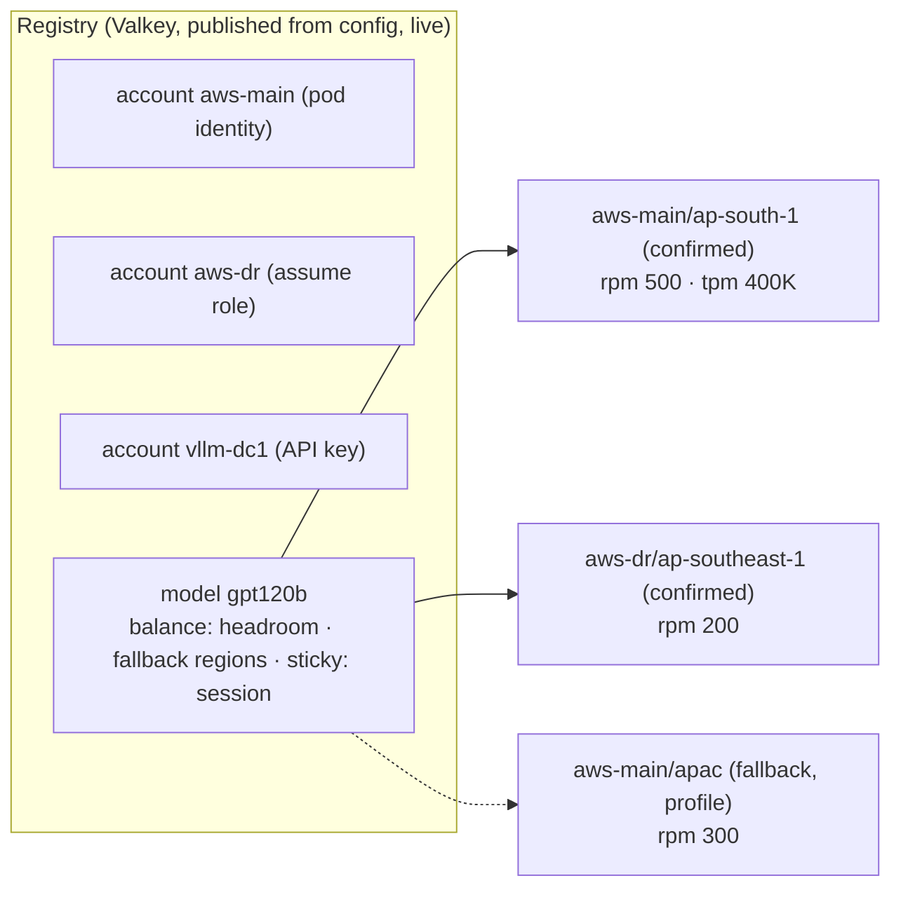
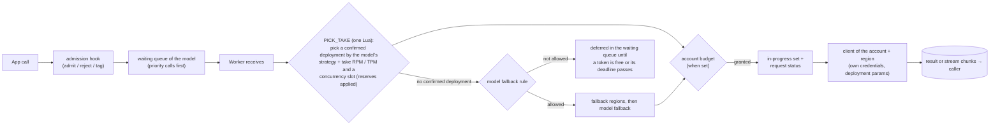
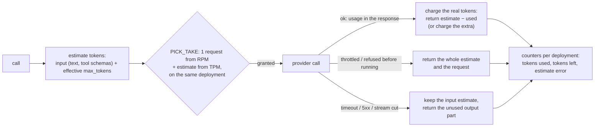
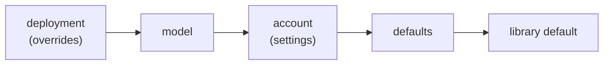
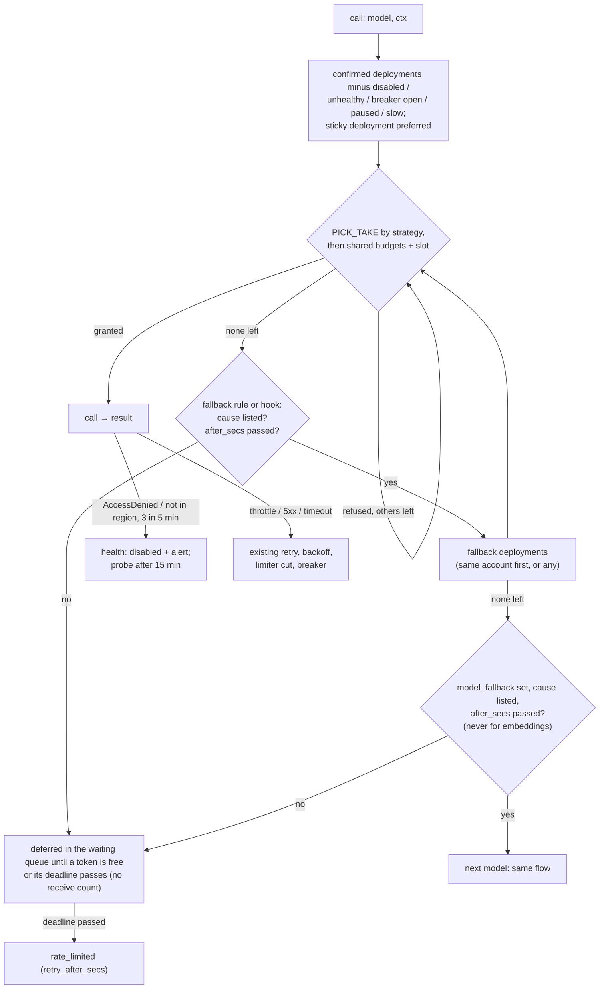
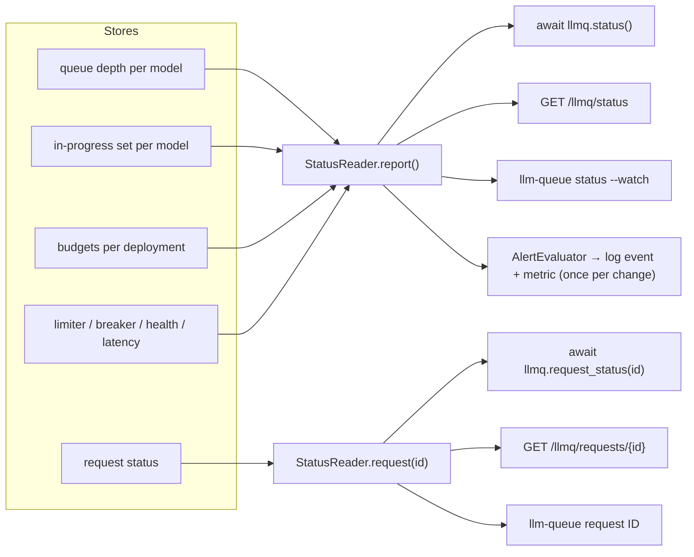
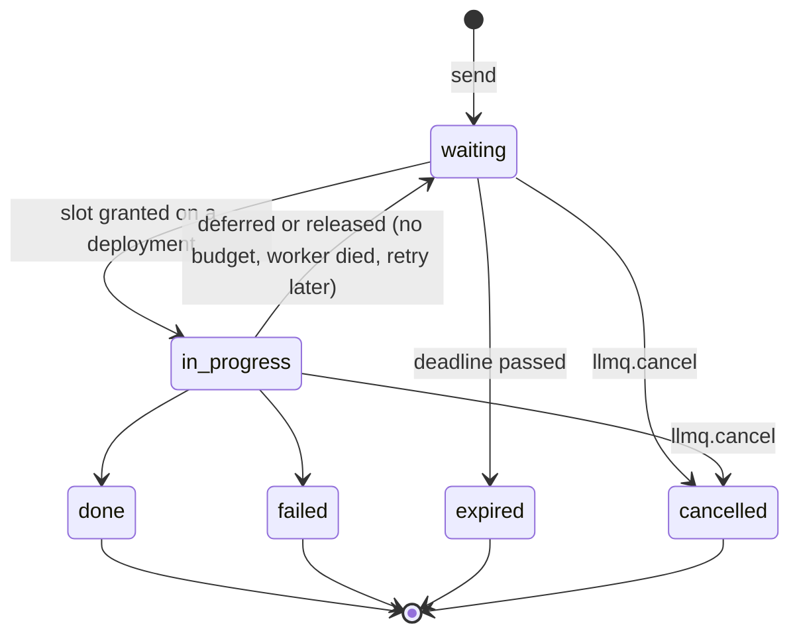
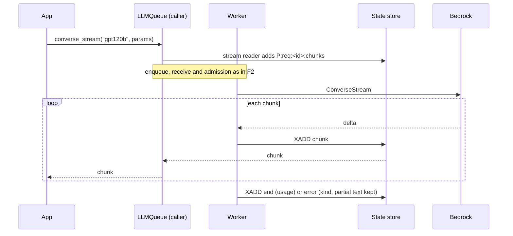

# Accounts, regions and load balancing: plan

Status: **design agreed, nothing built** (2026-11-11). Target releases 0.3.0 to 0.3.3 (§6). All
decisions are in §7, what is needed from the owner in §8, and the review that found and fixed 30
gaps in §9 (all confirmed by the owner). Builds on the rate budgets ([RATE_LIMIT_PLAN.md](RATE_LIMIT_PLAN.md)), the Valkey
queue backend ([VALKEY_QUEUE_PLAN.md](VALKEY_QUEUE_PLAN.md)) and the limiter, breaker and retry
loop ([ARCHITECTURE §4b, §5, §5a](ARCHITECTURE.md)).

A step-by-step walkthrough of one request, with every key and sample data, is in
[ACCOUNT_ROUTING_WALKTHROUGH.md](ACCOUNT_ROUTING_WALKTHROUGH.md).

## 1. The ask

> Serve every model from several **accounts**. Each account has **confirmed regions** and
> **fallback regions**. Keep RPM / TPM per **account × region × model** in Valkey. Per model keep a
> **waiting** queue and an **in-progress** queue, and pick the account and region of each request
> by a method chosen per model (round robin, weighted, quota-aware, custom). Build one client per
> account and region. Give a client to check the status of everything and of one request. Make
> everything configurable and customisable, independent of the number of pods, on Valkey / Redis
> only. Prove it with scenarios, test cases and user stories.

## 2. What the library does today (0.2.1) and the gaps

| Need | Today | Gap |
|---|---|---|
| RPM / TPM budget | ✅ Per (model alias, target) and per provider, in Valkey, `smooth` or `fixed` window, rt reserve, live settings (R01-R12) | No account key. Bedrock quotas are per account × region × model id |
| Registry in Valkey | ⚠️ Limits, usage, limiter, breaker, routing and fallback are live in Valkey | Models and targets are static config; a new region needs a redeploy |
| Waiting queue | ✅ One queue per model and lane, on SQS or Valkey Streams | SQS is the default backend |
| In-progress queue | ⚠️ Concurrency leases per target, in-flight messages | Not per request |
| Choosing a region | ❌ Strict order: primary target, others only after it fails or runs out | No round robin, weights, quota-aware or custom choice |
| Confirmed / fallback regions | ⚠️ Flat ordered `targets`, live `skip_targets` | No groups, no per-model rule |
| Client per account and region | ⚠️ Bedrock client per (region, endpoint) | One credential chain; no assume role |
| Status | ✅ CLI `llm-queue status`, `limiter`, `breaker`, `queues` | No Python API, HTTP, per-account view, per-request lookup |
| Pod count | ⚠️ While Valkey is down each pod takes `limit / live pods` (`PodRegistry`) | Behaviour depends on the number of pods |
| Streaming | ❌ Whole responses only | No token streaming |

## 3. Design

### 3.1 Concepts

| Concept | Meaning | Example |
|---|---|---|
| **Account** | Where calls are billed and quota lives; has its own credentials and provider kind | `aws-main` (pod identity), `aws-dr` (assume role), `vllm-dc1` (API key) |
| **Region group** | Per model and account: `confirmed` (normal serving) and `fallback` (used only under the model's fallback rule) | confirmed `ap-south-1`, `ap-south-2`; fallback `ap-southeast-2` |
| **Deployment** | One model served from one account + region, or from an inference profile. Replaces `Target` | `gpt120b @ aws-main/ap-south-1` |
| **Model policy** | Per model: balancing strategy, region fallback, model fallback, stickiness, reserves, store-down mode, inference defaults | `balance=headroom`, `fallback.after_secs=2` |
| **Quota scope** | A budget key: per deployment (= account × region × model, because a model id has exactly one alias) and per provider | `gpt120b @ aws-main/ap-south-1`: rpm 500 |
| **Registry** | The one config document for models: accounts, and per model its provider, model id, deployments, quota and policy; lives in Valkey, published from config | §3.8 |

A deployment is named `account/region` (or `account/name` for a profile, e.g. `aws-main/apac`).
It takes the place of today's target, so the limiter, breaker, lease and metric keys keep their
shape. There is **no pinning**: a call names a model alias and the balancer decides. A call may
still narrow the model's rule (`allow_fallback="regions"` keeps it on its own model, `"none"` on
its confirmed deployments).

**Alias and model id.** Each model has one alias that the owner defines (`gpt120b`, or
`openai.gpt-oss-120b-1`). A call may pass the alias or the full provider model id
(`openai.gpt-oss-120b-1:0`); the library resolves the id to its alias. Two aliases with the same
model id are refused at boot, so models never overlap. Keys, queues and metrics use the alias.
An alias has one provider and one model id: the same model on a vLLM / OpenAI-compatible
account is its own alias, reached through `model_fallback`.



### 3.2 Stores and queues

| Store | Setting | Holds | Hosting |
|---|---|---|---|
| **Queue store** | `queue_store_url` (unset = the state store) | Per queue: the waiting Stream, its DLQ, delays | ElastiCache Multi-AZ, `maxmemory-policy noeviction` |
| **State store** | `store_url` (or `store_host`, `store_port`, `store_password`, `store_ssl`) | Registry, budgets, limiter, breaker, leases, in-progress sets, request status, sticky map, health, results, stream chunks | ElastiCache Multi-AZ |

- `queue_backend=stream` is the **default** (Streams on any Redis-protocol store); `sqs` stays
  as an optional backend and runs the same suites.
- **Store kinds.** Any store that speaks the Redis protocol with Lua scripts and Streams: Valkey,
  Redis, ElastiCache, MemoryDB and compatible servers. Redis ≥ 7.2 and Valkey ≥ 8 are tested in
  CI; the others are expected to work. Setting names are generic (`store_*`, `queue_store_url`,
  `store_down`); the 0.2 names `redis_*`, `queue_redis_url` and `queue_backend=valkey` are
  removed in 0.3.0 (env: `LLMQ_STORE_URL`, `LLMQ_QUEUE_STORE_URL`).
- **Topology.** The tested topology is cluster mode **disabled** (one primary + replicas) for
  both stores. Per-key scripts are cluster-safe through hash tags, but two reads span keys
  (multiplexed stream reads, status pipelines), so cluster mode stays untested and unsupported in
  0.3.
- **Auth.** TLS with an AUTH token or an RBAC user + password. ElastiCache IAM auth (15 min
  tokens) is not supported in 0.3.
- A failover of an async replica can lose the last moment of sends / acks. Claims make a
  re-delivery safe; a lost send shows as a caller timeout. `queue_wait_replicas` (send waits for
  `WAIT 1 <ms>`) trades send latency for fewer losses; off by default, measured in B23.
- **Waiting** = one queue per model, named from its alias by default (`<prefix>llm-<alias>`;
  `queue` in the model's entry overrides the name). There are **no lanes**. Two models sharing
  one queue is refused at boot.
- **Priority flag.** A call may pass `priority=True` (live chat); the queue serves priority
  calls before the others, first in first out within each class. It is still one queue: on
  Valkey it holds a priority stream and a normal stream under one name; on SQS a second queue
  `<name>-priority` plays that part. Nothing else differs between the two classes.
- **In progress** = per model a zset `P:{m:ALIAS}:inprog` (request id → deadline) and a small hash
  per request (deployment, priority, attempt, started). Written when a slot is granted, removed at the
  end. Entries past their deadline are swept by whichever worker holds the sweep lock (`SET NX`,
  one sweeper at a time, any number of processes). A dead worker's calls resume within 60 s.
- **Request status** = `P:req:<id>`, for every call on the queue path and the direct path:
  `waiting → in_progress(deployment) → done | failed | expired | cancelled`, with timestamps.
  Kept 30 min; results 5 min (settings). While the state store is down no status is written.
- **Deferring without a receive count.** A call sent back to wait for budget
  must not move toward the DLQ. The Valkey queue gets a `defer` operation (visible again after a
  delay, receive count unchanged); on SQS the message is re-sent with a delay and the old one
  deleted. Only failures and crashes count toward `max_receives`.
- Missing Valkey queues are created at worker start, and by `llm-queue queues create` in the
  deploy pipeline; existing queues keep their attributes.
- **Sizing** (state store, 10K calls / min): request status ≈ 300K hashes × ~300 B ≈ 90 MB at the
  30 min TTL; sticky map ≈ 100 B per live session; stream chunks are capped per request
  (`MAXLEN`) and expire with the result TTL. Measured in B34.
- Job queues (`send_job`) are not part of this design and work as today.

### 3.3 The request path



A call starts only when it holds a token from every budget that applies and a concurrency slot.
A call without quota waits in the queue until a token is free or its own deadline passes
(`timeout_secs`: a default per model, or passed per call), then `rate_limited`. The direct
path (canary route `direct`, sync calls, direct streaming) runs the same admission. The canary
route name `sqs` becomes `queue`. No new cancel work; the existing `llmq.cancel` is unchanged.

### 3.4 Balancing (per model, live switchable)

**Choose-and-take in Valkey.** The rate budgets of all deployments of a model and its rotation
state share the hash tag `{m:ALIAS}`, so one Lua script (`PICK_TAKE`)
reads the budgets, picks by the strategy and takes the tokens **and the concurrency slot** of
the chosen deployment atomically (the limiter and lease keys carry the same tag), so admission
is one store call and a call never holds budget while it is refused a slot. It replaces the token
take that already happens (no extra Valkey call), gives the same result for any number of
processes and cannot herd.

| `balance` | Inside `PICK_TAKE` |
|---|---|
| `ordered` | First usable deployment in config order with budget (today's behaviour) |
| `round_robin` | One rotation shared by the whole cluster, skipping deployments without budget |
| `weighted` | Smooth weighted round robin on `weight` |
| `headroom` | By `balance_opts.pick`: `percent` (most left as a share of quota, the default), `max` (most left), `spread` (random, weighted by what is left) |
| `custom:<name>` | A Python hook orders the deployments; the script takes from the first one with budget |

- **Inputs** from the worker: the strategy, the usable candidates, the preferred (sticky)
  deployment, the costs (1 request, the token estimate), the priority flag, and a random number for
  `spread` (scripts do not draw their own).
- **Usable** = enabled by the operator, not disabled by health, breaker not open, not paused, not
  slow, and inside the call's `allowed_regions` / `allowed_accounts` when it has them.
- **Retries go to the next deployment.** After a retryable failure (5xx, timeout) the retry runs
  `PICK_TAKE` again without the deployment that just failed, so it lands on another region or
  account when one is usable, and on the same one only when it is the only one.
- **A deployment added live takes its full share at once**: its adaptive limiter starts at its
  cap (`max_concurrency`, else the limiter maximum) instead of `limiter_initial`, and still cuts
  on throttles.
- **Refusal** returns the shortest wait among the candidates; a deferred call comes back after
  that long.
- **Provider budget** (`shared_rpm` / `shared_tpm`, when set) keeps its own `RATE` call after
  the pick; if it refuses, the tokens go back. Everything else is inside the one script.
- **"Left" for `headroom`** = the limit minus what was used in the current minute (the
  `seen_calls` / `seen_tokens` counters of the budget hash, the numbers the status view shows);
  a deployment's headroom is the smaller of its RPM share left and its TPM share left.
- **Keys.** One budget hash per deployment, `P:{m:ALIAS}:rate:DEPLOYMENT`; rotation state in
  `P:{m:ALIAS}:rot`; the account budget in `P:{a:ACCOUNT}:rate`.
- **No quota.** A deployment without a quota always has budget. `headroom` needs a quota on
  every confirmed deployment (validation error otherwise).
- **State reset.** Rotation and weight state is keyed by the deployment list; a registry change
  to that list starts it again.
- **Latency-aware.** p95 latency per deployment is kept in Valkey. A deployment is excluded while
  its p95 is over `slow_ratio` × the model's median **and** over `slow_min_secs`, with at least
  `slow_min_samples` calls and at least 3 usable deployments; the last usable deployment is never
  excluded (B28).
- **Sticky sessions** (per model, off by default): session id → deployment in Valkey, 30 min idle
  TTL renewed per call. The sticky deployment is preferred; the session moves only when it is
  exhausted or unusable, then sticks again. `register_sticky_key` replaces the key.

### 3.5 Fallback, chain, health

```json
{"fallback": {"on": ["exhausted", "broken"], "after_secs": 2, "regions": "account"},
 "model_fallback": {"on": ["exhausted", "broken"], "after_secs": 5,
                    "models": ["gpt120b-vllm", {"model": "gpt20b", "require_headroom": true}]}}
```

| Field | Meaning |
|---|---|
| (no rule) | A model without `fallback` never leaves its confirmed deployments; its calls wait for the next window |
| `on` | Causes: `exhausted` (no budget or slot), `broken` (breaker open, region outage), `error` (target errors) |
| `after_secs` | How long a call tries confirmed deployments before it spills |
| `regions` | `account`: the same account's fallback regions first; `any`: any account's |

Both settings are **optional** and independent. `fallback` moves a call to the model's fallback
regions; `model_fallback` moves it to another model. They take the same fields:

| `model_fallback` field | Meaning |
|---|---|
| `on` | The same causes as above; a call changes model only for a listed cause |
| `after_secs` | How long the call has tried this model's deployments (confirmed, then fallback regions when allowed) before it changes model |
| `models` | Other models in order: an alias, or `{"model": alias, "require_headroom": true}` to use it only while it has spare quota. Each is tried with its own deployments and balancing, on its own budget |

Without `model_fallback` a call never changes model. Checks at boot: every listed model exists; a
model does not list itself; two models that list each other must both use `require_headroom`
(so an overload cannot bounce between them); an embedding model cannot have `model_fallback`
(vectors of another model are not compatible); a chat model can only list chat models. The
request must be valid for the other model: its deployment `params` adapt it (guardrail, model
fields) and the inference parameters follow §3.9; nothing else is converted. A call may pass
`allow_fallback="regions"` to stay on its model.

`register_fallback_policy(name, fn)` replaces the rule with code.

**Health is separate from the registry.** Operator intent (`enabled`) lives in the registry.
Health (`disabled_until`, error counts, latency) lives in `P:{m:ALIAS}:health`, so a registry
publish never re-enables a broken deployment and health never shows up as a registry edit.

- **Auto-disable.** 3 target errors (AccessDenied, model not in region) in 5 min on one
  deployment → disabled, alert.
- **Probe.** After 15 min one probe call (chat: 1-token converse; embeddings: one short word),
  made by the single process that wins the probe lock (`SET NX`). A failure doubles the wait up
  to 2 h; success re-enables it and logs `deployment_recovered`. Every number is a setting;
  `register_probe` replaces the call.
- **Real quota below the configured one.** The adaptive limiter cuts on 429s as today, traffic
  moves to other deployments, and one alert "configured quota above observed" carries the
  observed rate.

### 3.6 Accounts, credentials, clients, deployment params

| Account `kind` | Provider | Credentials | "Region" |
|---|---|---|---|
| `aws` without `role_arn` | bedrock | The pod's own chain (IRSA / Pod Identity) | AWS region |
| `aws` with `role_arn` | bedrock | STS `AssumeRole` from the pod role, optional `external_id`, 1 h sessions (the role-chaining maximum) refreshed 5 min early | AWS region |
| `openai` | openai-compatible | `base_url` + `api_key_ref` (the name of a secret key; the key is never in Valkey) | a named endpoint |
| `azure_openai` | later | `kind` is open, so no schema change is needed | Azure resource |

- **One provider per alias.** Every account of a model must be of the kind that serves the
  model's provider (validation). vLLM capacity for a Bedrock model is a second alias with its
  own model id, named in the first one's `model_fallback.models`.
- One client per (account, region), built on first use and closed at `stop()`.
- A deployment may carry `params` merged into the request when it is picked: `guardrailConfig`
  (guardrails are per account and region), `additionalModelRequestFields`.

### 3.7 Quotas, reserves, embeddings

- **Quota of a deployment:** its override → the model's `rpm` / `tpm` → `defaults` → none (then only the
  adaptive limiter applies). Numbers are set by operators; the limiter still learns from 429s.
- **Scopes:** the deployment budget is the account × region × model budget (one alias per model
  id); the provider budget (`shared_rpm` / `shared_tpm`) stays as an optional cap across models.
- **Reserves** (per model, both settable, 0 turns one off). `priority_reserve` (default 0.2) is
  the share of RPM / TPM and of concurrency slots that only priority calls may use, so a bulk
  run cannot spend the whole minute before a chat call arrives. `normal_min_share` (default
  0.1) is the share priority calls cannot take, so normal work never starves. Both are applied
  inside `PICK_TAKE` as a cap per class next to the total: normal calls ≤ (1 − `priority_reserve`)
  of the budget, priority calls ≤ (1 − `normal_min_share`). A model with no priority traffic
  sets `priority_reserve: 0` to use its whole budget.
- **`tenant_id`** is an optional label on a call (which team or app it belongs to). It is kept
  in the request status and the logs for filtering; it does not change order or quota.
- **Embedding batches:** the library splits texts into model-sized batches (titan 1 text per
  call, cohere up to 96); each batch costs 1 request (plus its input tokens when token limiting is
  on for the model) and is balanced like any call.
- **Tokens:** estimated before the call (`register_token_estimator` replaces characters / 4),
  corrected by the real usage after it. Token metrics per model × account × region. No prices.

### 3.7a Token accounting (TPM next to RPM)

A call is admitted on **both** budgets of its deployment: one request against RPM and
its tokens against TPM, taken together in `PICK_TAKE` (both or neither). A model with only
`rpm` or only `tpm` is limited on that one.

**Each budget is optional and can be switched on and off per model.** `rpm` and `tpm` are
enforced when they are set. `rate_limits` turns enforcement off without deleting the numbers:

| `rate_limits` | Effect |
|---|---|
| `"both"` | RPM and TPM enforced (whichever is set) |
| `"rpm"` | Only RPM enforced; no token estimate, reservation or correction |
| `"tpm"` | Only TPM enforced |
| `"off"` | No budget; only the adaptive limiter protects the provider |

Defaults: `"both"` for a chat model, `"rpm"` for an embedding model (embedding quotas are
normally per request). An embedding model may set `rate_limits: "both"` with a `tpm`; its
tokens are then its input only (no output), each batch costs one request plus its input
tokens, and usage comes from the response (Titan body; Cohere from the
`x-amzn-bedrock-input-token-count` header). The setting is live-editable at every level, so
an operator can switch token limiting off during an incident and back on after.



| Step | Rule |
|---|---|
| Estimate (before the call) | Input: characters / 4 of every text in the request, **including tool definitions and tool results**; plus the effective `max_tokens` (the call's, else the model's inference default, else 1,000). `register_token_estimator` replaces it (a real tokenizer) |
| Take | RPM and TPM of the chosen deployment in one atomic step; then the account's `shared_rpm` / `shared_tpm` when set. `priority_reserve` and `normal_min_share` apply to both budgets |
| Success | The response's usage replaces the estimate: the difference goes back to the budget (or is charged when the call used more) |
| Provider throttled it (429) or refused it before running | Nothing was consumed: the request and the whole estimate go back |
| Timeout, 5xx, connection lost | Unknown: the input part stays charged, the unused output part goes back |
| Streaming | Usage arrives with the last event and is charged then; a stream cut mid-way is charged its input estimate plus the tokens of the chunks received |
| No usage in the response | The estimate stays charged and `llmq_token_usage_missing_total` counts it |
| Retries and model fallback | Every attempt takes its own tokens; on another model the estimate is made again with that model's `max_tokens` |
| A request larger than the whole budget | Input estimate alone above `tpm` → refused at once with `request_too_large` (it could never start). Input fits but input + `max_tokens` does not → admitted when the bucket is idle (existing rule), so a generous `max_tokens` never blocks a call forever |

**Kept up to date and visible:**

- Status per deployment: RPM used / left and TPM used / left this minute, tokens in flight
  (reserved, not yet corrected).
- Metrics per model × account × region: `llmq_tokens_input_total`, `llmq_tokens_output_total`,
  `llmq_rate_used` / `llmq_rate_remaining` for both budgets, and `llmq_token_estimate_ratio`
  (estimate ÷ real usage) so a poor estimator is seen and tuned.
- `headroom` balancing looks at both budgets: a deployment's headroom is the smaller of its RPM
  share left and its TPM share left.
- Alerts "quota near its limit" and "configured quota above observed" fire for RPM and for TPM.

**Settings** (optional, every level):

| Setting | Default | Meaning |
|---|---|---|
| `tpm` | none | Tokens per minute of a deployment |
| `tpm_output_weight` | 1 | How many quota tokens one output token costs. Some Bedrock models count output tokens several times against the quota (**unverified** per model; set it from the model's quota page) |
| `tpm_count_cached` | true | Whether prompt-cache read tokens count against TPM (model-dependent) |
| `default_output_tokens` | 1000 | Output reservation when neither the call nor the model sets `max_tokens` |
| `token_estimator` | built in | Name of a registered estimator hook |

**What 0.2.1 does today, and what changes** (checked in `reliability/rate.py` and `core.py`):

| # | Today | 0.3 |
|---|---|---|
| T1 | Tokens are corrected only after a successful call; a throttled or failed attempt keeps its whole reservation, so a throttle storm also eats the token budget | Refund rules above |
| T2 | Embedding calls always reserve and count tokens; Cohere embeddings return no token count in the body, so theirs is never corrected | Token limiting is off for embedding models by default (`rate_limits: "rpm"`) and optional; when on, Cohere usage is read from the response header |
| T3 | Tool definitions are counted only as far as they are plain strings in the request | Counted explicitly; scenario B47 |
| T4 | The default output reservation is a fixed 1,000 when a call has no `max_tokens` | The model's inference default is used first |
| T5 | No measure of how good the estimate is | `llmq_token_estimate_ratio` |
| T6 | Output tokens always cost 1 | `tpm_output_weight` |
| T7 | A request bigger than the budget waits until its deadline | `request_too_large` at once |
| T8 | Streaming has no token accounting (no streaming) | Rules above |

### 3.8 Registry in Valkey

| Key | Holds |
|---|---|
| `P:{reg}:doc` | The registry JSON (accounts, models) |
| `P:{reg}:version` | The published `registry_version`, its content hash, a change counter; processes reload on change or every `cfg_reload_secs` |
| `P:audit` | Every publish and live edit: who, when, before, after |

- **Source.** `LLMQ_REGISTRY` (JSON in the secret or env), or `LLMQ_REGISTRY_FILE` /
  `LLMQ_REGISTRY_SECRET` (its own secret) when it outgrows the shared secret (Secrets Manager
  holds 64 KB per secret).
- **Version rule.** Config carries `registry_version`. At boot: higher than stored → replace
  (the old one goes to the audit stream); equal → keep the stored one with its live edits; lower
  → ignore and log. So config wins on every deploy that changes it, and a rolling deploy never
  goes backwards.
- **Forgotten bump.** Equal version but a different content hash than the one published → the
  stored registry is kept and `registry_version_not_bumped` is logged and alerted, so a config
  change is never silently ignored.
- **Live edits.** Every field of an existing model or account can be changed from the CLI or the
  Python API (HTTP is read only). Adding or removing a whole model needs a new
  `registry_version` (a deploy), because workers start and stop queue readers for it.
  Each edit is audited and the CLI warns that it lasts until the next config version;
  `llm-queue registry diff` shows what is live but not in config.
- **Validation** runs before any publish or edit and reports all errors at once (§3.9). A bad
  stored value keeps the last good one.

### 3.9 Config schema

One document, `LLMQ_REGISTRY` (secret, env, file or its own secret), holds everything about
models: accounts, deployments, quotas, rules, inference defaults, live settings, fallback and
canary routing. `LLMQ_MODELS`, `LLMQ_SETTINGS`, `LLMQ_FALLBACK_CHAINS`, `LLMQ_ROUTING_DEFAULT`
and `LLMQ_WORKER_SLOTS` are gone; `llm-queue settings` and `llm-queue routing` read and edit the
registry. `QueueConfig` (`LLMQ_*` env) keeps only infrastructure: the two stores, key prefix,
TTLs, security lists.

**Shape.** Every setting is optional. The same setting names work at four levels, most specific
first: a deployment's `overrides` → the model → the account's `settings` → `defaults`. An
unknown name is refused at boot with the nearest valid name suggested.

```json
{
  "registry_version": 1,

  "defaults": {
    "timeout_secs": 90,
    "priority_reserve": 0.2,
    "normal_min_share": 0.1,
    "balance": "ordered",
    "store_down": "pause",
    "request_status": true,
    "queue_pct": 100,
    "worker_slots": 20,
    "attempt_timeout_secs": 120,
    "retry_attempts": 3,
    "throttle_retry_attempts": 6,
    "inference": {"temperature": 0.2, "max_tokens": 2048},
    "queue": {"visibility_secs": 60, "max_receives": 10, "retention_secs": 345600},
    "health": {"disable_errors": 3, "disable_window_secs": 300, "probe_after_secs": 900,
               "probe_max_secs": 7200, "slow_ratio": 3.0, "slow_min_secs": 5, "slow_min_samples": 20},
    "alerts": {"quota_used_pct": 90, "quota_used_mins": 5, "spill_pct": 20, "waiting_age_secs": 60}
  },

  "routing": {"kill_switch": false, "allow_users": []},

  "accounts": {
    "aws-main": {"kind": "aws", "settings": {"shared_rpm": 5000}},
    "aws-dr": {"kind": "aws", "enabled": true,
               "role_arn": "arn:aws:iam::222222222222:role/llmq-bedrock",
               "external_id_ref": "LLMQ_DR_EXTERNAL_ID",
               "settings": {"attempt_timeout_secs": 150}},
    "vllm-dc1": {"kind": "openai", "base_url": "https://vllm.internal/v1",
                 "api_key_ref": "LLMQ_VLLM_API_KEY"}
  },

  "models": {
    "gpt120b": {
      "type": "chat",
      "provider": "bedrock",
      "model_id": "openai.gpt-oss-120b-1:0",
      "rpm": 500,
      "tpm": 400000,
      "timeout_secs": 90,
      "max_wait_secs": 30,
      "priority_reserve": 0.3,
      "balance": "headroom",
      "balance_opts": {"pick": "percent"},
      "sticky": {"key": "session", "idle_ttl_secs": 1800},
      "store_down": "static_cap",
      "inference": {"temperature": 0.2, "top_p": 0.9, "max_tokens": 4096,
                    "stop": ["</answer>"], "extra": {"reasoning_effort": "low"}},
      "inference_limits": {"max_tokens": 8192, "locked": ["top_p"]},
      "fallback": {"on": ["exhausted", "broken"], "after_secs": 2},
      "model_fallback": {"on": ["exhausted", "broken"], "after_secs": 5,
                         "models": ["gpt120b-vllm", {"model": "gpt20b", "require_headroom": true}]},
      "deployments": {
        "aws-main": {
          "confirmed": ["ap-south-1", "us-east-1"],
          "fallback": ["us-west-2",
                       {"name": "apac", "region": "ap-south-1",
                        "profile_id": "apac.openai.gpt-oss-120b-1:0", "rpm": 300}],
          "overrides": {
            "ap-south-1": {"params": {"guardrailConfig": {
              "guardrailIdentifier": "gr-abc", "guardrailVersion": "1"}}},
            "us-east-1": {"rpm": 300, "max_concurrency": 40, "enabled": true}
          }
        },
        "aws-dr": {"confirmed": ["ap-southeast-1"], "overrides": {"ap-southeast-1": {"rpm": 200}}}
      }
    },

    "gpt20b": {
      "type": "chat",
      "provider": "bedrock",
      "model_id": "openai.gpt-oss-20b-1:0",
      "rpm": 1000,
      "tpm": 800000,
      "balance": "round_robin",
      "inference": {"temperature": 0.0, "max_tokens": 1024},
      "fallback": {"on": ["exhausted", "broken"], "after_secs": 2},
      "model_fallback": {"on": ["exhausted"], "after_secs": 5,
                         "models": [{"model": "gpt120b", "require_headroom": true}]},
      "deployments": {
        "aws-main": {"confirmed": ["ap-south-1", "us-east-1"], "fallback": ["us-west-2"]}
      }
    },

    "gpt120b-vllm": {
      "type": "chat",
      "provider": "openai",
      "model_id": "gpt-oss-120b",
      "rpm": 120,
      "inference": {"temperature": 0.2, "max_tokens": 4096, "seed": 7},
      "deployments": {"vllm-dc1": {"confirmed": ["dc1"]}}
    },

    "embed-titan": {
      "type": "embedding",
      "provider": "bedrock",
      "model_id": "amazon.titan-embed-text-v2:0",
      "rpm": 2000,
      "timeout_secs": 60,
      "embed_batch_size": 1,
      "balance": "weighted",
      "inference": {"dimensions": 1024, "normalize": true},
      "queue": {"name": "llm-embed-titan", "visibility_secs": 30},
      "fallback": {"on": ["exhausted", "broken"], "after_secs": 1},
      "deployments": {
        "aws-main": {
          "confirmed": ["ap-south-1", "ap-south-2"],
          "fallback": ["ap-southeast-2", "ap-northeast-1"],
          "overrides": {"ap-south-1": {"weight": 3}, "ap-south-2": {"rpm": 1000}}
        }
      }
    },

    "embed-cohere": {
      "type": "embedding",
      "provider": "bedrock",
      "model_id": "cohere.embed-english-v3",
      "rpm": 2000,
      "embed_batch_size": 96,
      "inference": {"input_type": "search_document", "truncate": "END"},
      "deployments": {
        "aws-main": {"confirmed": ["ap-south-1", "ap-southeast-1"], "fallback": ["us-east-1"]}
      }
    }
  }
}
```

**The smallest valid registry** (everything else takes its default):

```json
{
  "registry_version": 1,
  "accounts": {"aws-main": {"kind": "aws"}},
  "models": {
    "gpt20b": {"type": "chat", "provider": "bedrock", "model_id": "openai.gpt-oss-20b-1:0",
               "deployments": {"aws-main": {"confirmed": ["ap-south-1"]}}}
  }
}
```

#### Settings reference

"Levels": D = `defaults`, A = account `settings`, M = model, R = a deployment's `overrides`.
Everything is live-editable except the rows marked *deploy*.

| Setting | Default | Levels | Meaning |
|---|---|---|---|
| `type` | required | M (*deploy*) | `chat` or `embedding` |
| `provider`, `model_id` | required | M (*deploy*) | Provider kind and its model id; one alias per model id |
| `enabled` | true | A, M, R | false stops new calls there (in-flight calls finish) |
| `rpm` | none | D, M, R | Requests per minute of a deployment; none = no budget, only the adaptive limiter |
| `tpm` | none | D, M, R | Tokens per minute of a deployment (§3.7a) |
| `rate_limits` | `both` (chat), `rpm` (embedding) | D, A, M, R | Which budgets are enforced: `both`, `rpm`, `tpm`, `off`; switches enforcement without deleting the numbers |
| `tpm_output_weight`, `tpm_count_cached`, `default_output_tokens` | 1, true, 1000 | D, A, M, R | Token accounting details (§3.7a) |
| `shared_rpm`, `shared_tpm` | none | A | One budget across every model of the account |
| `rate_window`, `rate_burst` | `smooth`, 10 % of rpm | D, A, M, R | `smooth` (default: starts spread evenly, small burst allowance) or `fixed` (calendar minute) |
| `max_concurrency`, `limiter_initial` | none, 20 | D, A, M, R | Hard cap and start value of calls in flight per deployment. The adaptive limiter stays on next to RPM / TPM as the safety net when the real quota is lower |
| `priority_reserve` | 0.2 | D, M | Share of quota and slots only priority calls may use |
| `normal_min_share` | 0.1 | D, M | Share priority calls cannot take |
| `timeout_secs` | 90 | D, A, M + per call | Deadline of a call, queue wait included |
| `max_wait_secs` | none | D, M + per call | Longest wait for quota; then `rate_limited` with `retry_after_secs`. None = until the deadline |
| `attempt_timeout_secs` | 180 | D, A, M, R | Limit of one provider attempt |
| `retry_attempts`, `throttle_retry_attempts`, `retry_base_secs`, `retry_multiplier`, `retry_spread`, `retry_max_secs`, `throttle_retry_max_secs` | as in 0.2 | D, A, M, R | Retry budget and backoff per deployment |
| `breaker_threshold`, `breaker_cooldown_secs` | 5, 15 | D, A, M, R | Circuit breaker per deployment |
| `balance`, `balance_opts` | `ordered` | D, M | Strategy (§3.4); `balance_opts.pick` for `headroom` |
| `weight` | 1 | R | Share for `weighted` |
| `sticky` | off | D, M | `{"key": "session" \| "custom:<name>", "idle_ttl_secs": 1800}` |
| `fallback` | none | D, M | Region fallback rule (§3.5) |
| `model_fallback` | none | M | Model fallback rule (§3.5) |
| `store_down` | `pause` | D, M | `pause`, `static_cap`, `fail_fast` (§3.11); `local_limit_cap` (10) is the cap |
| `queue_pct` | 100 | D, M | Share of calls sent through the queue; the rest run direct under the same budgets (canary) |
| `worker_slots` | 20 | D, M | Messages of this model one process works on at once |
| `queue` | derived | D, M (*deploy* for `name`) | `{"name", "visibility_secs", "max_receives", "retention_secs"}` |
| `request_status` | true | D, M | Per-request status on or off |
| `embed_batch_size` | 1 | M | Texts per embedding call |
| `inference`, `inference_limits` | none | D, A, M, R | Default model parameters and their limits (below) |
| `params` | none | R | Raw request fields merged for one deployment (guardrail, model fields) |
| `health.*` | see example | D, A, M, R | Auto-disable, probe and slow-region numbers |
| `alerts.*` | see example | D, M | Alert thresholds |
| `admission`, `fallback_policy`, `token_estimator`, `probe` | none | D, M | Names of registered hooks (§3.10) |
| `debug_capture` | off | M | Truncated text for ≤ 60 min (§3.12) |
| `routing.kill_switch`, `routing.allow_users` | false, [] | top level | Kill switch sends every call direct; listed users always use the queue |

**Per call** (all optional): `priority`, `timeout_secs`, `max_wait_secs`, `session_id`,
`user_id`, `tenant_id`, `request_id`, `allow_fallback` (`all`, the default; `regions`: region
fallback only; `none`: confirmed deployments of this model only), `allowed_regions` /
`allowed_accounts` (the balancer, the region fallback and the model fallback choose only among
these; not a pin, the balancer still decides inside the set; a filter that leaves no deployment
fails at once with `no_deployment`), and the inference parameters.

#### Inference parameters (temperature and the rest)

A model may carry default model parameters; every one is optional. The library fills in what
the call did not set, so callers no longer repeat them and an operator can change them live.

| Name in the registry | Bedrock Converse | OpenAI-compatible | Applies to |
|---|---|---|---|
| `max_tokens` | `inferenceConfig.maxTokens` | `max_tokens` | chat |
| `temperature` | `inferenceConfig.temperature` | `temperature` | chat |
| `top_p` | `inferenceConfig.topP` | `top_p` | chat |
| `stop` | `inferenceConfig.stopSequences` | `stop` | chat |
| `top_k` | `additionalModelRequestFields.top_k` | `extra_body.top_k` | chat (model-dependent) |
| `seed` | not supported: refused at boot for a Bedrock model | `seed` | chat |
| `frequency_penalty`, `presence_penalty` | `additionalModelRequestFields` (model-dependent) | same names | chat |
| `extra` | merged into `additionalModelRequestFields` | merged into the request body | chat: anything model-specific, e.g. `reasoning_effort` (**unverified** per model) |
| `dimensions`, `normalize` | Titan body `dimensions`, `normalize` | `dimensions` | embedding |
| `input_type`, `truncate`, `embedding_types` | Cohere body fields | — | embedding |

Rules:

1. **Order.** library default < `defaults` < account < model < deployment < **the call**. A value
   the caller sets wins, except a **locked** name: `inference_limits.locked` lists parameters the
   caller cannot change (the registry value is used and the difference is logged once).
2. **Limits.** `inference_limits.max_tokens` is a ceiling: a larger request is lowered to it
   (`inference_limits.on_exceed`: `clamp`, the default, or `reject`). Ranges are checked at boot
   and on every edit: `temperature` 0-2, `top_p` 0-1, `max_tokens` ≥ 1, `top_k` ≥ 1.
3. **Token budget.** The TPM reservation uses the effective `max_tokens` (the call's, else the
   model's default), so a sensible default also makes the budget estimate accurate.
4. **Model fallback.** On another model, values the caller set explicitly are kept (within that
   model's limits); values that came from defaults are replaced by the other model's defaults;
   a parameter the other model's provider does not support is dropped and logged once.
5. **Wrong type.** A chat-only parameter on an embedding model, or the reverse, is refused at
   boot. `extra` is passed through unchecked, so a bad field there shows as a provider error.
6. **Visibility.** `llm-queue settings get --model gpt120b` shows each effective parameter and
   its level; the request status records the effective `temperature` and `max_tokens` (no text).
7. **LangChain adapters.** A value set on the model object (`temperature=0`) is a call value;
   an unset one takes the registry default.

| Rule | Detail |
|---|---|
| Region entry | A string (in-region model id) or an object for an inference profile (`name`, `region` to call, `profile_id`, optional settings); a profile is its own deployment with its own quota |
| Regions | `confirmed` and `fallback` are the only place a region is named (no catalog). A region where the model is not available is found on the first calls: auto-disable and alert (§3.5) |
| Validation (all errors at once) | Unknown setting names; `rate_limits` naming a budget that has no number (`"tpm"` without `tpm`); alias format; one alias per model id; no queue shared by two models; account exists and its kind serves the model's provider; confirmed ∩ fallback empty; at least one confirmed deployment per model; override keys are listed regions; `headroom` needs `rpm` or `tpm` on every confirmed deployment; `priority_reserve + normal_min_share` < 1; `after_secs` and `max_wait_secs` below `timeout_secs` (a warning when `model_fallback.after_secs` is below `fallback.after_secs`); `kind=openai` needs `base_url`; hook names are registered; `model_fallback` checks (§3.5); inference names, ranges and model type; queue names (existing rule) |
| Secrets | `api_key_ref` and `external_id_ref` name an environment variable or secret key; the value is read by the process and never stored in Valkey |
| Compatibility | Clean break in 0.3.0: `LLMQ_MODELS`, `LLMQ_SETTINGS`, `LLMQ_FALLBACK_CHAINS`, `LLMQ_ROUTING_DEFAULT`, `LLMQ_WORKER_SLOTS`, `Target`, `targets`, `skip_targets`, `alias@target`, `Lane` and every per-lane setting are removed; `gpt120b@primary` becomes `gpt120b@aws-main/ap-south-1` in keys and metrics, so learned limiter state starts fresh. Upgrade steps: §6.1 |

### 3.10 Configurable and customisable everywhere

**Four override levels.** A value comes from the most specific level that sets it; `llm-queue
settings get` shows the level of every value.



Which setting works at which level is in the settings reference (§3.9).

**Hooks.** Registered by name in code, chosen by name in config, so one config works on every
process. A hook is a pure function over a snapshot (no I/O). If it raises or returns nonsense the
built-in default is used and the error is logged once.

| Hook | Signature (sketch) | Default |
|---|---|---|
| `register_balancer(name, fn)` | `fn(candidates: list[DeploymentView], ctx: CallContext) -> list[str]` | the model's `balance` |
| `register_fallback_policy(name, fn)` | `fn(cause, tried, candidates, ctx) -> list[str] \| None` (None = wait) | §3.5 rule |
| `register_token_estimator(model, fn)` | `fn(params) -> int` | characters / 4 + max tokens |
| `register_sticky_key(name, fn)` | `fn(ctx) -> str \| None` | session id |
| `register_admission(name, fn)` | `fn(ctx, model) -> Admit \| Reject(reason) \| Tag(labels)` | admit all |
| `register_probe(model, fn)` | `fn(deployment, client) -> None` (raises on failure) | minimal real call |

`DeploymentView`: name, account, region, group, weight, enabled, healthy, RPM / TPM left,
concurrency in use / limit, breaker, paused, p95 latency, `tags` (free labels from config, e.g.
cost class). A custom balancer reads the view from a snapshot at most 1 s old; the take itself
stays atomic.

### 3.11 No logic based on the number of pods; outages

Removed: `PodRegistry`, `local_cap()`, `FailoverState.live_pods` / `set_live_pods`, the
`1 / live pods` share of `LocalRateBudget`. Kept, because they count nothing: each process renews
its own leases on its heartbeat (a crashed process's slots return within 60 s), and
`worker_slots` bounds the messages one process works on. Work that must happen once (probe,
sweep, alert) is taken with a short Valkey lock, so it is correct for any number of processes.

| Outage | Behaviour |
|---|---|
| **Queue store down, state store up** | Existing queue failover: after `sqs_failover_secs` of send / receive errors, calls run on the direct path under the shared budgets and limiter; queued messages wait in the store; back to the queue when a probe succeeds |
| **State store down** | Per model, `store_down`: `pause` (default: no call starts without the shared budget; queued work waits; a direct call waits up to its deadline, then `queue_unavailable`; quotas never exceeded), `static_cap` (a fixed `local_limit_cap` per process, calls keep flowing, quotas may be exceeded and 429s are retried), `fail_fast` (`queue_unavailable` at once) |
| **Both down** | As "state store down" |
| **One region / account down** | Breaker and health exclude its deployments; the fallback rule decides the rest (§3.5) |

### 3.12 Status, metrics, alerts, privacy

| Surface | Gives |
|---|---|
| `await llmq.status(model=, account=, region=, by=)` | Per model × deployment: waiting (priority and normal), in progress, started this minute, RPM / TPM used and left, concurrency limit, breaker, paused, enabled, healthy, p95 latency |
| `await llmq.request_status(request_id)` | State, deployment, priority, attempts, timings, error kind |
| HTTP (extra `[http]`) | Read-only FastAPI router the app mounts with its own auth dependency: `/status`, `/requests/{id}`, `/registry` (secret references and role ARNs redacted), and `/health` without auth |
| Health | `await llmq.health()` and `GET /llmq/health`: 200 when the stores are reachable and the registry is loaded; 503 while draining or when no deployment of any model is usable; no details in the body |
| CLI | `llm-queue status --by account\|region\|model --watch`, `llm-queue request ID`, `llm-queue registry get\|set\|enable\|disable\|import\|diff` |

- **Metrics** carry model + account + region (+ `priority` on wait-time metrics), to CloudWatch EMF or
  Prometheus (config).
- **Alerts** (a log event and a metric, raised once per state change through a Valkey marker, so
  many processes do not repeat them): deployment auto-disabled / recovered; fallback spill rate
  high; quota near or at its limit for Y minutes; oldest waiting message too old; configured
  quota above observed; `registry_version_not_bumped`.
- **Privacy.** Status and logs hold ids, model, deployment, tokens, timings and error kind;
  user and session ids are hashed. No prompt or response text, except with a per-model
  `debug_capture`: truncated text for at most 60 min. In prod it is turned on by an audited live
  edit only and is off again at the next registry publish; non-prod environments
  (`debug_capture_from_config=true`) may also turn it on from config.

### 3.13 Streaming (both modes)

| Mode | How |
|---|---|
| Queued | The worker calls `ConverseStream` and appends chunks to a per-request Valkey stream in the state store (capped, expiring with the result TTL). One reader per caller process multiplexes all its open streams, so open streams do not each hold a connection |
| Direct | The caller streams itself but takes its budget tokens and slot from Valkey first, like any call |

A failure after chunks were sent ends the stream with an error event that carries the partial
text. There is no silent switch to another deployment; the app decides whether to retry.

### 3.14 End-to-end flows

**F1. Boot: config → registry → every process.**

```mermaid
sequenceDiagram
  participant SM as Secrets Manager / env
  participant P as Process (LLMQueue.start)
  participant V as State store
  participant Q as Queue store
  SM->>P: LLMQ_REGISTRY, LLMQ_STORE_URL, LLMQ_QUEUE_STORE_URL
  P->>P: validate the registry (all errors at once; boot fails on any)
  P->>V: publish if registry_version is higher (old one to audit); else load the stored one
  P->>Q: ensure queues (create the missing ones)
  P->>P: resolve deployments and effective settings; hooks by name; lazy client pool
  loop every cfg_reload_secs or on a version change
    P->>V: reload (a bad value keeps the last good)
  end
```

**F2. One call, happy path (priority chat call, queued).**

```mermaid
sequenceDiagram
  participant App
  participant C as LLMQueue (caller)
  participant WQ as waiting queue (gpt120b)
  participant W as Worker
  participant V as State store
  participant B as Bedrock (aws-main / ap-south-1)
  App->>C: converse("gpt120b", params, priority=True, session_id=s)
  C->>C: admission hook
  C->>V: request status = waiting
  C->>WQ: send envelope (request id, priority, deadline)
  W->>WQ: receive (priority calls first)
  W->>V: claim; sticky lookup (session s)
  W->>V: PICK_TAKE → aws-main/ap-south-1 + RPM / TPM token + concurrency slot
  W->>V: account budget (when set)
  W->>V: in-progress add, request status = in_progress
  W->>B: converse via the client of (aws-main, ap-south-1), deployment params merged
  B-->>W: response + usage
  W->>V: TPM correction, slot release, breaker ok, latency sample, sticky renew
  W->>V: store result, in-progress remove, request status = done
  V-->>C: result
  C-->>App: LLMReply(meta.deployment="aws-main/ap-south-1", meta.fallback=None)
```

**F3. Choosing a deployment (per attempt).**



**F4. Status.**



**F5. Request lifecycle.**



**F6. Queued streaming.**



### 3.15 Client API

```python
from taskiq_llm_queue import LLMQueue, register_balancer, DeploymentView, CallContext

llmq = LLMQueue.from_env()          # infrastructure settings + LLMQ_REGISTRY
# a model is named by its alias or its full model id: "gpt120b" == "openai.gpt-oss-120b-1:0"
await llmq.start()                  # publish / load the registry, ensure queues, start workers

reply = await llmq.converse("gpt120b", params, priority=True, session_id=sid,
                            max_wait_secs=30, tenant_id="research-desk")
reply.meta.deployment               # "aws-main/ap-south-1"
reply.meta.fallback                 # None | "region" | "model"
vectors = await llmq.embed("embed-titan", texts, timeout_secs=900)   # batched by the library
async for chunk in llmq.converse_stream("gpt120b", params, priority=True):
    ...

report = await llmq.status(model="gpt120b", by="region")       # StatusReport
state = await llmq.request_status(reply.meta.request_id)       # RequestStatus

await llmq.registry.set("gpt120b", {"deployments.aws-main.overrides.ap-south-1.rpm": 400})
await llmq.registry.disable("gpt120b", "aws-main/ap-south-2", reason="maintenance")
diff = await llmq.registry.diff()

@register_balancer("cheapest_first")
def cheapest_first(cands: list[DeploymentView], ctx: CallContext) -> list[str]:
    return [d.name for d in sorted(cands, key=lambda d: (d.tags.get("cost", 1), -d.rpm_left))]

from taskiq_llm_queue.http import status_router                # extra [http]
app.include_router(status_router(llmq, dependencies=[Depends(require_admin)]), prefix="/llmq")
```

### 3.16 Code structure

`core.run_call` keeps its retry / limiter / breaker loop and gets its steps from `plan_call`
instead of `resolve_fallback`.

| Module | Public symbols | Key functions (sketch) |
|---|---|---|
| `registry/schema.py` | `Registry`, `Account`, `ModelEntry`, `AccountDeployments`, `ProfileRef`, `Quota`, `RegionOverride`, `FallbackRule`, `StickyRule` | `Registry.problems() -> list[str]`; `Registry.alias_of(model) -> str` (alias or model id) |
| `registry/resolve.py` | `Deployment` (frozen dataclass), `ResolvedRegistry` | `resolve(registry, defaults)`; `deployments(alias, group=None)`; `effective(alias, deployment, name) -> (value, level)` |
| `registry/store.py` | `RegistryStore` | `publish(registry, actor)` (version + hash rule), `load()`, `set()`, `enable()`, `disable()`, `diff()`, `run()` reload loop |
| `reliability/_lua.py` | — | new scripts `PICK_TAKE`, `DEPLOY_HEALTH`, `LATENCY`, `ONCE` (lock / marker) |
| `broker/stream_queue.py` (was `valkey_queue.py`) | — | new `defer` operation (visible after a delay, receive count unchanged); priority and normal streams under one queue name |
| `routing/balance.py` | `Balancer` (Protocol), `register_balancer` | `pick_take(alias, strategy, candidates, preferred, costs, priority) -> Grant \| Wait` |
| `routing/plan.py` | `CallPlan`, `plan_call` | `plan_call(alias, ctx, resolved, sticky) -> CallPlan`; `CallPlan.next(cause)` |
| `routing/fallback_rule.py` | `register_fallback_policy` | `allowed(rule, cause, waited_secs) -> bool` |
| `routing/sticky.py` | `StickyStore`, `register_sticky_key` | `get(alias, key)`, `put(alias, key, deployment, ttl)` |
| `routing/health.py` | `DeploymentHealth`, `DeploymentProber`, `register_probe` | `record_error()`, `record_latency()`, `unusable(alias)`, prober `run()` loop |
| `routing/view.py` | `DeploymentView`, `CallContext` | `view(alias) -> list[DeploymentView]` (custom hooks and status) |
| `hooks.py` | `HookRegistry`, `register_token_estimator`, `register_admission` | `call_safely(kind, name, *args, default)` |
| `clients/credentials.py` | `AccountCredentials` | `session_for(account)` (assume role, refreshable) |
| `clients/pool.py` | `ClientPool` | `get(account, region)`, `aclose()` |
| `tracking/inprogress.py` | `InProgressTracker` | `add()`, `remove()`, `sweep()`, `count(alias, deployment)` |
| `tracking/requests.py` | `RequestStatusStore`, `RequestStatus` | `mark(request_id, state, **fields)` (pipelined with existing writes), `get(id)` |
| `streaming.py` | `ChunkWriter`, `ChunkReader` | `write(request_id, chunk)`, `end()`, `error()`, `read(request_id)` |
| `status/reader.py` | `StatusReader`, `StatusReport` | `report(model, account, region, by)`, `request(id)` |
| `status/alerts.py` | `AlertEvaluator` | `evaluate(report) -> list[Alert]` |
| `http.py` (extra) | `status_router` | FastAPI `APIRouter`, read only |
| `cli.py` | — | `registry ...`, `status --by --watch`, `request ID` |

Removed: `Target`, `ModelConfig.targets`, `FallbackConfig.skip_targets`, `resolve_fallback`,
`PodRegistry`, `local_cap`, `FailoverState.live_pods`, `Lane` and the per-lane settings
(`rt_rate_share`, `bg_share`, `lane_max_concurrency`, per-lane timeouts), `QueueConfig.models` /
`LLMQ_MODELS`. Key schema goes from 2 to 3.

## 4. User stories

| # | As | I want | So that |
|---|---|---|---|
| U1 | platform owner | to add a second AWS account with its own regions and quotas | we raise our Bedrock quota in minutes |
| U2 | platform owner | to set RPM / TPM per account × region × model | we never exceed what AWS gave each account |
| U3 | model owner | to choose per model how load is spread | each model uses its quota the way that suits it |
| U4 | model owner | to decide per model which lanes may use fallback regions and why | live chat survives a region outage while bulk work waits |
| U5 | chat user | my conversation to stay in one region | the prompt cache stays warm |
| U6 | operator | one view of waiting / in progress / budget per model, account and region | I see where the bottleneck is |
| U7 | developer | the status of one request id | I can answer "where is my request?" |
| U8 | operator | to disable one deployment live | I can drain a region before maintenance |
| U9 | security | credentials only in Secrets Manager / IAM roles, no prompt text in logs | a Valkey or log leak exposes no keys or user text |
| U10 | developer | to plug in vLLM / OpenAI-compatible endpoints as accounts | on-prem capacity joins the same balancing |
| U11 | chat user | to see the answer as it is written | the chat feels fast |
| U12 | chat user | my call not to wait behind a bulk run | chat stays fast while ingestion is running |
| U13 | platform owner | the same behaviour with 2 or 20 worker processes | scaling needs no retuning |
| U14 | developer | my own balancer, fallback rule or token estimator | the library fits our rules without a fork |
| U15 | operator | a safe upgrade from 0.2 to 0.3 | no call is lost or run by a worker that does not understand it |

## 5. Scenarios

Run on fakellm with the queue store separate from the state store, on Valkey and on Redis. Each
has a pass / fail gate. Test prerequisites (step A0): fakellm quota per access key × region ×
model, latency and error injection per region, `ConverseStream`; a fake STS (moto) for assume
role; a Redis image and a second Valkey in `docker/compose.yaml`.

| # | Scenario | Gate |
|---|---|---|
| B01 | Round robin over 3 confirmed regions, 900 calls | each region 300 ± 5 %; 0 lost, 0 duplicates |
| B02 | Weighted 60 / 30 / 10 | shares within ± 5 % |
| B03 | Headroom, RPM 500 / 300 / 200, each `pick` | shares as the pick defines; no region over its RPM in any window |
| B04 | Custom balancer; a hook that raises | order followed; the raising hook falls back to `ordered` and logs once |
| B05 | Two accounts on one model; a call by alias and a call by model id; two aliases with one model id | each account ≤ its RPM; both calls land on the same model and budget; the overlapping config is refused at boot |
| B06 | Confirmed exhausted: a model with `on=[exhausted]` and a model with no fallback rule | the first is served from fallback within `after_secs`; the second waits for the next window and never touches another region |
| B07 | Region outage (5xx on one region) | breaker opens; traffic moves to other confirmed regions; fallback only if the rule has `broken` |
| B08 | Assume-role account, credentials expire mid-run | refreshed before expiry; 0 auth failures |
| B09 | A Bedrock model chained to its vLLM alias (API-key account) | spills to the vLLM alias under the fallback rule; the key never in Valkey or logs |
| B10 | Sticky session over 20 turns | one deployment unless it is exhausted or unusable; then moves and sticks again |
| B11 | Live registry edits: add a region, change a quota, switch strategy, disable a deployment | applied everywhere within `cfg_reload_secs`; in-flight calls finish; audit entry |
| B12 | Invalid registry (unknown account, two aliases for one model id, shared queue, unknown hook, headroom without quota, chain to a missing model) | refused with all errors listed; a bad stored value keeps the last good |
| B13 | Per-request status under a worker kill | `in_progress → waiting → done`; counts match the call log |
| B14 | Python API, HTTP and CLI status | the same numbers within one sample interval; no secret reference in HTTP output |
| B15 | Embeddings across accounts | balanced across deployments; never another model |
| B16 | State store down, one model per `store_down` mode | `pause`: 0 calls start, all served after it returns; `static_cap`: ≤ cap in flight per process; `fail_fast`: `queue_unavailable` within 100 ms |
| B17 | 10K mixed calls, 3 accounts × 3 regions | no budget exceeded; throughput ≥ 0.9 × the sum of quotas; priority-call wait p95 ≤ 2 s |
| B18 | Steady 17 / s, RPM 600 / 300 / 100, every strategy | shares within ± 5 % of the strategy's target; 0 overruns |
| B19 | Burst of 2,000 in 10 s | refusals per call ≤ 0.05; Valkey calls per request no higher than in 0.2.1 |
| B20 | One deployment with 5 tokens left | ≤ 5 calls land there; no extra refusals |
| B21 | 10 calls / min | all on the strategy's first choice; no background Valkey traffic beyond 0.2.1 |
| B22 | The same load on 2 and on 20 worker processes | shares and Valkey calls per request equal within ± 5 %; one probe, one sweep, one alert per event |
| B23 | Queue store primary killed mid-run, `queue_wait_replicas` off and on | lost sends and duplicates counted and recorded; 0 lost with it on; send p95 recorded for both |
| B24 | Full suite on Redis 7.2 and on Valkey 8 | the same pass set on both |
| B25 | Queued streaming, 200 concurrent | first chunk p95 ≤ queue wait + provider first token + 50 ms; chunks in order, none lost; connections ≤ the pool size |
| B26 | Direct streaming under a full budget | waits for a token until its deadline, then `rate_limited`; never over RPM |
| B27 | Deployment fails after 200 streamed tokens | error event with the partial text; no second deployment starts |
| B28 | One of four regions 5× slower; then only two regions | share of new calls drops to ~0 within 30 s and returns after recovery; with two regions nothing is excluded |
| B29 | Real quota 200, configured 500 | 429 rate < 5 % within 60 s; traffic moves; one alert with the observed rate |
| B30 | Worker killed with 50 calls in progress | all 50 finish elsewhere within 60 s; 0 lost |
| B31 | A bulk run of 5,000 normal calls fills the quota; 50 priority calls arrive mid-minute; then constant priority load | priority calls start within 2 s (they use `priority_reserve`); under constant priority load normal calls still get `normal_min_share` |
| B32 | Bulk embed 50K texts on titan and cohere, with the default (`rpm`) and with `rate_limits: "both"` | batch sizes as §3.7; RPM held per deployment (one request per batch); with `both`, TPM held too and corrected from usage; vectors in input order |
| B33 | Rolling deploy of 4 workers (0.3.x → 0.3.y) under 10K / min | 0 lost, 0 failed priority calls, mixed versions safe, registry version never goes back |
| B34 | Ramp from 10K / min until something saturates | the ceiling, the bottleneck and the state-store memory recorded here; with no backlog the queue path adds ≤ 20 ms at p95 over a direct call (store calls per request counted and recorded) |
| B35 | Live suite (`-m live`, dev account), off by default | each model × deployment answers once; a failure names the deployment and the AWS error |
| B36 | `debug_capture` on for one model (live edit; config in non-prod only) | truncated text kept ≤ 60 min, then gone; off after a registry publish; refused from config in prod; other models and all logs hold none |
| B37 | AccessDenied on one deployment, 20 processes | disabled after 3 errors in 5 min, one alert; one probe after 15 min; re-enabled on success; a registry publish does not re-enable it |
| B38 | Guardrail params per deployment | each call carries the guardrail of the deployment that served it |
| B39 | Queue store down, state store up | calls run direct under the shared budgets; queued messages intact and served after it returns |
| B40 | Config changed without a version bump | stored registry kept; `registry_version_not_bumped` logged and alerted once |
| B41 | Upgrade 0.2.1 → 0.3.0 by §6.1 under load | 0 lost; no 0.3 worker receives a 0.2 message and the reverse |
| B42 | A rate-deferred message 50 times | receive count unchanged; never in the DLQ; a failing handler still reaches the DLQ at `max_receives` |
| B43 | 5,000 normal calls queued, then 100 priority calls | priority wait p95 ≤ 2 s; every normal call still finishes; first in, first out inside each class |
| B44 | A region where the model does not exist is listed as confirmed | disabled after 3 errors with an alert naming the deployment and the AWS error; calls served by the other regions; 0 failed calls |
| B45 | Inference defaults: a call without parameters; a call with its own `temperature`; a locked `top_p`; `max_tokens` over the limit; a model change | defaults applied; the call's value wins; the locked value is kept; the limit is enforced (`clamp` and `reject`); explicit values carried to the other model, defaults replaced by its own, unsupported ones dropped |
| B46 | A call with `max_wait_secs=5` while the quota is used up | `rate_limited` with `retry_after_secs` after 5 s, not at the deadline |
| B47 | A tool-calling turn (tool definitions, tool call, tool result), also across a model fallback | request and response pass through unchanged; the token estimate counts the tool schemas; the other model receives the same tools |
| B48 | The same request id sent twice, 100 ms apart and after the first finished | one provider call; both callers get the same result within the result TTL |
| B49 | TPM is the tighter limit: RPM 1,000, TPM 100K, calls of ~2K tokens | starts per minute ≈ 50, tokens per minute ≤ 100K in every window on every deployment; RPM never the reason for a refusal |
| B50 | Token refunds: 30 % of attempts throttled by the provider; calls that use far fewer tokens than `max_tokens` | throttled attempts return their tokens (throughput within 5 % of the no-throttle run); the budget follows real usage, not the reservations |
| B51 | Usage missing in a chat response, a stream cut mid-way, `tpm_output_weight=5`, a request larger than `tpm`; `rate_limits` switched live from `both` to `rpm` and to `off` and back | estimate kept and counted as missing; partial stream charged for what was received; weighted tokens held under the quota; `request_too_large` at once; each switch applies within `cfg_reload_secs` and only the enabled budgets refuse calls |
| B52 | A call with `allowed_regions` of two of four regions; one of the two exhausted; a filter matching nothing | only the allowed regions are used, also for fallback and model fallback; `no_deployment` at once for the empty set |
| B53 | One region returns 5xx on every call | each retry lands on another deployment; 0 failed calls while another region is usable; the breaker opens for the bad one |
| B54 | A deployment added live to a busy model | it takes its quota share within one reload, no ramp; throttles still cut it |
| B55 | Health: stores reachable; state store down; draining; every deployment disabled | 200; 503; 503; 503 from the Python call and the route |

## 6. Work plan by release

| Release | Step | Content | Gate |
|---|---|---|---|
| **0.3.0** | A0 | Test prerequisites: fakellm quotas per key × region × model, latency / error injection, fake STS, Redis + second Valkey in compose | harness self-test |
| | A1 | Registry schema (one document: defaults, routing, accounts, models), all setting names and levels, inference parameters and limits, validation, resolve; alias or model id in calls, queue name from the alias; the five old `LLMQ_*` model configs, `targets` and lanes removed from config; key schema 3 | unit; B12, B05 |
| | A2 | Registry store: version + hash rule, live edits, audit, CLI `registry`, registry file / own secret | B11, B40 |
| | A3 | `PICK_TAKE`, strategies, `balance_opts`, custom balancer hook | B01-B04, B18-B22 |
| | A4 | Deployment and provider budgets on RPM and TPM, token refund rules, usage from headers, `tpm_output_weight`, estimate metric, `request_too_large`; `priority_reserve` and `normal_min_share`, `max_wait_secs`, `defer` on both backends | R01-R12 still pass; B05, B31, B42, B49-B51 |
| | A5 | Region fallback and model fallback rules and hook, per-deployment params, inference defaults merged per provider (locked names, limits, model change), tool calls in the token estimate | B06, B07, B38, B45, B47, B48 |
| | A6 | Valkey default backend, one queue per model with the priority flag, queues created at start, two stores, Redis + Valkey CI, `queue_wait_replicas`, route `sqs` → `queue` | B23, B24, B39, B43 |
| | A7 | Pod-count logic removed; `store_down` modes; once-locks | B16, B22 |
| | A8 | Upgrade guide and the app's config moved to the registry | B41 |
| **0.3.1** | A9 | Accounts: assume role, API-key accounts, client pool | B08, B09 |
| | A10 | Sticky sessions; latency-aware exclusion; health, auto-disable and probe; quota-drop alert | B10, B28, B29, B37 |
| **0.3.2** | A11 | In-progress set, per-request status, sweeper | B13, B30; extra Valkey cost per call measured |
| | A12 | Status reader, Python API, CLI views, HTTP router, alerts, both metric sinks, `debug_capture` | B14, B36 |
| | A13 | Embedding batching, optional token limiting for embeddings, token estimator hook and token metrics | B15, B32 |
| **0.3.3** | A14 | Streaming, queued and direct | B25-B27 |
| every release | A15 | Load and deploy scenarios, live suite, docs, samples, CHANGELOG | B17, B33-B35; all green on both engines |

The first setup used for seeds and scenario numbers: `gpt120b` (`openai.gpt-oss-120b-1:0`, chain
to `gpt20b`), `gpt20b` (`openai.gpt-oss-20b-1:0`), `embed-titan` (`amazon.titan-embed-text-v2:0`),
`embed-cohere` (`cohere.embed-english-v3`) on `aws-main`, with placeholder quotas until real
numbers arrive. Load is designed for 10K calls / min with a mix of chat and bulk work; B34 finds the ceiling.

### 6.1 Upgrade from 0.2.x to 0.3.0

0.3.0 is a clean break: a 0.2 worker cannot run a 0.3 message and the reverse, and state keys
change (schema 3, new deployment names). "Mixed versions are safe" holds between 0.3.x releases
only. The upgrade therefore never lets the two versions share queues or state. Two paths:

**New prefix and drain** (uat / prod):

1. Deploy 0.3.0 with a **new key prefix and queue prefix** (e.g. `llmq:<env>:v3`,
   `...-v3-`), so its queues and state are separate. New queues are created at start.
2. Old pods finish what is on the old queues during the rollout (drain); new pods send and work
   only on the new ones.
3. When the old queues and their DLQs are empty (`llm-queue queues list` with the old prefix),
   delete the old keys and queues.

**Stop the world** (dev, or any env where the queue is off): set `LLM_QUEUE_ENABLED=false` (calls
run direct), wait until the queues are empty, upgrade, turn it on again. With the queue already
off (uat / prod today) there is nothing to drain.

## 7. Decisions (2026-11-11)

| # | Topic | Decision |
|---|---|---|
| E1 | Accounts | Several AWS accounts (assume role), one account with many regions (pod identity), API-key providers; Azure OpenAI later (`kind` stays open) |
| E2 | Balancing | Per model, live switchable: `ordered`, `round_robin`, `weighted`, `headroom`, `custom` |
| E3 | Balancing state | Choose-and-take in one Valkey Lua for every strategy; no extra calls; `round_robin` is one shared rotation |
| E4 | Headroom pick | `balance_opts.pick` = `percent` (default) / `max` / `spread`, a setting at every level |
| E5 | Fallback regions | Optional `fallback` per model: causes, `after_secs`, region scope. Without it a model stays on its confirmed deployments |
| E6 | Model fallback | Optional `model_fallback` per model with the same fields as the region fallback (`on`, `after_secs`) plus `models`; checked at boot; embeddings never change model |
| E7 | Queues | Per model one waiting queue and one in-progress set; quota per account × region × model |
| E8 | Queue backend | Valkey / Redis Streams by default; SQS optional; both run the same suites |
| E9 | Stores | Queue store and state store separate; ElastiCache Multi-AZ; `noeviction` on the queue store |
| E10 | Engines | Redis ≥ 7.2 and Valkey ≥ 8, both in CI |
| E11 | Failover loss | Accepted (idempotent claims, caller deadlines); optional `queue_wait_replicas`, measured |
| E12 | Registry | In Valkey; `registry_version` rule: higher replaces, equal keeps live edits, lower ignored |
| E13 | Live edits | Every field, audited, CLI warns they last until the next config version; `registry diff` |
| E14 | Config documents | One document, `LLMQ_REGISTRY`: defaults, routing, accounts, models. It replaces `LLMQ_MODELS`, `LLMQ_SETTINGS`, `LLMQ_FALLBACK_CHAINS`, `LLMQ_ROUTING_DEFAULT` and `LLMQ_WORKER_SLOTS` |
| E15 | Regions | No catalog: `confirmed` and `fallback` per model and account are the only region lists; a wrong region is caught by auto-disable and alert |
| E16 | Quotas | One default per model, overrides per region; set by operators, limiter learns from 429s |
| E17 | Inference profiles | Their own deployment with their own quota |
| E18 | Compatibility | Clean break in 0.3.0; no `targets`, no pinning |
| E19 | Override levels | Global → account / provider → model → deployment |
| E20 | Hooks | Balancer, fallback policy, token estimator, sticky key, admission, probe |
| E21 | Stickiness | Per model; session id, 30 min idle TTL |
| E22 | Auto-disable | 3 target errors in 5 min; probe after 15 min doubling to 2 h, minimal real call |
| E23 | Slow region | Latency-aware exclusion (`slow_ratio` × the model median) |
| E24 | Quota below configured | Limiter cuts, traffic shifts, one alert with the observed rate |
| E25 | Pod count | No logic depends on it; `PodRegistry` and the `/ live pods` shares removed |
| E26 | State store down | Per model: `pause` (default), `static_cap`, `fail_fast` |
| E27 | Extra AWS accounts | `role_arn` from the pod role, optional `external_id`, 1 h sessions refreshed 5 min early |
| E28 | Deployment params | Per deployment: guardrail config, extra model fields |
| E29 | Request status | Every call; cost measured before it ships on by default |
| E30 | Status surfaces | Python API, per-request lookup, read-only FastAPI router with the app's auth, CLI views |
| E31 | Metrics and alerts | Labels model + account + region + lane; EMF and Prometheus; alerts as in §3.12 |
| E32 | Cost | Token metrics only |
| E33 | Privacy | No text in status or logs; optional per-model `debug_capture` |
| E34 | Streaming | Queued and direct; a mid-stream failure is an error event with the partial text |
| E35 | Waiting for quota | Every call waits in the queue until a token is free or its deadline passes, then `rate_limited` |
| E36 | Worker crash | In-progress calls resume within 60 s |
| E37 | Priority | No lanes and no tenant shares; one optional `priority=True` flag per call inside the same queue, with `priority_reserve` (0.2) and `normal_min_share` (0.1) per model; `tenant_id` is only a label |
| E38 | Cancel and retention | No new cancel work; results 5 min, request status 30 min |
| E39 | Embedding batches | The library batches to the model's size and balances the batches |
| E40 | Rolling deploys | No lost calls, mixed 0.3.x versions safe, registry never goes back, zero failed priority calls |
| E41 | Tests | fakellm scenarios B01-B55; a small `live` suite off by default; balancing bench gated |
| E42 | Load | Design for 10K / min, a mix of chat and bulk work; find and record the ceiling |
| E43 | Releases | 0.3.0 to 0.3.3 as in §6 |
| E45 | Alias and model id | One owner-defined alias per model; calls accept the alias or the full model id; two aliases with one model id are refused at boot |
| E46 | Queues per model | Named from the alias by default, overridable; one queue set per model, no sharing |
| E47 | Provider per alias | One provider and model id per alias; vLLM capacity is a separate alias reached through the chain; no shared account-region-model scope is needed |
| E48 | Max wait | Optional `max_wait_secs` per model and per call; unset = wait until the deadline |
| E49 | Debug capture | ≤ 60 min; prod: audited live edit only; non-prod may enable it from config |
| E50 | Upgrade 0.2 → 0.3 | Both paths documented: new prefix and drain (uat / prod), stop the world (dev) |
| E51 | Repo flow | Library branch `feat/accounts-routing`, one local commit per finished step (pushed by the owner) |
| E52 | Lanes | Removed: no rt / bg / bulk, no per-lane settings |
| E53 | Timeouts | One default per model (settable at every level), and per call |
| E54 | Models in the registry | Adding or removing a whole model needs a new `registry_version` (a deploy); everything else is live |
| E57 | Store kinds and names | Any Redis-protocol store (Lua + Streams); generic names `store_url`, `queue_store_url`, `store_down`, `queue_backend=stream`; the 0.2 `redis_*` / `valkey` names are removed in 0.3.0 |
| E58 | Canary | `queue_pct` defaults to 100 (the queue is the normal path); `routing.kill_switch` for incidents |
| E59 | Request kinds | Text chat, tool calling (the app's agents use it) and embeddings are supported and tested. Images, documents and structured output pass through unchanged but are not tested in 0.3 |
| E60 | Sync API | `converse_sync`, `invoke_model_sync`, `embed_sync` stay, with the same admission as async |
| E61 | Jobs | `send_job` / `register_job` stay as they are, outside this design |
| E62 | Duplicate request id | One provider call; the second sender waits for and gets the first one's result |
| E63 | Prompt caching | No special handling: cache points pass through and `sticky` keeps a session in one region |
| E64 | Propagation of live edits | Polling only: every process reloads within `cfg_reload_secs` (30 s) |
| E65 | Edit rights and audit | Whoever can reach the CLI / the store may edit; every edit records the actor, time, before and after; the audit stream is kept 90 days (`audit_retention_days`) |
| E66 | Token accounting | A chat call is admitted on RPM and TPM together; tokens are estimated, then corrected from real usage; refunds on throttles, partial charge on failures and cut streams; output weight, estimate-quality metric, `request_too_large` (§3.7a) |
| E67 | Budgets on and off | `rate_limits` = `both` / `rpm` / `tpm` / `off` per model (live, every level). Default `both` for chat and `rpm` for embeddings; an embedding model may turn token limiting on |
| E68 | Retry target | The next usable deployment, not the one that just failed |
| E69 | Adaptive limiter | Kept, on by default, next to RPM / TPM; `max_concurrency` is an optional hard cap |
| E70 | Budget window | `smooth` by default; `fixed` per model |
| E71 | Per-call region filter | Optional `allowed_regions` / `allowed_accounts`; the balancer decides inside the set |
| E72 | Workers | In the app pods now (`mode=both`); dedicated worker pods possible later with the same setting; a sample manifest and a queue-depth metric in the docs |
| E73 | Scheduled settings | Not in 0.3; operators or a cron job use `llm-queue registry set` |
| E74 | New deployment | Takes its full share at once (limiter starts at its cap) |
| E75 | Health | `llmq.health()` and `GET /llmq/health` |
| E76 | Budget keys | One hash per deployment under the model tag (`P:{m:ALIAS}:rate:DEPLOYMENT`); `P:{m:ALIAS}:rot`, `P:{a:ACCOUNT}:rate` |
| E77 | Priority on the stream backend | A priority stream and a normal stream under one queue name; one receive call reads priority first |
| E78 | "Left" for `headroom` | Limit minus used in the current minute; the smaller of the RPM and TPM shares |
| E79 | Reserves | A cap per class: normal ≤ 80 %, priority ≤ 90 % of each budget by default; `priority_reserve: 0` for models without priority traffic |
| E80 | Envelope version 2 | `lane` removed; `priority`, `allow_fallback`, `allowed_regions`, `max_wait_secs` added; workers accept v1 and v2 during the upgrade rule of §6.1 |
| E81 | Expired calls | Status `expired`; the caller gets `rate_limited` with `retry_after_secs` |
| E82 | One admission call | The concurrency slot is taken inside `PICK_TAKE`; overhead target ≤ 20 ms p95 with no backlog (B34) |
| E55 | Inference parameters | Optional defaults per model (and per level): `temperature`, `top_p`, `max_tokens`, `stop`, `top_k`, `seed`, penalties, `extra`; embedding `dimensions`, `normalize`, `input_type`, `truncate`. The call wins unless the name is locked; `inference_limits` cap `max_tokens` |
| E56 | Settings shape | Every setting optional, the same names at four levels, flat `rpm` / `tpm`, unknown names refused; full reference in §3.9 |
| E44 | App | Valkey queues now on 0.2.1: local and dev first, dedicated queue store per env, `LLMQ_QUEUE_BACKEND` switch kept, queues created by the pipeline and at start |

## 8. Needed from the owner

| # | Item |
|---|---|
| Q1 | RPM / TPM per region for the four first models |
| Q2 | For each of the four first models: which regions are confirmed and which fallback |
| Q3 | Account ids and role ARNs when a second AWS account is added (0.3.1) |
| Q4 | Compliance sign-off that request text may be processed in every region listed as confirmed or fallback (the cohere list includes EU, US, Canada and Brazil) |

## 9. Review: gaps found and fixed (2026-11-11)

The plan was re-read against the code and the decisions. Each gap below is fixed in the section
named. The owner confirmed them on 2026-11-11; G4 was decided differently from the first proposal.

| # | Gap | Fix | Where |
|---|---|---|---|
| G1 | **Tenant share did not give fairness** (FIFO queue, DLQ risk) | Tenant shares were dropped by the owner; chat is protected by the priority flag and the two reserves instead. The `defer` operation stays for G2 | §3.7, B31 |
| G2 | The same DLQ risk for every rate-limited call that waits several windows | `defer` on both backends; only failures and crashes count toward `max_receives` | §3.2, B42 |
| G3 | **0.2 → 0.3 upgrade was unsafe.** "Mixed versions safe" cannot hold across the clean break: a 0.2 worker cannot run a 0.3 message | Upgrade on a new key and queue prefix, drain the old queues; mixed-version safety promised between 0.3.x only | §6.1, B41, U15 |
| G4 | **One model could not mix Bedrock and vLLM** (B09): provider and model id are single per alias in `QueueConfig` | Kept single: vLLM capacity is its own alias reached through the chain; one alias per model id, so the extra shared budget scope is dropped and the pick is fully atomic | §3.1, §3.6, B09 |
| G5 | Auto-disable was a registry edit, so the next registry publish would re-enable a broken deployment | Health state kept apart from the registry | §3.5, B37 |
| G6 | With many processes, every one would probe, sweep and alert | Short Valkey locks / markers: one probe, one sweep, one alert per event | §3.5, §3.11, §3.12, B22 |
| G7 | A config change without a version bump would be silently ignored | Content hash stored with the version; a mismatch is logged and alerted | §3.8, B40 |
| G8 | Latency-aware exclusion was undefined with 1-2 deployments and could exclude the last one | Needs ≥ 3 usable deployments, minimum samples, an absolute floor; never the last usable one | §3.4, B28 |
| G9 | Tenant as a metric label gives unbounded series | No tenant label in metrics; `tenant_id` is only in the request status and logs | §3.7 |
| G10 | `headroom` is undefined for a deployment without a quota | Validation error; a deployment without a quota otherwise always has budget | §3.4, §3.9 |
| G11 | `spread` needs randomness inside a Lua script | The worker passes the random number in | §3.4 |
| G12 | Sticky and atomic pick were two steps | The sticky deployment is a "preferred" input of `PICK_TAKE` | §3.4 |
| G13 | The wait time of a refused call across several deployments was undefined | The shortest wait among the candidates | §3.4 |
| G14 | Outage matrix incomplete: queue store down with the state store up was not described | Existing queue failover to the direct path under shared budgets; matrix added | §3.11, B39 |
| G15 | Cluster mode: multiplexed stream reads and status pipelines span keys | Cluster mode disabled is the tested topology; unsupported in 0.3 | §3.2 |
| G16 | ElastiCache IAM auth was implied; its 15 min tokens need a credential provider | AUTH token or RBAC user + password only in 0.3 | §3.2 |
| G17 | Queued streaming would hold one blocked connection per open stream | One multiplexed reader per caller process; chunk streams capped and expiring | §3.13, B25 |
| G18 | State-store memory for per-request status, sticky map and chunks was not sized | Estimate (≈ 90 MB status at 10K / min) and measurement in B34 | §3.2 |
| G19 | The registry may outgrow the shared secret (64 KB) | `LLMQ_REGISTRY_FILE` or its own secret | §3.8 |
| G20 | The HTTP `/registry` view could expose role ARNs and secret references | Redacted | §3.12, B14 |
| G21 | `debug_capture` stores user text and could be left on by config | ≤ 60 min; prod: audited live edit only, off at the next publish; non-prod may use config | §3.12, B36 |
| G22 | Request status on the direct path and while the state store is down was undefined | Written on both paths; skipped while the store is down | §3.2 |
| G23 | The canary route is still called `sqs` although Valkey is the default | Renamed `queue` | §3.3, A6 |
| G24 | The request lifecycle dropped `cancelled` although `llmq.cancel` still exists | State restored | F5 |
| G25 | Shared queues between models (the app's embedding queues) vs "a queue per model" | Not allowed: one queue set per model, named from the alias; the app's embedding queues split per model | §3.2 |
| G26 | The per-call `fallback` argument vs the model's rule | The model's rule decides; a call may only narrow it | §3.1 |
| G27 | A model chain into another family may get a request it cannot serve | Deployment `params` adapt it; nothing else is converted; stated as the app's responsibility | §3.5 |
| G28 | Scenarios needed test features that do not exist (per-key quotas, STS, streaming, Redis image) | Step A0 | §5, §6 |
| G29 | The app's own config migration to the registry was not in the plan | Step A8 | §6 |
| G30 | Data residency: fallback regions outside India were decided but not signed off | Owner item Q4 | §8 |

### 9.1 Settings review (2026-11-11)

| # | Gap | Fix |
|---|---|---|
| S1 | No model type, so the model-fallback checks had nothing to read | `type`: `chat` or `embedding` |
| S2 | Embedding batch size was fixed in the text | `embed_batch_size` per model |
| S3 | Account-level and global settings had no place in the document | `defaults` block and `settings` per account |
| S4 | Quota written two ways (`quota` and flat `rpm`) | Flat `rpm` / `tpm` at every level |
| S5 | Health, probe, slow-region, alert and streaming numbers were promised but never named | Settings reference with names, defaults and levels |
| S6 | `enabled` was not in the schema | `enabled` on account, model and deployment |
| S7 | Hooks other than the balancer had no config key | `admission`, `fallback_policy`, `token_estimator`, `probe`, `sticky.key` |
| S8 | Queue attributes were not settable per model | `queue` block with global defaults |
| S9 | Per-call options were undefined | The per-call list, with `allow_fallback` = `all` / `regions` / `none` |
| S10 | Timings were not checked against each other | Errors and one warning at boot |
| S11 | A typo in a setting name would be ignored | Unknown names refused, nearest name suggested |
| S12 | Request status had no switch | `request_status` per model |
| S13 | Priority calls had no reserved capacity; normal calls could starve | `priority_reserve` and `normal_min_share` |
| S14 | Two systems configured the same values | Everything in the registry; five old `LLMQ_*` configs removed |
| S15 | Tenant share was one number | Tenant shares removed by the owner; `tenant_id` is a label only |
| S16 | A call could wait its whole timeout for quota | Optional `max_wait_secs` per model and per call |
| S17 | Model parameters (temperature, max tokens, ...) had to be repeated by every caller and could not be changed live | `inference` defaults and `inference_limits` at every level |
| S18 | Token accounting was only one line in the plan; the code refunds nothing on a failed attempt and misses Cohere usage | §3.7a with T1-T8 |
