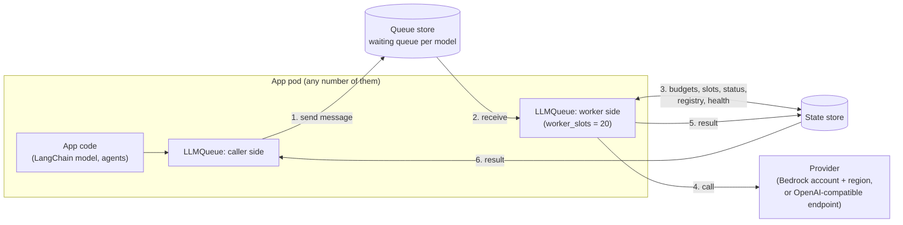
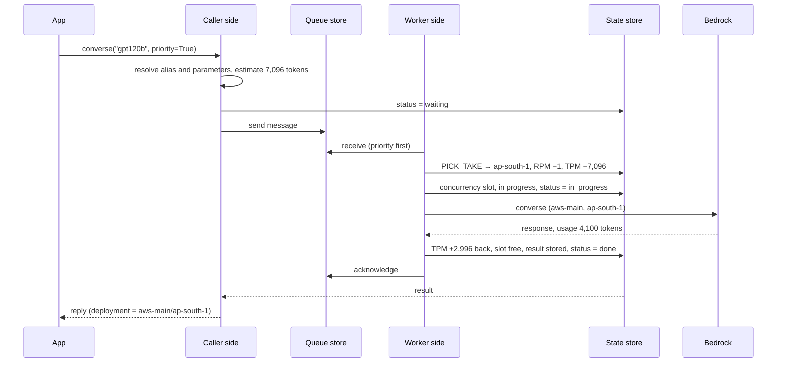

# Accounts, regions and load balancing: step-by-step walkthrough

This page explains the 0.3 design one step at a time, with the data that exists at every step.
It is the companion of [ACCOUNT_ROUTING_PLAN.md](ACCOUNT_ROUTING_PLAN.md): the plan holds the
rules and decisions, this page shows them working on one example.

Status: **design, nothing built**. Key names and fields marked *(proposed)* are not fixed in the
plan yet; they are settled in steps A1 and A4 and were decided on 2026-11-12 (§14). Every
other name comes from the plan or from the 0.2.1 code.

Contents: 1 the parts · 2 words · 3 example config · 4 every key in the stores · 5 start-up ·
6 one request, step by step · 7 RPM and TPM in depth · 8 when something goes wrong ·
9 deployment health · 10 changing a setting live · 11 status · 12 embeddings · 13 streaming ·
14 decisions on the open details.

## 1. The parts



| Part | What it is | What it holds |
|---|---|---|
| Caller side | The code the app calls (`llmq.converse`, the LangChain model) | Nothing durable |
| Worker side | Runs inside the same pods (`mode=both`); takes messages and calls the provider | Nothing durable |
| Queue store | A Redis-protocol store (Valkey / Redis), `LLMQ_QUEUE_STORE_URL` | Waiting messages |
| State store | A Redis-protocol store, `LLMQ_STORE_URL` | Everything else: registry, RPM / TPM budgets, concurrency, in progress, status, health, results |
| Provider | Bedrock in one account and region, or a vLLM / OpenAI-compatible endpoint | The model |

No pod keeps a count of its own. Every pod runs the same scripts against the same keys, so the
result is the same for 1 pod or 50.

## 2. Words

| Word | Meaning | Example |
|---|---|---|
| Model (alias) | One model the app can call, named by the owner | `gpt120b` |
| Account | Where the model is called from: an AWS account or an endpoint | `aws-main` |
| Deployment | One model in one account and one region. This is what has an RPM / TPM budget | `aws-main/ap-south-1` |
| Confirmed regions | Regions the model normally uses | `ap-south-1`, `us-east-1` |
| Fallback regions | Regions used only when the fallback rule allows it | `us-west-2` |
| RPM | Requests per minute allowed on one deployment | 500 |
| TPM | Tokens per minute allowed on one deployment | 400,000 |
| Balancing | How a deployment is chosen for a call | `headroom` |
| Waiting | The call is in the model's queue | |
| In progress | The call holds a budget and a slot and is at the provider | |

## 3. The example config

One document, `LLMQ_REGISTRY`, read from the secret or env. This walkthrough uses:

```json
{
  "registry_version": 7,
  "defaults": {"timeout_secs": 90, "priority_reserve": 0.2, "normal_min_share": 0.1,
               "balance": "ordered", "store_down": "pause", "worker_slots": 20,
               "inference": {"temperature": 0.2, "max_tokens": 2048}},
  "routing": {"kill_switch": false},
  "accounts": {"aws-main": {"kind": "aws"}},
  "models": {
    "gpt120b": {
      "type": "chat", "provider": "bedrock", "model_id": "openai.gpt-oss-120b-1:0",
      "rpm": 500, "tpm": 400000, "max_wait_secs": 30, "balance": "headroom",
      "inference": {"max_tokens": 4096},
      "fallback": {"on": ["exhausted", "broken"], "after_secs": 2},
      "model_fallback": {"on": ["exhausted", "broken"], "after_secs": 5,
                         "models": [{"model": "gpt20b", "require_headroom": true}]},
      "deployments": {"aws-main": {"confirmed": ["ap-south-1", "us-east-1"],
                                   "fallback": ["us-west-2"],
                                   "overrides": {"us-east-1": {"rpm": 300}}}}
    },
    "gpt20b": {
      "type": "chat", "provider": "bedrock", "model_id": "openai.gpt-oss-20b-1:0",
      "rpm": 1000, "tpm": 800000,
      "deployments": {"aws-main": {"confirmed": ["ap-south-1"]}}
    },
    "embed-titan": {
      "type": "embedding", "provider": "bedrock", "model_id": "amazon.titan-embed-text-v2:0",
      "rpm": 2000, "embed_batch_size": 1,
      "inference": {"dimensions": 1024, "normalize": true},
      "deployments": {"aws-main": {"confirmed": ["ap-south-1", "ap-south-2"]}}
    }
  }
}
```

**How one setting gets its value.** Four levels, the most specific wins:
deployment `overrides` → model → account `settings` → `defaults`.

After resolving, the library holds this table in memory (rebuilt on every registry reload):

| Model | Deployment | Group | rpm | tpm | max_tokens | balance | Where rpm came from |
|---|---|---|---|---|---|---|---|
| gpt120b | aws-main/ap-south-1 | confirmed | 500 | 400,000 | 4096 | headroom | model |
| gpt120b | aws-main/us-east-1 | confirmed | 300 | 400,000 | 4096 | headroom | deployment override |
| gpt120b | aws-main/us-west-2 | fallback | 500 | 400,000 | 4096 | headroom | model |
| gpt20b | aws-main/ap-south-1 | confirmed | 1000 | 800,000 | 2048 | ordered | model |
| embed-titan | aws-main/ap-south-1 | confirmed | 2000 | not used | — | ordered | model |
| embed-titan | aws-main/ap-south-2 | confirmed | 2000 | not used | — | ordered | model |

`llm-queue registry get gpt120b --effective` prints this table with the level of every value.

## 4. Every key in the stores

`P` is the key prefix of the environment, for example `llmq:prod`. Keys of one model share the
tag `{m:ALIAS}` so one script can read and change them together.

### 4.1 Queue store (per model queue)

Queue name: `<prefix>llm-<alias>`, for example `ra-prod-llm-gpt120b`.

| Key | Type | Holds | Sample |
|---|---|---|---|
| `{P:q:NAME}:s` | Stream | Waiting messages, normal calls | `1731400000123-0 → {mid, body, attrs, sent}` |
| `{P:q:NAME}:sp` *(proposed)* | Stream | Waiting messages, priority calls (served first) | same shape |
| `{P:q:NAME}:vis` | Sorted set | Messages a worker has received and not finished; score = when it becomes visible again | `1731400000123-0 → 1731400060.1` |
| `{P:q:NAME}:rc` | Hash | Receive count per message | `1731400000123-0 → 1` |
| `{P:q:NAME}:delay` | Sorted set | Deferred messages; score = when to put them back | `<message> → 1731400002.4` |
| `{P:q:NAME}:dlq` | Stream | Dead letters (failed `max_receives` times) | |
| `{P:q:NAME}:cfg` | Hash | Queue attributes | `visibility_secs=60, max_receives=10, retention_secs=345600` |

### 4.2 State store

| Key | Type | Holds | TTL | Written by |
|---|---|---|---|---|
| `P:{reg}:doc` | String (JSON) | The registry document | none | publish at boot, live edits |
| `P:{reg}:version` | Hash | `version=7, hash=ab12…, changes=3` | none | publish, live edits |
| `P:audit` | Stream | Every publish and edit: who, when, before, after | 90 days | publish, live edits |
| `P:{m:ALIAS}:rate:DEPLOYMENT` *(proposed)* | Hash | RPM / TPM budget of one deployment (§7) | 2 min idle | `PICK_TAKE`, token correction |
| `P:{a:ACCOUNT}:rate` *(proposed)* | Hash | Account-wide `shared_rpm` / `shared_tpm`, when set | 2 min idle | `RATE` |
| `P:{m:ALIAS}:rot` *(proposed)* | Hash | Rotation state for `round_robin` / `weighted` | none | `PICK_TAKE` |
| `P:{m:ALIAS}:ac:DEPLOYMENT` | Hash | Adaptive concurrency limit: `limit=24, ok_count=…, paused_until=0` | none | limiter scripts |
| `P:{m:ALIAS}:lease:DEPLOYMENT` | Sorted set | Slots in use: request id → lease expiry | none | limiter scripts |
| `P:{m:ALIAS}:cb:DEPLOYMENT` | Hash | Circuit breaker: `state=closed, failures=0` | none | breaker script |
| `P:{m:ALIAS}:health` | Hash | Per deployment: error count, `disabled_until`, next probe, p95 latency | none | health script, prober |
| `P:{m:ALIAS}:inprog` | Sorted set | Calls in progress: request id → deadline | none | worker |
| `P:{m:ALIAS}:inprog:ID` *(proposed)* | Hash | `deployment, priority, attempt, started` of one call in progress | deadline | worker |
| `P:{m:ALIAS}:sticky:SESSION` *(proposed)* | String | Deployment a session sticks to (only when sticky is on) | 30 min idle | worker |
| `P:req:ID` | Hash | Request status (§6, §11) | 30 min | caller, worker |
| `P:{r:ID}:job` | Hash | Claim of the message: `state, worker, heartbeat, failures` (stops two workers running one call) | deadline | claim scripts |
| `P:{r:ID}:res` | String (JSON) | The result | 5 min | worker |
| `P:req:ID:chunks` | Stream | Stream chunks of a streaming call | 5 min | worker |

## 5. Start-up, step by step

Each pod does this in `await llmq.start()`.

| # | Step | Data |
|---|---|---|
| 1 | Read settings: secret first, then env | `LLMQ_STORE_URL`, `LLMQ_QUEUE_STORE_URL`, `LLMQ_REGISTRY` |
| 2 | Validate the registry; all problems are listed together and the pod does not start | e.g. `models.gpt120b.model_fallback.models[0]: unknown model 'gpt2ob'` |
| 3 | Connect to both stores | |
| 4 | Publish or load the registry by version (table below) | `P:{reg}:doc`, `P:{reg}:version`, `P:audit` |
| 5 | Create missing queues (existing ones keep their attributes) | `{P:q:ra-prod-llm-gpt120b}:cfg` … |
| 6 | Resolve the deployment table of §3 | in memory |
| 7 | Start queue readers and the reload loop (every 30 s) | |
| 8 | `GET /llmq/health` → 200 | |

Version rule in step 4:

| Config says | Store has | Result |
|---|---|---|
| version 7 | nothing, or version 6 | Config is published; the old document goes to `P:audit` |
| version 7 | version 7, same content | The stored one is used, with its live edits |
| version 7 | version 7, different content | The stored one is kept; alert `registry_version_not_bumped` |
| version 6 | version 7 | Config is ignored (an old pod during a rolling deploy) |

Provider clients are built on first use: one per (account, region), with the account's
credentials (pod identity, or an assumed role refreshed every hour).

## 6. One request, step by step

The example: a live chat turn on `gpt120b`, sent with `priority=True`. The prompt, history and
tool definitions are 12,000 characters. The app does not pass `max_tokens`.

```python
reply = await llmq.converse("gpt120b", params, priority=True,
                            session_id="s-91", request_id="req-7f3a")
```

### Step 1. Resolve the model and the parameters (caller, in memory)

- `"gpt120b"` is an alias. `"openai.gpt-oss-120b-1:0"` would resolve to the same alias.
- Inference parameters are merged: call → model → account → defaults.

| Parameter | Call | Model | Defaults | Used |
|---|---|---|---|---|
| `max_tokens` | — | 4096 | 2048 | **4096** |
| `temperature` | — | — | 0.2 | **0.2** |

`inference_limits` are then applied (a ceiling on `max_tokens`, locked parameters). None here.

### Step 2. Route and admit (caller)

| Check | Value here | Effect |
|---|---|---|
| `routing.kill_switch` | false | true would send every call on the direct path |
| `queue_pct` | 100 | below 100, that share goes through the queue and the rest direct |
| Admission hook | none registered | a hook may reject or tag the call |
| Same `request_id` seen before | no | yes would return the first run's result instead of running again |

The direct path skips steps 4 and 5 only: it takes budgets and a slot exactly like a worker.

### Step 3. Estimate tokens (caller)

```
input   = 12,000 characters / 4          = 3,000 tokens   (messages + tool definitions)
output  = effective max_tokens           = 4,096 tokens
estimate                                 = 7,096 tokens
```

A request whose input alone is above `tpm` (400,000) fails here with `request_too_large`.

### Step 4. Write the status and send the message (caller → both stores)

State store, `P:req:req-7f3a`:

```json
{"state": "waiting", "model": "gpt120b", "priority": 1, "op": "converse",
 "est_tokens": 7096, "enqueued_at": 1731400000.10, "deadline_at": 1731400090.10,
 "session": "5c1e…(hashed)", "attempts": 0}
```

Queue store, appended to the priority stream of `ra-prod-llm-gpt120b`. The message body is the
envelope (0.2.1 fields; `lane` is removed and the fields marked ← are new, *proposed*):

```text
{"v": 2, "request_id": "req-7f3a", "session_id": "s-91", "op": "converse",
 "model": "gpt120b", "priority": true,                     ←
 "allow_fallback": "any", "allowed_regions": null,         ←
 "max_wait_secs": 30,                                      ←
 "params": {"messages": [...], "inferenceConfig": {"maxTokens": 4096, "temperature": 0.2}},
 "est_tokens": 7096, "enqueued_at": 1731400000.10, "deadline_at": 1731400090.10,
 "reply_to": "pod-a"}
```

Params above the size limit are stored by reference (`params_ref`), as today.
Nothing has been taken from RPM or TPM yet: **a waiting call costs no budget**.

### Step 5. A worker receives the message (worker → queue store)

Any pod's worker reads the queue; priority messages are read before normal ones.

| Key | Change |
|---|---|
| `{P:q:…}:vis` | `1731400000123-0 → now + 60 s` (hidden from other workers for `visibility_secs`) |
| `{P:q:…}:rc` | `1731400000123-0 → 1` |
| `P:{r:req-7f3a}:job` | `state=running, worker=pod-b-3, heartbeat=…` (the claim: a duplicate delivery is dropped) |

### Step 6. Choose a deployment, take RPM + TPM and a concurrency slot (`PICK_TAKE`, one script)

The worker first works out which deployments are **usable**:

| Deployment | Group | Enabled | Healthy | Breaker | Slow | Usable |
|---|---|---|---|---|---|---|
| aws-main/ap-south-1 | confirmed | yes | yes | closed | no | yes |
| aws-main/us-east-1 | confirmed | yes | yes | closed | no | yes |
| aws-main/us-west-2 | fallback | yes | yes | closed | no | not offered yet (fallback group) |

Input to the script:

```json
{"strategy": "headroom", "pick": "percent",
 "candidates": [
   {"name": "aws-main/ap-south-1", "rpm": 500, "tpm": 400000},
   {"name": "aws-main/us-east-1",  "rpm": 300, "tpm": 400000}],
 "preferred": null,
 "cost": {"requests": 1, "tokens": 7096},
 "priority": true, "priority_reserve": 0.2, "normal_min_share": 0.1,
 "window": "smooth", "random": 0.417}
```

What the script sees and decides (all inside the store, atomically):

| Deployment | RPM left | TPM left | Headroom (the smaller share) | Fits 1 request + 7,096 tokens |
|---|---|---|---|---|
| aws-main/ap-south-1 | 350 of 500 (70 %) | 264,000 of 400,000 (66 %) | **66 %** | yes |
| aws-main/us-east-1 | 120 of 300 (40 %) | 220,000 of 400,000 (55 %) | 40 % | yes |

`headroom` picks the one with the most left: **aws-main/ap-south-1**. The script takes 1 from its
RPM budget, 7,096 from its TPM budget and one concurrency slot in the same step (all or
nothing) and returns:

```json
{"granted": true, "deployment": "aws-main/ap-south-1", "slot": "req-7f3a"}
```

Other strategies with the same data: `ordered` → ap-south-1 (first in config);
`round_robin` → the next one in the shared rotation; `weighted` → by `weight`.

### Step 7. The concurrency slot and the account budget

| Check | Key | Here |
|---|---|---|
| Concurrency slot (adaptive limiter), taken inside `PICK_TAKE` | `P:{m:gpt120b}:ac:aws-main/ap-south-1`, `…:lease:…` | limit 24, 11 in use → slot granted, `lease: req-7f3a → now + 90 s`. A deployment with no free slot counts as full in step 6 |
| Account-wide cap (`shared_rpm` / `shared_tpm`), a second call only when set | `P:{a:aws-main}:rate` | not set, skipped. When set and full, the tokens and the slot of step 6 go back and the call waits |

The limiter is the safety net: it learns the real concurrency the provider accepts and shrinks
on throttles, whatever the configured RPM says.

### Step 8. Mark in progress (worker → state store)

```
P:{m:gpt120b}:inprog                 req-7f3a → 1731400090.10          (deadline)
P:{m:gpt120b}:inprog:req-7f3a        {deployment: aws-main/ap-south-1, priority: 1,
                                      attempt: 1, started: 1731400000.31}
P:req:req-7f3a                       state=in_progress, deployment=aws-main/ap-south-1,
                                      started_at=1731400000.31, attempts=1
```

### Step 9. Call the provider (worker → Bedrock)

- Client: the one for (`aws-main`, `ap-south-1`), with that account's credentials.
- Request: the app's `params`, plus the deployment's `params` when it has any (guardrail).
- While it runs, the worker extends the message's visibility and the claim heartbeat.

### Step 10. Response: correct the tokens, free the slot (worker → state store)

Bedrock returns `usage: {inputTokens: 3200, outputTokens: 900}` after 2.4 s.

| What | Change |
|---|---|
| TPM | Reserved 7,096, used 4,100 → **2,996 tokens go back** to `aws-main/ap-south-1` |
| RPM | Stays charged: the request happened |
| Slot | Lease removed; the limiter counts one success |
| Breaker | Success recorded |
| Health | Latency sample 2.4 s added |
| Metrics | `llmq_tokens_input_total +3200`, `llmq_tokens_output_total +900`, `llmq_token_estimate_ratio = 7096 / 4100 = 1.73` |

### Step 11. Store the result and finish (worker → both stores)

```
P:{r:req-7f3a}:res        the LLMReply JSON, kept 5 min
P:req:req-7f3a            state=done, finished_at=1731400002.75, tokens_in=3200, tokens_out=900
P:{m:gpt120b}:inprog      req-7f3a removed
queue                     message acknowledged and deleted (vis, rc entries removed)
```

### Step 12. The caller gets the reply

```json
{"request_id": "req-7f3a", "ok": true,
 "response": {"output": {"message": {...}}, "usage": {"inputTokens": 3200, "outputTokens": 900}},
 "meta": {"served_model": "gpt120b", "deployment": "aws-main/ap-south-1", "fallback": null,
          "queue_wait_ms": 210, "provider_ms": 2400, "attempts": 1}}
```

The whole path as one picture:



## 7. RPM and TPM in depth

### 7.1 Where the numbers are

| Number | Kept in | Changes when |
|---|---|---|
| The limit (`rpm: 500`, `tpm: 400000`) | The registry, resolved per deployment (§3) | A deploy, or a live edit; every pod sees it within 30 s |
| How much is used right now | One hash per deployment in the state store (§7.2) | Every take, correction and refund |

### 7.2 The budget of one deployment

`P:{m:gpt120b}:rate:aws-main/ap-south-1` (the same fields the 0.2.1 `RATE` script uses):

```
rpm_tat      1731400018.12     # smooth mode: the time up to which RPM is already spent
tpm_tat      1731400020.40     # same for TPM
seen_win     28856666          # the current minute (for the status view)
seen_calls   150               # requests started in this minute
seen_tokens  136000            # tokens charged in this minute
```

**`smooth` mode (default) in plain words.** Each budget is a clock, not a counter.

- One request "costs" `60 / rpm` seconds: at 500 rpm that is **0.12 s**.
- One token costs `60 / tpm` seconds: at 400,000 tpm that is **0.00015 s**.
- `rpm_tat` is the time up to which the budget is already spent. Taking a request pushes it
  0.12 s further. As real time passes, the budget frees itself; nothing has to reset it.
- A take is allowed while the clock is not too far ahead of now. "Too far" is the burst
  allowance (`rate_burst`, 10 % of the limit by default): 50 requests = 6 s for RPM, 40,000
  tokens = 6 s for TPM.

The example call, with the bucket idle at `now = 1000.00`:

| Moment | `rpm_tat` | `tpm_tat` | Why |
|---|---|---|---|
| Before | 1000.00 | 1000.00 | idle: nothing spent |
| Take 1 request + 7,096 tokens | 1000.12 | 1001.0644 | + 1 × 0.12 s; + 7,096 × 0.00015 s |
| Correction: 2,996 tokens back | 1000.12 | 1000.6150 | − 2,996 × 0.00015 s |

A call is refused when either clock would pass `now + burst`. The script then answers with how
long to wait:

```json
{"granted": false, "wait_secs": 0.8, "reason": "tpm"}
```

**`fixed` mode** (per model, `rate_window: "fixed"`): plain counters per calendar minute,
`rpm_n` and `tpm_n`, set back to 0 when the minute changes. Simpler to read, but allows the
whole minute's quota in the first second.

### 7.3 Every event that changes a budget

| Event | RPM | TPM |
|---|---|---|
| Call waits in the queue | no change | no change |
| Admitted (`PICK_TAKE`) | −1 | − estimate (input + `max_tokens`) |
| Success | stays | corrected to the real usage (difference back, or extra charged) |
| Provider throttled it (429), or refused it before running | +1 back | whole estimate back |
| 5xx, timeout, connection lost | stays | input part stays, unused output part back |
| Stream cut mid-way | stays | input + tokens of the chunks received stay |
| No usage in the response | stays | estimate stays; `llmq_token_usage_missing_total` +1 |
| Retry or fallback | a new take on the new deployment | a new estimate and take |
| Call cancelled or expired while waiting | nothing was taken | nothing was taken |

### 7.4 Priority and normal calls share one budget

Two shares protect each class (both per model, both can be set to 0):

| Setting | Default | Effect at rpm 500, tpm 400,000 |
|---|---|---|
| `priority_reserve` | 0.2 | Normal calls can use at most 80 %: 400 rpm, 320,000 tpm. The last 20 % is only for priority calls |
| `normal_min_share` | 0.1 | Priority calls can use at most 90 %: 450 rpm, 360,000 tpm. The last 10 % is always left for normal calls |

So a bulk run cannot empty the minute before a chat call arrives, and a chat rush cannot starve
background work. In the store this is a second clock per class next to the main one.

### 7.5 Optional pieces

| Setting | Default | Meaning |
|---|---|---|
| `rate_limits` | `both` for chat, `rpm` for embedding | `both`, `rpm`, `tpm` or `off`, at any level, changeable live |
| `shared_rpm` / `shared_tpm` (account settings) | none | A cap across all models of an account, checked after the deployment budget |
| `tpm_output_weight` | 1 | How many quota tokens one output token costs (some Bedrock models count more; unverified per model) |
| `tpm_count_cached` | true | Whether cache-read tokens count |
| `default_output_tokens` | 1000 | Output reservation when nothing sets `max_tokens` |
| `token_estimator` | characters / 4 | Name of a registered estimator (a real tokenizer) |
| `max_concurrency` | none | A hard cap on calls in progress per deployment, on top of the adaptive limiter |

A deployment with no `rpm` and no `tpm` has no budget: only the adaptive limiter applies.

## 8. When something goes wrong

Each case shows what the call does and what data changes.

### 8.1 No quota on the confirmed deployments

Both confirmed deployments are full when `req-7f3a` arrives.

| Time since send | What happens | Data |
|---|---|---|
| 0.2 s | `PICK_TAKE` refuses, wait 0.8 s. The message is **deferred**: back to the queue, visible in 0.8 s, receive count unchanged | `{P:q:…}:delay: msg → now + 0.8`; status stays `waiting`, `deferred=1` |
| 1.0 s | Tried again, refused again | `deferred=2` |
| 2.0 s | `fallback.after_secs` (2) passed and the cause `exhausted` is listed → fallback regions are offered too: `us-west-2` | `PICK_TAKE` candidates now include `aws-main/us-west-2` |
| 2.0 s | Granted on `us-west-2` | reply `meta.fallback = "region"` |

If `us-west-2` is full as well:

| Time | What happens |
|---|---|
| 5.0 s | `model_fallback.after_secs` (5) passed → `gpt20b` is tried, with its own deployments, budget and a new estimate. `require_headroom` means only while `gpt20b` has spare quota. Reply `meta.fallback = "model"`, `meta.served_model = "gpt20b"` |
| 30 s | `max_wait_secs` (30) passed and still nothing → status `expired`, the caller gets `rate_limited` with `retry_after_secs` |

A model without `fallback` and `model_fallback` simply waits for budget until its deadline.

### 8.2 The provider throttles the call (429)

| Step | Data |
|---|---|
| The request and the whole estimate go back | RPM +1, TPM +7,096 on that deployment |
| The limiter cuts that deployment's concurrency | `ac: limit 24 → 18` |
| The call retries on the next usable deployment | a new `PICK_TAKE` without the one that throttled |
| Many throttles while the budget still had room | alert "configured quota above observed" with the observed rate |

### 8.3 Server error or timeout (5xx)

| Step | Data |
|---|---|
| Input tokens stay charged, the unused output part goes back | TPM +4,096 |
| Breaker and health count the failure | `cb: failures +1` |
| Retry with backoff on the next usable deployment; `attempts` goes up | status `attempts=2` |
| Out of attempts or past the deadline | status `failed`, error kind in the reply |

### 8.4 The worker pod dies mid-call

| Step | Data |
|---|---|
| Nobody extends the visibility; after 60 s the message is visible again | `{P:q:…}:vis` entry lapses, `rc → 2` |
| The sweeper returns the dead call's slot and removes it from in progress | `lease`, `inprog` entries removed |
| Another worker runs it | status back to `in_progress` with the new worker |
| The same message fails 10 times (`max_receives`) | moved to the dead-letter stream, status `failed` |

### 8.5 The other cases

| Case | What happens |
|---|---|
| Same `request_id` sent twice | One provider call; both callers get the same result (within the 5 min result TTL) |
| `llmq.cancel(id)` | Waiting: removed, status `cancelled`. In progress: the worker stops the attempt, budgets follow the "timeout" rule |
| Call with `allowed_regions=["ap-south-1"]` | Only deployments in those regions are offered, also for fallback. None left → `no_deployment` at once |
| State store down | Per model `store_down`: `pause` (default: no call starts without the shared budget; a call waits up to its deadline, then `queue_unavailable`), `static_cap` (a fixed small concurrency per process; quotas may be exceeded), `fail_fast` (`queue_unavailable` at once) |
| Queue store down, state store up | After a short run of send / receive errors, calls run on the direct path under the same budgets and limiter; queued messages wait in the store; back to the queue when a probe succeeds |
| Access denied / model not in that region | Counts toward auto-disable (§9); the call moves to another deployment |

## 9. Health of one deployment

`P:{m:gpt120b}:health`, one entry per deployment *(field layout proposed)*:

```json
{"aws-main/us-east-1": {"errors": [1731400100, 1731400160, 1731400230],
                        "disabled_until": 1731401130, "probe_wait_secs": 900,
                        "p95_ms": 2600, "samples": 412}}
```

| State | Enters when | Leaves when |
|---|---|---|
| Usable | enabled, healthy, breaker closed, not paused, not slow | — |
| Auto-disabled | 3 target errors (access denied, model not in region) in 5 min | A probe call succeeds. First probe after 15 min; each failure doubles the wait, up to 2 h |
| Slow (skipped) | p95 above `slow_ratio` × the model's median and above `slow_min_secs`, with ≥ 3 usable deployments | p95 recovers. The last usable deployment is never skipped |
| Breaker open | Repeated failures | The breaker's own timer and trial call |
| Disabled by an operator | `llm-queue registry disable gpt120b aws-main/us-east-1` | `… enable …` |

Health lives apart from the registry, so a deploy never switches a broken deployment back on.
One process at a time runs the probe (a lock in the store).

## 10. Changing a setting live

```
llm-queue registry set gpt120b deployments.aws-main.overrides.ap-south-1.rpm=400
```

| # | Step | Data |
|---|---|---|
| 1 | The whole document is validated with the change | refused with every problem listed if invalid |
| 2 | The document is saved and the change counter goes up | `P:{reg}:version: changes 3 → 4` |
| 3 | The edit is audited | `P:audit: {actor: "hemprasad", at: …, path: "…ap-south-1.rpm", before: 500, after: 400}` |
| 4 | Every pod reloads within 30 s and rebuilds the table of §3 | |
| 5 | The next take on that deployment uses 400 | no reset of the budget is needed |

The edit lasts until a deploy brings a higher `registry_version`; `llm-queue registry diff`
shows what is live but not in config. Adding or removing a whole model needs a deploy.

## 11. Status

`await llmq.status(model="gpt120b")`, also `GET /llmq/status` and `llm-queue status --watch`:

```json
{"model": "gpt120b", "waiting": {"priority": 0, "normal": 14}, "in_progress": 31,
 "deployments": [
   {"name": "aws-main/ap-south-1", "group": "confirmed", "usable": true,
    "rpm": {"limit": 500, "used": 151, "left": 349},
    "tpm": {"limit": 400000, "used": 140100, "left": 259900, "in_flight": 42000},
    "concurrency": {"limit": 24, "in_use": 12}, "breaker": "closed", "p95_ms": 2400},
   {"name": "aws-main/us-east-1", "group": "confirmed", "usable": true,
    "rpm": {"limit": 300, "used": 180, "left": 120},
    "tpm": {"limit": 400000, "used": 180000, "left": 220000, "in_flight": 31000},
    "concurrency": {"limit": 20, "in_use": 19}, "breaker": "closed", "p95_ms": 2900},
   {"name": "aws-main/us-west-2", "group": "fallback", "usable": true,
    "rpm": {"limit": 500, "used": 0, "left": 500},
    "tpm": {"limit": 400000, "used": 0, "left": 400000, "in_flight": 0},
    "concurrency": {"limit": 20, "in_use": 0}, "breaker": "closed", "p95_ms": null}]}
```

`await llmq.request_status("req-7f3a")`:

```json
{"request_id": "req-7f3a", "state": "done", "model": "gpt120b",
 "deployment": "aws-main/ap-south-1", "priority": true, "attempts": 1, "fallback": null,
 "enqueued_at": 1731400000.10, "started_at": 1731400000.31, "finished_at": 1731400002.75,
 "tokens_in": 3200, "tokens_out": 900, "error": null}
```

States: `waiting → in_progress → done | failed | expired | cancelled`. Status holds ids, model,
deployment, tokens, timings and error kind; never prompt or response text.

## 12. Embeddings

`await llmq.embed("embed-titan", texts)` with 250 texts:

| Step | What happens |
|---|---|
| Split | `embed_batch_size: 1` (Titan takes one text per call) → 250 calls, each its own message |
| Budget | `rate_limits` is `rpm` for embedding models: each call takes 1 request, no token estimate, no TPM |
| Balancing | `ordered`: ap-south-1 until its 2,000 rpm is spent, then ap-south-2 |
| Fallback | Regions only. An embedding model never changes model (vectors would not match) |
| Result | The vectors come back in the order of the texts |

Setting `rate_limits: "both"` and a `tpm` on the model turns token limiting on for it too.

## 13. Streaming

| Step | Data |
|---|---|
| Send, receive, budgets, slot: as in §6 | |
| The worker calls `ConverseStream`; each chunk is appended | `P:req:req-7f3a:chunks: {seq: 14, delta: "…"}` |
| The caller's single stream reader passes chunks to the app | |
| End of stream carries the usage; TPM is corrected then | `{end: true, usage: {…}}` |
| Failure after chunks were sent | an error event with the partial text; no silent switch to another deployment |

## 14. Decisions on the open details

Decided on 2026-11-12, choosing the option with the fewest store calls (plan E76 to E82).

| # | Point | Decision |
|---|---|---|
| 1 | Key names | One budget hash per deployment, `P:{m:ALIAS}:rate:DEPLOYMENT`, and the others as listed in §4 |
| 2 | Priority inside one queue on the stream backend | A second stream `:sp` under the same queue name, read first |
| 3 | Envelope version 2 | `lane` removed; `priority`, `allow_fallback`, `allowed_regions`, `max_wait_secs` added |
| 4 | "Left" for `headroom` | Limit minus what was used in the current minute |
| 5 | Reserves | A cap per class: normal ≤ 80 %, priority ≤ 90 %; `priority_reserve: 0` on models without priority traffic |
| 6 | Expired calls | Status `expired`; the caller's error is `rate_limited` with `retry_after_secs` |
| 7 | Admission | The concurrency slot is taken inside `PICK_TAKE`: one store call |

Store calls of one queued request: caller 1 (status and send, in parallel); worker 6 (receive,
claim, `PICK_TAKE`, mark in progress, finish, acknowledge). Target: the queue path adds at most
20 ms at p95 with no backlog (measured in B34).

Still needed from the owner: real RPM / TPM per region for the first four models, and which
regions are confirmed or fallback. This page uses sample numbers only.
