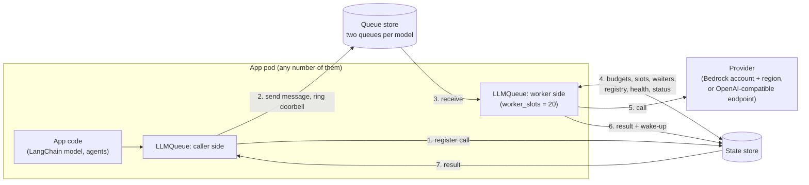
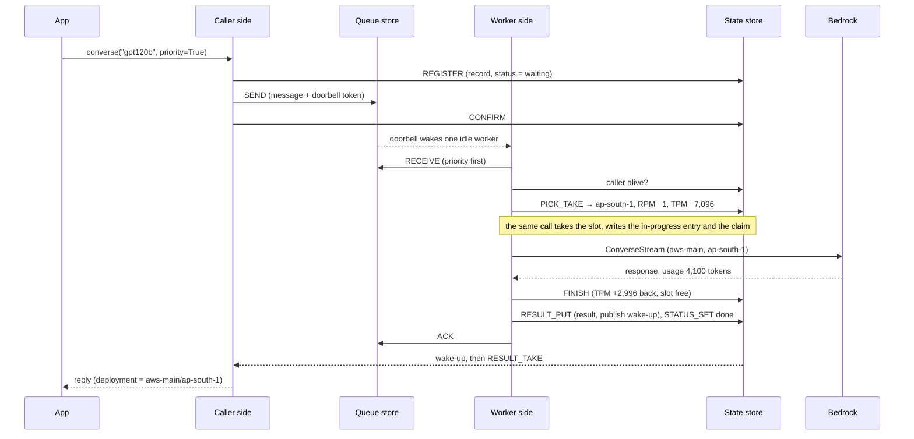

# Accounts, regions and load balancing: step-by-step walkthrough

This page explains the 0.3 design one step at a time, with the data that exists at every step.
It is the companion of [ACCOUNT_ROUTING_PLAN.md](ACCOUNT_ROUTING_PLAN.md): the plan holds the
rules and decisions, this page shows them working on one example. How the parts fit together is
in [ARCHITECTURE.md](ARCHITECTURE.md).

Status: **built** in 0.3.0 (not released yet). This page was checked against the code on
2026-11-13: key names, script inputs and outputs, CLI commands, settings and defaults are the
ones in `src/taskiq_llm_queue`. The numbers are sample numbers.

Contents: 1 the parts · 2 words · 3 example config and process settings · 4 every key in the
stores · 5 start-up · 6 one request, step by step · 7 RPM and TPM in depth · 8 when something goes
wrong · 9 deployment health · 10 changing a setting live · 11 status · 12 embeddings ·
13 streaming · 14 decisions on the open details.

## 1. The parts



| Part | What it is | What it holds |
|---|---|---|
| Caller side | The code the app calls (`llmq.converse`, the LangChain model) | Nothing durable |
| Worker side | Runs inside the same pods (`LLMQ_MODE=both`, the default); takes messages and calls the provider | Nothing durable |
| Queue store | A Redis-protocol store (Valkey / Redis), `LLMQ_QUEUE_STORE_URL`; when unset, the state store holds the queues too | Waiting messages, doorbells |
| State store | A Redis-protocol store, `LLMQ_STORE_URL`, one primary (cluster mode is not supported) | Everything else: registry, RPM / TPM budgets, slots, waiters, in progress, status, health, results |
| Provider | Bedrock in one account and region, or a vLLM / OpenAI-compatible endpoint | The model |

No pod keeps a count of its own. Every pod runs the same scripts against the same keys, so the
result is the same for 1 pod or 50.

## 2. Words

| Word | Meaning | Example |
|---|---|---|
| Model (alias) | One model the app can call, named by the owner | `gpt120b` |
| Account | Where the model is called from: an AWS account or an endpoint | `aws-main` |
| Deployment | One model in one account and one region, named `account/region`. This is what has an RPM / TPM budget | `aws-main/ap-south-1` |
| Confirmed regions | Regions the model normally uses | `ap-south-1`, `ap-south-2` |
| Fallback regions | Regions used only when the fallback rule allows it | `us-west-2` |
| RPM | Requests per minute allowed on one deployment | 500 |
| TPM | Tokens per minute allowed on one deployment | 400,000 |
| Balancing | How a deployment is chosen for a call | `headroom` |
| Waiting | The call is in the model's queue, or held by a worker until it gets budget | |
| In progress | The call holds a budget and a slot and is at the provider | |

## 3. The example config

One document, `LLMQ_REGISTRY` (or the file named by `LLMQ_REGISTRY_FILE`), read from the secret
or env. This walkthrough uses:

```json
{
  "registry_version": 7,
  "defaults": {"timeout_secs": 120, "priority_reserve": 0.2, "normal_min_share": 0.1,
               "balance": "ordered", "store_down": "pause", "worker_slots": 20,
               "inference": {"temperature": 0.2, "max_tokens": 2048}},
  "routing": {"kill_switch": false},
  "accounts": {"aws-main": {"kind": "aws"}},
  "models": {
    "gpt120b": {
      "type": "chat", "provider": "bedrock", "model_id": "openai.gpt-oss-120b-1:0",
      "rpm": 500, "tpm": 400000, "max_wait_secs": 30, "balance": "headroom",
      "inference": {"max_tokens": 4096},
      "fallback": {"on": ["exhausted", "broken"], "after_secs": 2},
      "model_fallback": {"on": ["exhausted", "broken"], "after_secs": 5,
                         "models": [{"model": "gpt20b", "require_headroom": true}]},
      "deployments": {"aws-main": {"confirmed": ["ap-south-1", "ap-south-2"],
                                   "fallback": ["us-east-1", "us-west-2"],
                                   "overrides": {"ap-south-2": {"rpm": 300}}}}
    },
    "gpt20b": {
      "type": "chat", "provider": "bedrock", "model_id": "openai.gpt-oss-20b-1:0",
      "rpm": 1000, "tpm": 800000,
      "deployments": {"aws-main": {"confirmed": ["ap-south-1"]}}
    },
    "embed-titan": {
      "type": "embedding", "provider": "bedrock", "model_id": "amazon.titan-embed-text-v2:0",
      "rpm": 2000, "embed_batch_size": 1,
      "inference": {"dimensions": 1024, "normalize": true},
      "deployments": {"aws-main": {"confirmed": ["ap-south-1", "ap-south-2"]}}
    }
  }
}
```

**How one setting gets its value.** Four levels, the most specific wins:
deployment `overrides` → model → account `settings` → `defaults` → the library default. Object
settings such as `inference`, `health` and `queue` combine key by key. `inference` set in
`defaults` or on an account applies only to models of the matching type (so `max_tokens` above
does not reach `embed-titan`). Validation lists every problem at once; for example
`fallback.after_secs` must be below `max_wait_secs`, and `attempt_timeout_secs` below
`timeout_secs`.

After resolving, the library holds this view in memory (rebuilt on every registry reload):

| Model | Deployment | Group | rpm | tpm | max_tokens | balance | Where rpm came from |
|---|---|---|---|---|---|---|---|
| gpt120b | aws-main/ap-south-1 | confirmed | 500 | 400,000 | 4096 | headroom | model |
| gpt120b | aws-main/ap-south-2 | confirmed | 300 | 400,000 | 4096 | headroom | deployment override |
| gpt120b | aws-main/us-east-1 | fallback | 500 | 400,000 | 4096 | headroom | model |
| gpt120b | aws-main/us-west-2 | fallback | 500 | 400,000 | 4096 | headroom | model |
| gpt20b | aws-main/ap-south-1 | confirmed | 1000 | 800,000 | 2048 | ordered | model |
| embed-titan | aws-main/ap-south-1 | confirmed | 2000 | not used | — | ordered | model |
| embed-titan | aws-main/ap-south-2 | confirmed | 2000 | not used | — | ordered | model |

`llm-queue settings get --model gpt120b --deployment aws-main/ap-south-2` prints every setting of
that deployment as `{"value": …, "level": …}` (`rpm` → `{"value": 300, "level": "deployment"}`).
Without `--deployment` the account and deployment levels are skipped.

### 3.1 Process settings

Everything about models is in the registry; the process reads only these `LLMQ_*` (secret first
when `LLMQueue.from_env(secrets=...)` is given, then the environment). All problems are reported
at once; a 0.2 name such as `LLMQ_REDIS_HOST` is an error naming its replacement.

| Setting | Default | Meaning |
|---|---|---|
| `LLMQ_STORE_URL` | required | State store, `redis://`, `rediss://`, `valkey://` or `valkeys://` |
| `LLMQ_QUEUE_STORE_URL` | unset | Separate queue store (unset: the state store) |
| `LLMQ_STORE_PASSWORD`, `LLMQ_QUEUE_STORE_PASSWORD` | unset | Read from `secrets` on every new connection (rotation) |
| `LLMQ_ENVIRONMENT` | `dev` | Outside `dev`, `local`, `test`, `ci` the store URLs must use TLS (`rediss://`, certificate and host name checked; localhost excepted) and `LLMQ_ID_HASH_SALT` is required |
| `LLMQ_ID_HASH_SALT` | unset | Key of the HMAC that hashes user and session ids everywhere outside the message |
| `LLMQ_STORE_MAX_CONNECTIONS` | 200 | Blocking pool size per store client |
| `LLMQ_KEY_PREFIX`, `LLMQ_QUEUE_PREFIX` | `llmq`, empty | Key prefix (`P` below); queue name prefix |
| `LLMQ_REGISTRY_LIVE_EDIT` | `safe` | `safe`, `all` or `off` (§10) |
| `LLMQ_CFG_RELOAD_SECS` | 30 | Registry reload interval |
| `LLMQ_RESULT_TTL_SECS`, `LLMQ_RESULT_DEDUPE_SECS` | 300, 0 | How long a result is kept; how long a library-made id's result stays after its first read (0: deleted at once) |
| `LLMQ_STATUS_TTL_SECS`, `LLMQ_AUDIT_RETENTION_DAYS` | 1800, 90 | Request status lifetime; audit retention |
| `LLMQ_LEASE_SECS`, `LLMQ_CALLER_TTL_SECS`, `LLMQ_DRAIN_SECS` | 60, 30, 45 | Grant lease; caller liveness key; shutdown drain |
| `LLMQ_LOCAL_LIMIT_CAP` | 10 | Calls per process and model under `store_down: static_cap` |
| `LLMQ_QUEUE_FAILOVER_SECS` | 5 | With a separate queue store: how long sends are retried before a call runs direct |
| `LLMQ_QUEUE_WAIT_REPLICAS`, `LLMQ_QUEUE_WAIT_MS` | 0, 100 | A send waits for this many replicas, this long (0: off); too few means the call runs direct |
| `LLMQ_DEBUG_CAPTURE_FROM_CONFIG` | false | Lets a model's `debug_capture` keep prompt text for 1 h; refused in prod |
| `LLMQ_MODE` | `both` | `both`, `caller` or `worker` |
| `LLMQ_METRICS_SINK` | `emf` | `emf`, `prometheus` or `none` |
| `LLMQ_BASE_URL_ALLOWED_HOSTS` | empty | Hosts an `openai` account's `base_url` may use |
| `LLMQ_BEDROCK_ENDPOINT_URL`, `LLMQ_STS_ENDPOINT_URL` | unset | Tests only (fakellm, moto) |

## 4. Every key in the stores

`P` is the key prefix of the environment, for example `llmq:prod`. Keys of one model share the
tag `{m:ALIAS}`, keys of one request `{r:ID}`, keys of one queue `{q:NAME}`; the scripts still
touch several tags at once, which is why one primary is required.

### 4.1 Queue store (per model queue)

Each model has two queues: `<queue_prefix>llm-<alias>` for normal calls and
`<queue_prefix>llm-<alias>-priority` for priority calls (a model may set `queue.name`), for example
`ra-prod-llm-gpt120b` and `ra-prod-llm-gpt120b-priority` with `LLMQ_QUEUE_PREFIX=ra-prod-`. Workers
read the priority queue first. Each queue has the keys below; there is no stored queue
configuration: `visibility_secs`, `max_receives` and the retentions come from the model's `queue`
setting on every call.

| Key | Type | Holds | Sample |
|---|---|---|---|
| `P:{q:NAME}:s` | Stream | Waiting messages; the id is the store's time at send (the call's place and the start of its deadline) | `1731400000123-0 → {body}` |
| `P:{q:NAME}:vis` | Sorted set | Messages received or returned; score = when it is visible again (a delayed return is a later score) | `1731400000123-0 → 1731400060123` |
| `P:{q:NAME}:gen` | Hash | Generation per message, +1 on every receive (a stale receipt cannot ack or extend) | `1731400000123-0 → 1` |
| `P:{q:NAME}:fails` | Hash | Failures per message (a lapsed hold, or a handler failure) | `1731400000123-0 → 0` |
| `P:{q:NAME}:st` | Hash | `h` held by a worker, `r` returned without a failure | `1731400000123-0 → h` |
| `P:{q:NAME}:dlq` | Stream | Dead letters (`body`, `src`, `fails`), kept `dlq_retention_secs` (1 day) | |
| `P:{q:NAME}:meta` | Hash | `cursor`: the last new message handed out | |
| `P:bell:NAME` | List | Doorbell: one token per send (at most 64, 60 s); an idle worker blocks on it | `["1"]` |

Defaults of `queue`: `visibility_secs` 60, `max_receives` 10, `retention_secs` 345,600 (4 days),
`dlq_retention_secs` 86,400.

### 4.2 State store

| Key | Type | Holds | TTL | Written by |
|---|---|---|---|---|
| `P:{reg}:doc` | String (JSON) | The registry document | none | publish, live edits |
| `P:{reg}:meta` | Hash | `version=7, config_hash=ab12…, changes=3, published=…` | none | publish, live edits |
| `P:{reg}:audit` | Stream | Every publish and edit: `actor, op, version, diff, ts`; `diff` is a list of `{path, before, after}` with secrets redacted | `LLMQ_AUDIT_RETENTION_DAYS` (90) | publish, live edits |
| `P:{reg}:history` | Hash | The last 20 published versions (for rollback) | none | publish |
| `P:{m:ALIAS}:cfg` | Hash | `numbers`: the resolved admission settings of the model and each deployment; `changes`: the change counter they belong to | none | publish, live edits |
| `P:{m:ALIAS}:rate:DEPLOYMENT` | Hash | RPM / TPM clocks of one deployment and its classes, minute counters (§7.2) | 180 s, refreshed on write | `PICK_TAKE`, `FINISH` |
| `P:{a:ACCOUNT}:rate` | Hash | Account-wide `shared_rpm` / `shared_tpm` clocks, when set | 180 s | `PICK_TAKE`, `FINISH` |
| `P:{m:ALIAS}:wait:p`, `:wait:n` | Sorted set | Waiters per class, scored by queue position | entries expire 2 s after their last ask | `PICK_TAKE` |
| `P:{m:ALIAS}:waitinfo` | Hash | Per waiter: cost (`r`, `t`), the deployments it may use, expiry | as above | `PICK_TAKE` |
| `P:caller:WORKER` | String | Liveness of a calling process; calls whose callers are all gone are dropped on receive | `LLMQ_CALLER_TTL_SECS` (30) | heartbeat |
| `P:{m:ALIAS}:rot` | Hash | Rotation state for `round_robin` / `weighted` | none | `PICK_TAKE` |
| `P:{m:ALIAS}:ac:DEPLOYMENT` | Hash | Learned concurrency limit: `limit=200, cut_at=…` | none | `PICK_TAKE`, `FINISH` |
| `P:{m:ALIAS}:lease:DEPLOYMENT:p`, `…:n` | Sorted set | Slots in use per class: owner token → lease expiry | none (entries expire by score) | `PICK_TAKE`, `RENEW`, `FINISH`, `SWEEP` |
| `P:{m:ALIAS}:cb:DEPLOYMENT` | Hash | Circuit breaker: `state=closed, failures=0, until, probe, probe_at` | none | `FINISH`, `PICK_TAKE` |
| `P:{m:ALIAS}:health` | Hash | Per deployment `DEP\|until`, `DEP\|wait`, `DEP\|since` (auto-disable), `DEP\|lat` (latency EWMA, ms), `DEP\|n` (samples) | none | health scripts, `FINISH` |
| `P:{m:ALIAS}:terr:DEPLOYMENT` | Sorted set | Target errors by request id in the window | the window | health script |
| `P:{m:ALIAS}:thr:DEPLOYMENT:MINUTE` | String | Throttles this minute (status, alert) | 180 s | `FINISH` |
| `P:{m:ALIAS}:inprog` | Sorted set | Calls in progress: owner token → lease expiry (renewed on the heartbeat) | none | `PICK_TAKE` (add), `FINISH` or `SWEEP` (remove) |
| `P:{m:ALIAS}:inprog:ID` | Hash | The grant: `owner, worker, dep, cls, minute, cost_r, cost_t, account, started, request, served` | 2 x lease, renewed | `PICK_TAKE` (add), `FINISH` or `SWEEP` (remove) |
| `P:{m:ALIAS}:sticky:HASH` | String | Deployment a session sticks to (only when `sticky` is set) | `sticky.idle_ttl_secs` (1800) | `PICK_TAKE` |
| `P:{m:ALIAS}:retries:MINUTE` | Hash | Retries and first attempts this minute (retry budget) | 120 s | worker |
| `P:{r:ID}:job` | Hash | The call's record and claim: `state` (`queued`, `running`, final), user and params hashes, `caller`, `confirmed`, `app`, `owner`, `hb` | deadline + status TTL | `REGISTER`, `CONFIRM`, `PICK_TAKE`, `RENEW`, `RESULT_PUT` |
| `P:{r:ID}:callers` | Set | Calling processes waiting on this id | as the job | `REGISTER` |
| `P:{r:ID}:status` | Hash | Request status (§11) | `LLMQ_STATUS_TTL_SECS` (1800) | caller, worker |
| `P:{r:ID}:res` | String (JSON) | The result. A library-made id's result is deleted on its first read; an app-supplied id's stays, so a duplicate id gets it too | `LLMQ_RESULT_TTL_SECS` (300) | `RESULT_PUT` |
| `P:{r:ID}:cancel` | String | Cancel flag | status TTL | `llmq.cancel` |
| `P:{r:ID}:chunks` | Stream | Stream entries of a streaming call (§13) | result TTL + call timeout | worker |
| `P:done:WORKER`, `P:cancel` | Pub/sub channels | Result wake-ups for one calling process; cancels for every worker | | `RESULT_PUT`, `llmq.cancel` |
| `P:epoch`, `P:lock:*`, `P:alert:*` | Strings | Store-reset detector; locks of the one-process tasks (sweep, probes, alerts); alert states | locks 5-25 s | heartbeat, background tasks |

## 5. Start-up, step by step

Each pod does this in `LLMQueue.from_env()` and `await llmq.start()`.

| # | Step | Data |
|---|---|---|
| 1 | Read the process settings (§3.1); all problems are listed together and the pod does not start | `LLMQ_STORE_URL`, `LLMQ_REGISTRY`, … |
| 2 | Build the store clients (failover options, blocking pool) and the provider client pool | |
| 3 | Validate the registry and publish it by version (table below); all problems are listed together and the pod does not start. If the store cannot be reached, the pod starts on its own config | `P:{reg}:doc`, `:meta`, `:audit`, `:history`, `P:{m:*}:cfg` |
| 4 | Measure the store's clock; write `P:epoch` if missing | |
| 5 | Caller side: subscribe to `P:done:<worker id>`; start the 5 s result sweep | |
| 6 | Worker side (`LLMQ_MODE` `both` or `worker`): one receive loop per model with `worker_slots` slots; the sweeper, prober, alert loop and cancel reader; build every Bedrock client now | |
| 7 | Heartbeat (caller key, leases, held messages, clock) and the registry reload loop (every `LLMQ_CFG_RELOAD_SECS`, 30 s); job loops for registered jobs | |
| 8 | `GET <prefix>/health/ready` → 200 (registry loaded, not draining; the stores are reported but never make it fail) | |

Queues need no creation step: a stream exists from its first message.

Version rule in step 3:

| Config says | Store has | Result |
|---|---|---|
| version 7 | nothing, or version 6 | Config is published; the diff goes to `P:{reg}:audit` |
| version 7 | version 7, same content | The stored one is used, with its live edits (`kept`) |
| version 7 | version 7, different content | The stored one is kept; warning `registry_version_not_bumped` |
| version 6 | version 7 | Config is ignored (an old pod during a rolling deploy) |

Provider clients: one per (account, region), with the account's credentials (pod identity, or
an assumed role with one-hour sessions named `llmq-<env>-<pod>`, refreshed by aiobotocore before
they expire).

## 6. One request, step by step

The example: a live chat turn on `gpt120b`, sent with `priority=True`. The prompt, history and
tool definitions are 12,000 characters. The app does not pass `max_tokens`. The caller's process
has worker id `pod-a`; the worker that serves it is `pod-b-3`.

```python
reply = await llmq.converse("gpt120b", params, priority=True,
                            session_id="s-91", request_id="req-7f3a")
```

### Step 1. Resolve the model (caller, in memory)

- `"gpt120b"` is an alias. `"openai.gpt-oss-120b-1:0"` would resolve to the same alias.
- `timeout_secs` is 120 (defaults), capped by `timeout_max_secs` (900). `max_wait_secs` is 30.
- A model disabled as a whole would send the call to its first `model_fallback` model, or fail
  `model_disabled`.

Inference parameters are **not** merged here: the message carries the app's params as given. The
worker fills them in (steps 5 and 9), the call's own values first:

| Parameter | Call | Model | Defaults | Used |
|---|---|---|---|---|
| `max_tokens` | — | 4096 | 2048 | **4096** |
| `temperature` | — | — | 0.2 | **0.2** |

`inference_limits` are then applied (a ceiling on `max_tokens` with `clamp` or `reject`, locked
parameters). None here.

### Step 2. Route (caller)

| Check | Value here | Effect |
|---|---|---|
| `routing.kill_switch` | false | true would run every call on the direct path |
| `queue_pct` | 100 | below 100, that share of request ids (by hash) runs direct and the rest through the queue; users in `routing.allow_users` always queue |
| Admission hook | none registered | a hook may `Reject` the call (`rejected`) |

The direct path skips the queue send and receive only: it registers the call, takes budgets and a
slot with the same `PICK_TAKE`, in the same waiter order, and runs the same attempts.

### Step 3. Register, send, confirm (caller → both stores)

Three store calls, one after the other.

`REGISTER` (state store) creates the record, unless the id is known:

```
P:{r:req-7f3a}:job      state=queued, user=<hash>, params=<hash>, caller=pod-a, confirmed=0, app=1
P:{r:req-7f3a}:callers  {pod-a}
P:{r:req-7f3a}:status   state=waiting, model=gpt120b, priority=1, enqueued_at=1731400000.100000
```

A known id answers `attached` (wait for the first run's result), `done` (the stored result),
`conflict` (other params or another user: `request_id_conflict`), `expired` (finished and its
result gone: `result_expired`) or `takeover` (an unconfirmed record older than 5 s: its sender died).

`SEND` (queue store) appends the message to `ra-prod-llm-gpt120b-priority`, pushes one token on its
doorbell, and refuses with `queue_full` when `max_waiting` (50,000) messages are there. The body is
message format version 2 (fields that are null are left out):

```text
{"v": 2, "request_id": "req-7f3a", "op": "converse", "model": "gpt120b",
 "params": {"messages": [...], "toolConfig": {...}},
 "priority": true, "caller": "pod-a", "timeout_secs": 120.0, "max_wait_secs": 30,
 "allow_fallback": "all", "session_id": "s-91",
 "app_request_id": true, "stream": false}
```

The message id, say `1731400000123-0`, is the store's time at send: the deadline is that time
plus `timeout_secs`, whatever the pods' clocks say. `CONFIRM` then sets `confirmed=1` and keeps the
record until the deadline plus the status TTL. Params always travel inside the message.
Nothing has been taken from RPM or TPM yet: **a waiting call costs no budget**.

### Step 4. A worker receives the message (worker → queue store)

An idle worker of any pod is blocked on the model's two doorbells; the token wakes exactly one.
It reads the priority queue first (`RECEIVE`, up to 10 messages or its free slots):

| Key | Change |
|---|---|
| `P:{q:ra-prod-llm-gpt120b-priority}:vis` | `1731400000123-0 → now + 60 s` (hidden from other workers for `visibility_secs`) |
| `…:gen` / `…:st` | `1731400000123-0 → 1` / `h` |

Then one check: is a caller of the call still alive (`P:caller:pod-a` exists)? If none is, the call
ends `cancelled` with the reason `caller_gone`. The claim is not written here: it is part of the
admission in step 6.

### Step 5. Estimate tokens (worker, in memory)

```
input   = 12,000 characters / 4          = 3,000 tokens   (every text: messages + tool definitions)
output  = effective max_tokens           = 4,096 tokens   (model-level inference, step 1)
estimate                                 = 7,096 tokens
```

A request whose input alone is above the `tpm` of every candidate (400,000) fails here with
`request_too_large`. The estimate is computed once per held call and registry version, and every
refund later settles against it.

### Step 6. Choose a deployment, take RPM + TPM and a concurrency slot (`PICK_TAKE`, one script)

The worker passes the deployments of the confirmed group (the fallback group joins only when the
fallback rule allows, §8.1), after the call's `allowed_regions` / `allowed_accounts` filters and
without accounts whose credentials failed in this process. The script reads the resolved numbers
(`P:{m:gpt120b}:cfg`), health, breaker and latency itself and keeps the **usable** ones:

| Deployment | Group | Enabled | Healthy | Breaker | Slow | Usable |
|---|---|---|---|---|---|---|
| aws-main/ap-south-1 | confirmed | yes | yes | closed | no | yes |
| aws-main/ap-south-2 | confirmed | yes | yes | closed | no | yes |
| aws-main/us-east-1, us-west-2 | fallback | yes | yes | closed | no | not passed yet (fallback group) |

Input to the script (the limits are not in it: the script reads them from `cfg`, and a change
counter that differs from the store's answers `stale_config`, so the worker reloads first):

```json
{"alias": "gpt120b", "changes": 3, "request_id": "req-7f3a",
 "owner": "req-7f3a|pod-b-3@1731400000123-0|1", "worker": "pod-b-3",
 "cls": "p", "pos": 1731400000123000,
 "cost_r": 1, "cost_t": 7096,
 "candidates": [{"key": "aws-main/ap-south-1", "tier": "confirmed", "last": false},
                {"key": "aws-main/ap-south-2", "tier": "confirmed", "last": false}],
 "strategy": "headroom", "pick": "percent", "claim": true,
 "lease_ms": 60000, "waiter_ms": 2000, "rand": 0.417}
```

First the script checks the call is not settled already (a stored result, a final state, a cancel
flag, or running under another worker with a fresh heartbeat: `duplicate`). Then, all inside the
store, atomically:

| Deployment | RPM bucket free | TPM bucket free | Slots free | Headroom (the smallest share) | Fits 1 request + 7,096 tokens |
|---|---|---|---|---|---|
| aws-main/ap-south-1 | 35 of 50 (70 %) | 26,400 of 40,000 (66 %) | 189 of 200 | **66 %** | yes |
| aws-main/ap-south-2 | 12 of 30 (40 %) | 22,000 of 40,000 (55 %) | 190 of 200 | 40 % | yes |

In the default `smooth` window the "bucket" is what can be taken right now: `rate_burst` (10 %) of
the minute's limit (§7.2). The class clocks (§7.4) and the account budget are checked the same way
and count in the smallest share; here they have more room. Headroom is measured **before** this
call.

`headroom` with `pick: percent` takes the largest share: **aws-main/ap-south-1**. (A model can set
`balance_priority: "ordered"` so priority calls take the first region in config while it has
budget, whatever the headroom; it has no default.) The script takes 1 from its RPM clock and
its class clock, 7,096 from its TPM clocks and one priority slot, in the same step (all or
nothing), and returns:

```json
{"r": "granted", "dep": "aws-main/ap-south-1", "minute": 28856666, "limit": 200,
 "tier": "confirmed"}
```

Other strategies with the same data: `ordered` → ap-south-1 (the first in config that fits; the
script stops looking there); `round_robin` → the next one in the shared rotation; `weighted` →
smooth weighted rotation by `weight`; `custom:<name>` → the order a registered balancer returns.

### Step 7. The concurrency slot and the account budget (both inside `PICK_TAKE`)

| Check | Key | Here |
|---|---|---|
| Concurrency slot (learned limit), taken inside `PICK_TAKE` | `P:{m:gpt120b}:ac:aws-main/ap-south-1`, `…:lease:aws-main/ap-south-1:p` | limit 200 (no `max_concurrency`: a new deployment starts at its cap, 200 when unset), 11 in use, a priority call may use up to 90 % → slot granted, the owner token of step 6 → now + 60 s. A deployment with no free slot counts as full in step 6 |
| Account-wide cap (`shared_rpm` / `shared_tpm`), checked inside `PICK_TAKE` when set | `P:{a:aws-main}:rate` | not set, skipped. When set and full, the deployments of that account are refused like any deployment without budget |

The limiter is the safety net: it shrinks on throttles (x0.7, at most once a second) and grows
back by 1/limit per success, whatever the configured RPM says.

### Step 8. Mark in progress (written by `PICK_TAKE` in step 6, no extra call)

```
P:{m:gpt120b}:inprog                 req-7f3a|pod-b-3@1731400000123-0|1 → now + 60 s   (lease)
P:{m:gpt120b}:inprog:req-7f3a        {owner, worker: pod-b-3, dep: aws-main/ap-south-1, cls: p,
                                      minute: 28856666, cost_r: 1, cost_t: 7096,
                                      account: aws-main, started: 1731400000310}
P:{r:req-7f3a}:job                   state=running, owner=pod-b-3, hb=1731400000310   (the claim)
```

`request_status` reads `in_progress` and the deployment from this entry, so `P:{r:req-7f3a}:status`
is not written again until the end.

### Step 9. Call the provider (worker → Bedrock)

- Client: the one for (`aws-main`, `ap-south-1`), with that account's credentials.
- Request: the app's `params`, with the `inference` defaults and limits resolved for this
  deployment, plus the deployment's `params` when it has any (guardrail).
- Timers: the first response within `min(attempt_timeout_secs (60), half the time left)` on the
  first attempt; then at most `stream_idle_secs` (30) between chunks. Bedrock chat always uses
  ConverseStream underneath, so a long answer is not cut.
- While it runs, the heartbeat (every 20 s) renews the lease and the claim (`RENEW`) and extends
  the message's visibility (`EXTEND`).

### Step 10. Response: correct the tokens, free the slot (`FINISH`, worker → state store)

Bedrock returns `usage: {inputTokens: 3200, outputTokens: 900}` after 2.4 s.

| What | Change |
|---|---|
| TPM | Reserved 7,096, used 4,100 → **2,996 tokens go back** to `aws-main/ap-south-1` |
| RPM | Stays charged: the request happened |
| Slot | Lease and in-progress entry removed; the limiter counts one success |
| Breaker | Closed, failures 0; target errors of this deployment cleared |
| Health | Latency EWMA updated with 2,400 ms; samples +1 |
| Metrics | `llmq_calls_total{outcome=ok}`, `llmq_tokens_input_total +3200`, `llmq_tokens_output_total +900`, `llmq_wait_seconds` |

### Step 11. Store the result and finish (worker → both stores)

```
RESULT_PUT   P:{r:req-7f3a}:res   the reply JSON, kept 5 min; job state=done; PUBLISH P:done:pod-a req-7f3a
STATUS_SET   P:{r:req-7f3a}:status  state=done, done_at=1731400002.750000, deployment, served_model,
                                    attempts=1, tokens_in=3200, tokens_out=900
ACK          message deleted from the stream (vis, gen, fails, st entries removed)
```

### Step 12. The caller gets the reply

The pub/sub message wakes the caller, which reads the result with `RESULT_TAKE`. Because the app
passed its own id, the result stays for its TTL (a duplicate `req-7f3a` gets the same answer); a
library-made id's result is deleted on this first read.

```json
{"request_id": "req-7f3a", "ok": true,
 "response": {"output": {"message": {...}}, "usage": {"inputTokens": 3200, "outputTokens": 900}},
 "meta": {"served_model": "gpt120b", "deployment": "aws-main/ap-south-1", "attempts": 1,
          "queue_wait_ms": 210, "provider_ms": 2400, "tokens_in": 3200, "tokens_out": 900,
          "worker": "pod-b-3"}}
```

`meta.fallback` is `"region"` or `"model"` when a fallback served the call (left out when null).

The whole path as one picture:



## 7. RPM and TPM in depth

### 7.1 Where the numbers are

| Number | Kept in | Changes when |
|---|---|---|
| The limit (`rpm: 500`, `tpm: 400000`) | The registry, resolved per deployment (§3) and written to `P:{m:ALIAS}:cfg` | A deploy, or a live edit; the next admission anywhere uses it (a stale change counter forces a reload) |
| How much is used right now | One hash per deployment in the state store (§7.2) | Every take, correction and refund |

### 7.2 The budget of one deployment

`P:{m:gpt120b}:rate:aws-main/ap-south-1`:

```
rpm_tat       1731400003120     # smooth mode: the time (ms) up to which RPM is already spent
tpm_tat       1731400004400     # same for TPM
p_rpm_tat     …                 # the priority class clocks (§7.4); n_… for normal calls
p_tpm_tat     …
seen_win      28856666          # the current minute (for the status view and the reserves)
seen_calls    150               # requests started in this minute
seen_tokens   136000            # tokens charged in this minute
seen_n        120               # normal-class requests in this minute
```

**`smooth` mode (default) in plain words.** Each budget is a clock, not a counter.

- One request "costs" `60 / rpm` seconds: at 500 rpm that is **0.12 s**.
- One token costs `60 / tpm` seconds: at 400,000 tpm that is **0.00015 s**.
- `rpm_tat` is the time up to which the budget is already spent. Taking a request pushes it
  0.12 s further. As real time passes, the budget frees itself; nothing has to reset it.
- A take is allowed while the clock is not too far ahead of now. "Too far" is the burst
  allowance (`rate_burst`, 10 % of the limit by default): 50 requests = 6 s for RPM, 40,000
  tokens = 6 s for TPM.
- A call larger than the whole burst (say 60,000 tokens) is taken only when the clock is idle.

The example call, with the bucket idle at `now = 1000.00` (seconds, for reading):

| Moment | `rpm_tat` | `tpm_tat` | Why |
|---|---|---|---|
| Before | 1000.00 | 1000.00 | idle: nothing spent |
| Take 1 request + 7,096 tokens | 1000.12 | 1001.0644 | + 1 × 0.12 s; + 7,096 × 0.00015 s |
| Correction: 2,996 tokens back | 1000.12 | 1000.6150 | − 2,996 × 0.00015 s |

A call is refused when either clock would pass `now + burst`, counting what older waiters set
aside (§8.1). The script then answers with how long to wait and why (`rpm`, `tpm`, `account`,
`reserve` for a class clock, `not_head` when older waiters hold the room, `slot`):

```json
{"r": "wait", "ms": 800, "reason": "tpm"}
```

**`fixed` mode** (`rate_window: "fixed"`, at any level): plain counters per calendar minute,
`rpm_win` / `rpm_n` and `tpm_win` / `tpm_n`, starting again at 0 when the minute changes. Simpler
to read, but allows the whole minute's quota in the first second. Refunds count only inside the
minute of the grant; an overrun found after the minute turned is charged to the new minute.

### 7.3 Every event that changes a budget

| Event | RPM | TPM |
|---|---|---|
| Call waits in the queue, or is held | no change | no change |
| Admitted (`PICK_TAKE`) | −1 | − estimate (input + `max_tokens`) |
| Success | stays | corrected to the real usage (difference back, or extra charged) |
| Provider throttled it (429), or refused it before running (access denied, validation, credentials) | +1 back | whole estimate back |
| 5xx, timeout, connection lost | stays | input part stays, unused output part back |
| Went idle mid-answer, stream cut after chunks were sent, cut by the call's own deadline, cancelled while running | stays | whole estimate stays |
| No usage in the response | stays | estimate stays |
| Retry or fallback | a new take on the new deployment | the same estimate taken again (a fallback model: its own estimate) |
| Worker died mid-call | stays (the sweeper frees the slot only) | estimate stays |
| Call cancelled or expired while waiting | nothing was taken | nothing was taken |

### 7.4 Priority and normal calls share one budget

Two shares protect each class (both per model; `priority_reserve` also per account for the account
budget; both can be set to 0):

| Setting | Default | Effect at rpm 500, tpm 400,000 |
|---|---|---|
| `priority_reserve` | 0.2 for chat models, 0 for embedding models | Normal calls can use at most 80 %: 400 rpm, 320,000 tpm, and 80 % of the slots. The last 20 % is only for priority calls |
| `normal_min_share` | 0.1 | Priority calls can use at most 90 %: 450 rpm, 360,000 tpm, and 90 % of the slots. The last 10 % is always left for normal calls |

So a bulk run cannot empty the minute before a chat call arrives, and a chat rush cannot starve
background work. In the store this is a second clock per class next to the main one
(`p_rpm_tat`, `n_rpm_tat`, …). On top of that, a normal call sets aside what waiting priority calls
need on a deployment, once normal use this minute has reached `normal_min_share` of its rpm. The two
shares must add up to less than 1.

### 7.5 Optional pieces

| Setting | Default | Meaning |
|---|---|---|
| `rate_limits` | `both` for chat, `rpm` for embedding (`both` when an embedding model has a `tpm`) | `both`, `rpm`, `tpm` or `off`, at any level, changeable live |
| `rate_window`, `rate_burst` | `smooth`, 0.1 | Clock or calendar-minute counters; the burst share |
| `shared_rpm` / `shared_tpm` (account settings) | none | A cap across all models of an account, checked and taken inside `PICK_TAKE`. Every deployment of that account must use the same `rate_window` and `rate_burst` |
| `tpm_output_weight` | 1 | How many quota tokens one output token costs: the model's burndown rate on Bedrock (1 unless its model card says otherwise) |
| `tpm_count_cached` | false | Whether cache-read tokens count (Bedrock does not count them); cache writes always count |
| `default_output_tokens` | 1000 | Output reservation when nothing sets `max_tokens` |
| `token_estimator` | characters / 4 | Name of an estimator registered with `register_token_estimator` (a real tokenizer) |
| `max_concurrency` | none (the script uses 200) | A hard cap on calls in progress per deployment; the learned limit starts there and never grows past it |

A deployment with no `rpm` and no `tpm` has no budget: only the concurrency limit applies.

## 8. When something goes wrong

Each case shows what the call does and what data changes.

### 8.1 No quota on the confirmed deployments

Both confirmed deployments are full when `req-7f3a` arrives.

| Time since send | What happens | Data |
|---|---|---|
| 0.2 s | `PICK_TAKE` refuses (wait 0.8 s, reason `tpm`) and registers the call as a waiter. The worker **holds** it and stops reading the priority queue of `gpt120b`; the calls behind it stay in the queue untouched | `P:{m:gpt120b}:wait:p: req-7f3a → its queue position`, `waitinfo` with cost and deployments; status stays `waiting`; `llmq_admission_refusals_total{reason=tpm}` +1; failure count unchanged |
| 1.0 s | The same worker extends the message's visibility and asks again, refused again | two store calls, nothing else |
| 2.0 s | `fallback.after_secs` (2) passed and the cause `exhausted` is listed → the fallback group is offered too: `us-east-1`, `us-west-2` | `PICK_TAKE` candidates now include them |
| 2.0 s | Granted on `us-east-1` (headroom picks the larger share) | reply `meta.fallback = "region"` |

A newer waiter of the same class may still start whenever budget remains after setting aside what
older waiters need, so a backlog uses the whole quota while order is kept.

If the fallback regions are full as well:

| Time | What happens |
|---|---|
| 5.0 s | `model_fallback.after_secs` (5) passed → `gpt20b` is tried, with its own deployments, budget and estimate, only while `gpt20b` has no waiters of its own. `require_headroom` means only while the chosen deployment has at least `require_headroom_pct` (20 %) of its bucket free. Reply `meta.fallback = "model"`, `meta.served_model = "gpt20b"` |
| 30 s | `max_wait_secs` (30, counted from the send) passed and still nothing → status `expired`, the caller gets `rate_limited` with `retry_after_secs` |

A model without `fallback` and `model_fallback` simply waits for budget until `max_wait_secs` or
its deadline. A call that already waited `max_wait_secs` in the queue before any worker received it
is refused the same way on arrival.

### 8.2 The provider throttles the call (429)

| Step | Data |
|---|---|
| The request and the whole estimate go back | RPM +1, TPM +7,096 on that deployment |
| The limiter cuts that deployment's concurrency | `ac: limit 24 → 16` (x0.7, at most once a second); throttle counter +1; the breaker is not touched |
| The call retries at once on the next usable deployment | a new `PICK_TAKE` with the one that throttled as a last choice |
| More than `throttle_retry_attempts` (6) throttles | `rate_limited`. Throttles do not count toward `max_attempts` |
| Throttles while the budget still had room | alert `quota_above_observed` (gauge and one log line) |

### 8.3 Server error or timeout (5xx)

| Step | Data |
|---|---|
| Input tokens stay charged, the unused output part goes back | TPM +4,096 |
| The breaker counts the failure; the latency is sampled | `cb: failures +1`; at `breaker_threshold` (5) it opens for `breaker_cooldown_secs` (15), then one trial call |
| Retry after a backoff on the next usable deployment | 1-2.5 s, then 4-10 s, 16-30 s (`retry_base_secs` x `retry_multiplier`^n, spread by `retry_spread`, capped at `retry_max_secs` and at the deadline) |
| Above the model's retry budget this minute | `retry_budget_exhausted` (retries above 20 % of first attempts, at least 10) |
| Out of attempts (`max_attempts`, 4) or past the deadline | status `failed`, `provider_error` or `deadline_exceeded` |

### 8.4 The worker pod dies mid-call

| Step | Data |
|---|---|
| Nobody extends the visibility or renews the lease; within 60 s the message is visible again | the next `RECEIVE` counts one failure: `gen 2`, `fails 1` |
| The sweeper (one process, every 10 s) removes the dead call's slot and in-progress entry once its lease lapsed | `lease`, `inprog` entries removed; the budget stays charged |
| Another worker runs it; `PICK_TAKE` drops the dead owner's entry if the sweeper has not yet | status shows `in_progress` with the new deployment |
| The same message fails 10 times (`max_receives`) | moved to the dead-letter stream; the caller gets `dead_lettered`, status `failed`; alert `dead_letters` |

### 8.5 The other cases

| Case | What happens |
|---|---|
| Same `request_id` sent twice | One provider call; both callers get the same result (an app-supplied id's result is kept `LLMQ_RESULT_TTL_SECS`, 5 min). Other params or another user with that id: `request_id_conflict`; after the result is gone: `result_expired` |
| `llmq.cancel(id)`, or the caller is gone (its task cancelled with no other caller on the id; or every calling process dead when a worker receives it) | Waiting: never started, status `cancelled`. In progress: the worker cancels the attempt; the grant is settled with nothing refunded |
| Call with `allowed_regions=["ap-south-1"]` | Only deployments in those regions are offered, also for fallback. None left → `no_deployment` at once |
| State store down when the call is made | Per model `store_down`: `pause` (default: the caller retries every second up to its timeout, then `queue_unavailable`), `static_cap` (at most `LLMQ_LOCAL_LIMIT_CAP` (10) calls per process and model, confirmed regions in order, no budgets: quotas may be exceeded), `fail_fast` (`queue_unavailable` at once). A call already sent waits for the store instead; a streaming call fails `queue_unavailable` |
| Queue store down, state store up | Each send is retried for `LLMQ_QUEUE_FAILOVER_SECS` (5); then that call runs on the direct path under the same budgets and limiter. Queued messages wait in the store. There is no global switch: every new call tries the queue first |
| A send no replica acknowledged (`LLMQ_QUEUE_WAIT_REPLICAS`) | The call runs direct under the same record (a copy that does reach the queue later finds it claimed) |
| Access denied / model not in that region | Counts toward auto-disable (§9); the call moves to another deployment. A request that fails this way on two deployments is itself the cause: it fails and is not counted |
| A region hangs | The first attempt is cut after `min(60 s, half the time left)` and retried on another region inside the 120 s deadline. A cut caused only by the call's own deadline is not held against the deployment |
| Provider brownout | At most 4 attempts per call (`max_attempts`); a model's retries are capped at 20 % of its first attempts per minute (at least 10) |
| Credentials of one account fail | That account is skipped in that process only, for 5 s doubling to 60 s; calls move to another account or fail with `credentials_unavailable` |
| No deployment of the model is enabled and healthy | `model_unavailable` at once, with `retry_after_secs` until the next probe |
| More than `max_waiting` (50,000) messages on a queue | New sends get `queue_full` (`retry_after_secs` 5) |
| The state store lost its data (restart, failover to an empty node) | The heartbeat sees `P:epoch` missing: running grants are put back, a fixed window waits for the next minute, the registry is republished from config (live edits lost, logged) |

## 9. Health of one deployment

`P:{m:gpt120b}:health`, one set of fields per deployment:

```
aws-main/ap-south-2|until   1731401130000    # auto-disabled: next probe at (ms)
aws-main/ap-south-2|wait    900000           # current probe wait (ms)
aws-main/ap-south-2|since   1731400230000
aws-main/ap-south-2|lat     2600.4           # latency EWMA (ms)
aws-main/ap-south-2|n       412              # latency samples
```

| State | Enters when | Leaves when |
|---|---|---|
| Usable | enabled, healthy, breaker closed, not blocked, inside residency | — |
| Auto-disabled | `disable_errors` (3) target errors (access denied, model not in region) from different requests in `disable_window_secs` (300 s) with no success in between; never when it is the last healthy deployment of the model (then only a log line) | A probe call succeeds. The first probe after `probe_after_secs` (15 min); each failure doubles the wait (at least 1 min), up to `probe_max_secs` (2 h) |
| Slow (last choice) | latency above `slow_ratio` (3) × the median of the candidates and above `slow_min_secs` (5 s), with at least 3 candidates having `slow_min_samples` (20) samples | latency recovers. It is never excluded, only tried after the others |
| Breaker open | `breaker_threshold` (5) failures within `breaker_window_secs` (60 s) with no success in between | after `breaker_cooldown_secs` (15 s) one trial call; other calls wait for it (`EngineTimings.admission_probe_wait_ms`, 200 ms) instead of failing; a success closes it |
| Disabled by an operator | `llm-queue registry disable gpt120b aws-main/ap-south-2` | `llm-queue registry enable gpt120b aws-main/ap-south-2` |

Health lives apart from the registry, so a deploy never switches a broken deployment back on.
One process at a time probes a model's deployments (a lock in the store, checked every 5 s); a
probe is one short real call, and a throttle counts as reachable.

## 10. Changing a setting live

```
llm-queue --actor oncall registry set --model gpt120b deployments.aws-main.overrides.ap-south-1.rpm=400
```

`--actor` (before the subcommand; default the OS user) is recorded in the audit. Values are JSON
when they parse (`400`, `true`, `["a"]`), else text; `null` deletes the path. Without `--model`,
paths start at the document root (`models.gpt120b.…`).

| # | Step | Data |
|---|---|---|
| 1 | The change is checked against `LLMQ_REGISTRY_LIVE_EDIT`: `off` refuses every edit; `safe` (default) refuses region lists, residency, account kind / URL / secrets, deployment `params` and `debug_capture`; every mode refuses `worker_slots`, `type`, `provider`, `model_id`, `queue.name` and adding or removing a model or account | refused with every reason listed |
| 2 | The whole document is validated with the change | refused with every problem listed if invalid |
| 3 | The document, the model numbers and the audit entry are saved in one script, compare-and-set on the change counter (retried up to 3 times on a race) | `P:{reg}:meta: changes 3 → 4`, `P:{m:gpt120b}:cfg` rewritten |
| 4 | The edit is audited | `P:{reg}:audit: {actor: "oncall", op: "edit", version: 7, diff: [{path: "models.gpt120b.deployments.aws-main.overrides.ap-south-1.rpm", before: null, after: 400}]}` |
| 5 | The next admission on any pod sees the new change counter (`stale_config`), reloads and uses 400; every pod also reloads within 30 s | no reset of the budget is needed |

The command prints `{"changes": 4, "version": 7}`. The edit lasts until a deploy brings a higher
`registry_version`; `llm-queue registry diff` shows what is live but not in config, `registry log`
the audit, `registry publish --from-version 6` republishes kept version 6 as a new version. Adding or
removing a whole model needs a deploy. Over HTTP, `POST <prefix>/registry` does the same when the
router was built with `http_router(allow_writes=True, actor=fn)`; `actor` is required with writes
and names the authenticated user in the audit.

## 11. Status

`await llmq.status(model="gpt120b")`, also `llm-queue status --model gpt120b` and, with the router
mounted at `/llmq`, `GET /llmq/status?model=gpt120b` (one script per model):

```json
{"model": "gpt120b", "enabled": true, "waiting": {"priority": 0, "normal": 14},
 "in_progress": 31, "dead_letters": 0,
 "deployments": [
   {"name": "aws-main/ap-south-1", "group": "confirmed", "enabled": true, "healthy": true,
    "next_probe": null, "outside_residency": false,
    "rpm": {"limit": 500, "used": 151, "left": 349},
    "tpm": {"limit": 400000, "used": 140100, "left": 259900},
    "concurrency": {"limit": 200, "in_use": 12}, "breaker": "closed",
    "latency_ms": 2400.0, "samples": 412, "throttles_1m": 0},
   {"name": "aws-main/ap-south-2", "group": "confirmed", "enabled": true, "healthy": true,
    "next_probe": null, "outside_residency": false,
    "rpm": {"limit": 300, "used": 180, "left": 120},
    "tpm": {"limit": 400000, "used": 180000, "left": 220000},
    "concurrency": {"limit": 200, "in_use": 19}, "breaker": "closed",
    "latency_ms": 2900.0, "samples": 388, "throttles_1m": 0},
   {"name": "aws-main/us-east-1", "group": "fallback", "enabled": true, "healthy": true,
    "next_probe": null, "outside_residency": false,
    "rpm": {"limit": 500, "used": 0, "left": 500},
    "tpm": {"limit": 400000, "used": 0, "left": 400000},
    "concurrency": {"limit": 200, "in_use": 0}, "breaker": "closed",
    "latency_ms": null, "samples": 0, "throttles_1m": 0}]}
```

(`us-west-2` is listed the same way.) `used` is what was started this minute (`seen_calls`,
`seen_tokens`); `left` is the limit minus that. Without a model, `status()` reports every model
with `registry_version`, `kill_switch`, `blocked_regions` and `blocked_accounts`.

`await llmq.request_status("req-7f3a")`, also `llm-queue request req-7f3a` and
`GET /llmq/requests/req-7f3a` (values are stored as text):

```json
{"request_id": "req-7f3a", "state": "done", "model": "gpt120b", "priority": "1",
 "enqueued_at": "1731400000.100000", "done_at": "1731400002.750000",
 "deployment": "aws-main/ap-south-1", "served_model": "gpt120b", "attempts": "1",
 "tokens_in": "3200", "tokens_out": "900"}
```

States: `waiting → in_progress → done | failed | expired | cancelled`. `in_progress` is read from
the in-progress entry while the stored state is still `waiting`; each final state stamps
`<state>_at`, and a failure adds `error` (the kind). A final state is never replaced. Status holds
ids, model, deployment, tokens, timings and error kind; never prompt or response text.

## 12. Embeddings

`await llmq.embed("embed-titan", texts)` with 250 texts:

| Step | What happens |
|---|---|
| Split | `embed_batch_size: 1` (Titan takes one text per call; the library caps the setting at what the provider takes: Titan 1, Cohere 96, OpenAI 2048) → 250 calls, each its own message, 16 in flight at a time |
| Budget | `rate_limits` is `rpm` for embedding models: each call takes 1 request, no TPM |
| Balancing | `ordered`: ap-south-1 while it has room, then ap-south-2 |
| Fallback | Regions only. An embedding model never changes model (vectors would not match); validation refuses `model_fallback` on one |
| Result | `EmbedResult.vectors`, one per text in the order of the texts. One failed batch stops the others and raises `CallFailed` |

Setting a `tpm` on the model turns token limiting on for it too (`rate_limits` then defaults to
`both`).

## 13. Streaming

`llmq.converse_stream("gpt120b", params, priority=True)` (also `chat_stream`):

| Step | Data |
|---|---|
| Register, send, receive, budgets, slot: as in §6 | |
| The worker calls ConverseStream; the first event is written at once, later ones every `stream_flush_ms` (30 ms) together | `P:{r:req-7f3a}:chunks: {seq: 14, att: <owner>, t: chunk, d: [events]}` |
| The caller's single chunk reader (one per process, one blocking read over every open stream) passes events to the app; a gap in `seq` is `worker_lost`, no entry for `stream_idle_secs` (30) is `deadline_exceeded` | |
| End of stream carries the usage; TPM is corrected then | `{t: end, d: {usage: {…}}}` |
| Above `stream_max_bytes` (8 MiB) | an error entry; the stream is never trimmed |
| Failure after chunks were sent | an error entry with the partial text (`CallFailed.partial_text`); no silent switch to another deployment |
| A redelivered call whose stream another worker already began | `worker_lost` |

## 14. Decisions on the open details

Decided on 2026-11-12, choosing the option with the fewest store calls (plan E76 to E91; later
reviews added E92 to E143). The right column says how it is built.

| # | Point | Decision, as built |
|---|---|---|
| 1 | Key names | One budget hash per deployment, `P:{m:ALIAS}:rate:DEPLOYMENT`, and the others as listed in §4 |
| 2 | Priority | Two queues per model, `<name>` and `<name>-priority` |
| 3 | Message format version 2 | `lane` removed; `priority`, `allow_fallback`, `allowed_regions`, `allowed_accounts`, `max_wait_secs` added |
| 4 | "Left" for `headroom` | The free share before the call, of the bucket (`smooth`) or of the minute (`fixed`), the smallest over the budgets and the slots |
| 5 | Reserves | A cap per class: normal ≤ 80 %, priority ≤ 90 %; `priority_reserve` defaults to 0 on embedding models |
| 6 | Expired calls | Status `expired`; the caller's error is `rate_limited` with `retry_after_secs` |
| 7 | Admission | The concurrency slot is taken inside `PICK_TAKE`: one store call |
| 8 | Fast path | None: a queued call always goes through the queue, also when budget is free. The direct path is only for sync calls, the kill switch, `queue_pct` and queue-store failures |
| 9 | Request status | Full (waiting, final), written inside calls that are made anyway; `in_progress` is read from the in-progress entry. The `request_status` setting (`full` / `final` / `off`) is accepted but not yet acted on |
| 10 | Stream chunks | First chunk at once, then batched for 30 ms |
| 11 | Usable check | Read inside `PICK_TAKE` on every call |
| 12 | Waiting for budget | The worker holds the head call per model and class and stops reading; no receive-and-defer loop |
| 13 | Admission round trip | Claim + `PICK_TAKE` (budget, slot, in-progress entry) in one script; no status write at admission |
| 14 | Output reservation | The effective `max_tokens` (Bedrock reserves it at the start of a request); the planned `observed` mode was dropped in 0.3.0 |
| 15 | Strategy per class | `balance_priority` per model, no default (priority calls use `balance` unless it is set) |

Store calls of one queued request, as built: caller 4 (register, send, confirm, read the result
after the wake-up); worker 8 (receive, caller check, `PICK_TAKE`, first-attempt counter, `FINISH`,
`RESULT_PUT`, status, acknowledge), plus the doorbell and the heartbeat. Measured: 11.6 store
scripts per call (B19). Target: the queue path adds at most 20 ms at p95 with no backlog; measured
+0 ms at p95 over a direct call (B34; CHANGELOG reports 0-15 ms).

**Second review (2026-11-12, plan §10 and §3.18).** Five reviewers found 50 gaps; the ones that
change this walkthrough: order is kept in the store (waiters, oldest first, priority before
normal); every grant has an owner token; the account budget is checked inside `PICK_TAKE`;
timeouts are 120 s per call and 60 s per attempt; a call makes at most 4 attempts; calls of a
caller that is gone are cancelled; 0.3 keeps no compatibility with 0.2. (Results were to be read
without deleting them; since B97 a library-made id's result is deleted on its first read, and an
app-supplied id's result keeps its TTL.)

**Third pass (2026-11-12, plan §11 and §3.19).** A waiting call starts whenever budget remains
after setting aside what older waiters need (not only the oldest one), so a backlog uses the
whole quota. The 60 s attempt limit is the time until the provider starts answering; chat calls
use the streaming API under the hood, so long answers are not cut. Provider throttles do not
count toward the 4 attempts. `/health/ready` does not depend on the stores. Everything planned for
0.3.1 (assume-role accounts, latency-aware exclusion, streaming to the caller) ships in 0.3.0.
Regions follow E114: India confirmed, others fallback and unused until the residency list allows
them.

**Owner decisions E127 to E143.** The library creates request ids (UUIDv7) unless the app passes
one. Calls are normal unless the app marks its live-chat model as priority. A send above 50,000
waiting calls fails with `queue_full`. A per-call timeout is capped at 15 minutes
(`timeout_max_secs`). Large results may go to an encrypted bucket for one day
(`from_env(offload=..., offload_bytes=...)`); large requests travel inside the message. Checked
against the AWS documentation: Bedrock reserves `max_tokens` when a request starts and returns the
unused part at the end (the same rule this page describes), cache reads are not counted, and
embedding models are throttled by requests per minute only.

Still needed from the owner: real RPM / TPM per region for the first four models, and the
residency list once compliance answers. This page uses sample numbers only.
