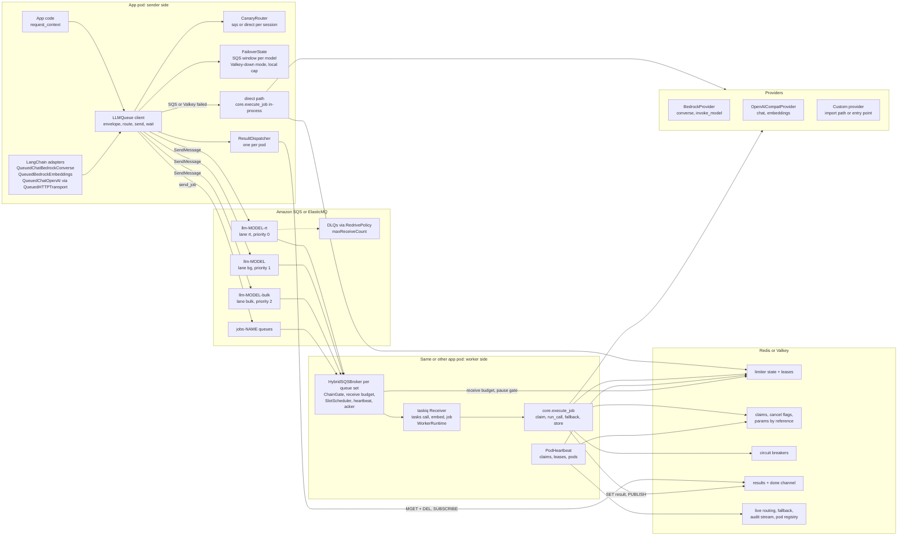
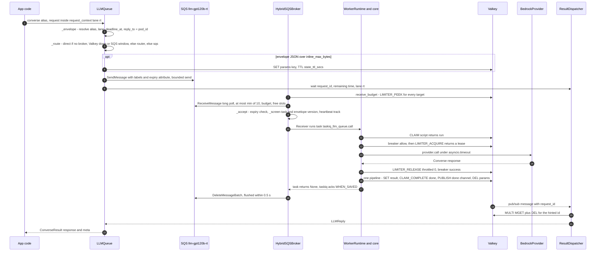
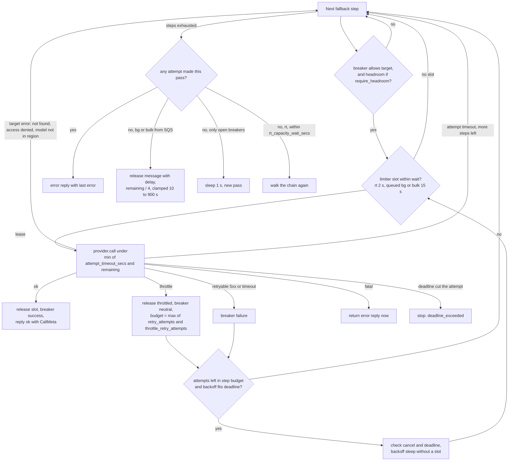
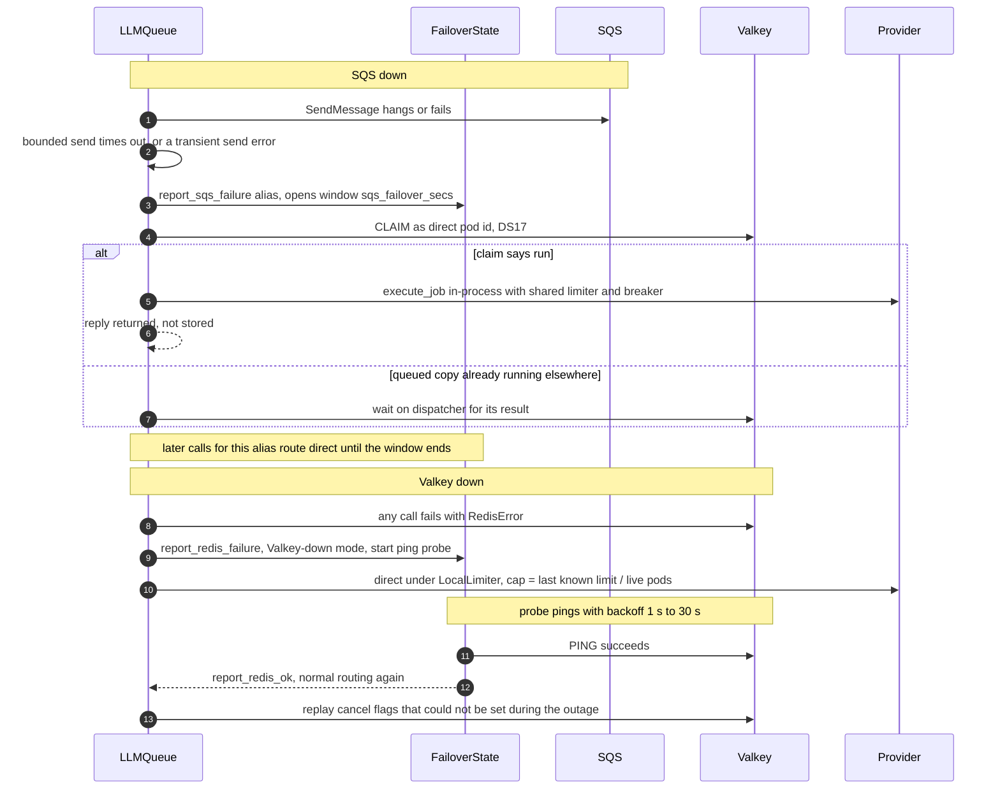
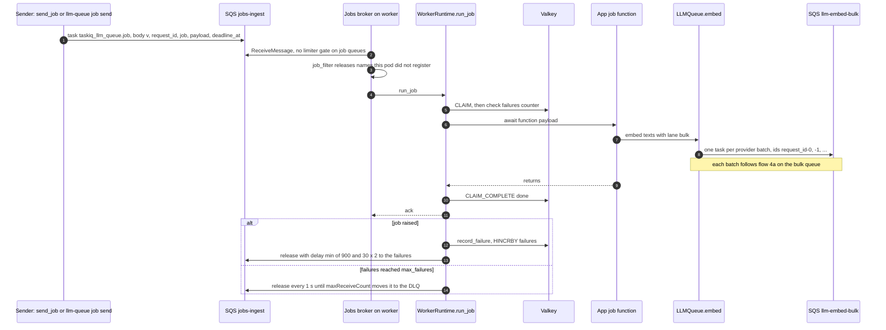
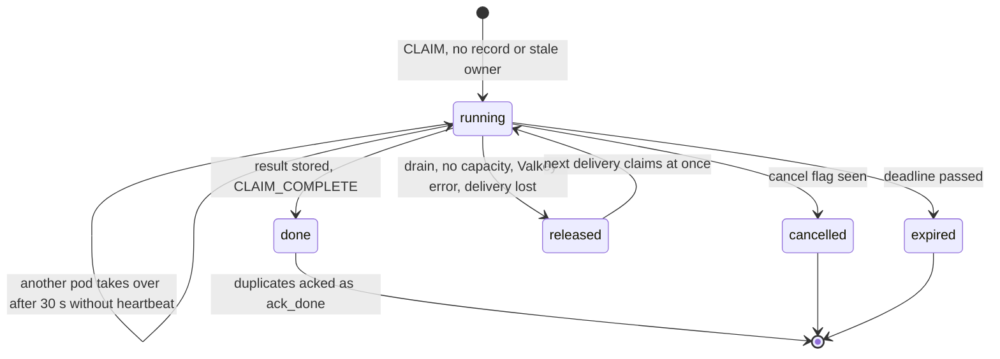
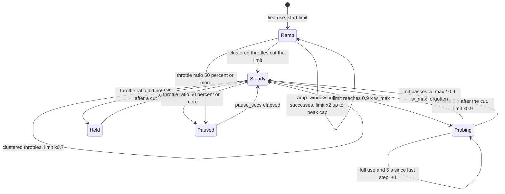
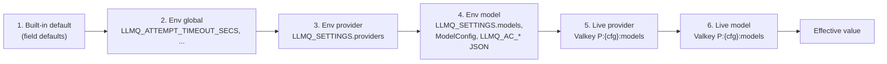

# Architecture

How `taskiq-llm-queue` 0.1.0a1 works end to end, for an engineer taking over the library. Every statement below was checked against `src/taskiq_llm_queue/**` at this release; anything not verified is marked **unverified**. The rule IDs used in code comments (DS1–DS19, P1–P17, A1–A9) are defined in [DESIGN.md](DESIGN.md) and are not repeated here. Scenario IDs (S01–S52) refer to the harness in `tools/scenarios` (see [§9](#9-testing-and-verification)).

**Contents:** [1 Summary](#1-summary) · [2 Components](#2-components) · [3 Dependencies](#3-dependencies) · [4 Data flows](#4-data-flows) · [5 Adaptive limiter](#5-adaptive-limiter) · [6 Key schema and wire format](#6-valkey-key-schema-and-wire-format) · [7 Configuration](#7-configuration-reference) · [8 Observability](#8-observability) · [9 Testing](#9-testing-and-verification) · [10 Glossary](#10-glossary)

---

## 1. Summary

`taskiq-llm-queue` is an LLM request client with its own durable queue. An app calls `LLMQueue.converse / chat / embed / invoke_model` (or a LangChain adapter). Each call becomes a taskiq task on an Amazon SQS queue chosen by model alias and lane. Worker coroutines inside the same app pods (no separate worker service) receive it, claim it in Valkey so it runs once, take a slot from a cluster-wide adaptive concurrency limiter that learns each provider's capacity from throttles, call Bedrock or an OpenAI-compatible server with retry and fallback, and write the reply to Valkey, where the sender's per-pod `ResultDispatcher` picks it up. If SQS or Valkey fail, the sender runs the call in-process (`direct`) under the same or a local limit.

| Use it when | Don't use it when |
|---|---|
| Several pods share one provider quota and throttling (429 / `ThrottlingException`) is a real problem | One process, low volume: a plain SDK client with retries is simpler |
| Traffic is bursty and calls may wait seconds in a queue instead of failing | Every call needs token streaming (streaming is forced off; one full message is returned) |
| Live chat must stay ahead of background and bulk work | You cannot run SQS and Redis/Valkey (both are required for the queued path) |
| You want fallback across regions, cross-region profiles and models, changeable at runtime | You need the OpenAI Responses API (`/responses` is not supported by the transport) |

---

## 2. Components

### Component map



Notes on the map:

- **One process plays both roles** with `start(mode="both")`; `mode="send"` skips the receivers, `mode="work"` skips the dispatcher. The `PodHeartbeat` runs in every mode.
- **S3 offload is not on this path.** `S3OffloadMiddleware` (P9) and `S3ResultBackend` (P10) ship in `taskiq_llm_queue.broker` / `.results` for direct broker users, but `lifecycle.build_brokers` does not install them. `LLMQueue` moves large params to **Valkey** instead (`params_ref`, [§4a](#4a-rt-converse-happy-path)).
- **DLQs are SQS infrastructure.** The library never creates queues by default (`SQSQueue.is_declare=False`); DLQs and `maxReceiveCount` come from each queue's `RedrivePolicy` (10 for LLM queues, 5 for job queues in `docker/elasticmq.conf`).

### Source map

| Module | Responsibility |
|---|---|
| `client.py` | `LLMQueue`: `start` / `stop`, public calls, envelope build, routing, `_via_sqs` / `_direct` / `_wait`, sync runner, `_LocalLimiters` |
| `config.py` | `QueueConfig`, `ModelConfig`, `Target`, `Lane`, `LimiterTuning`, `BreakerTuning`, `from_env`, `create_redis`, `redis_pool_size` |
| `envelope.py` | `Envelope` v1, `LLMReply`, `CallMeta`, task names, `parse_envelope`, keyed BLAKE2b `hashed_id` |
| `context.py` | `request_context` / `current_context` (lane, session, user via `ContextVar`) |
| `routing.py`, `routing_hooks.py` | `CanaryRouter` + `RoutingConfig`; protocols `PathRouter`, `FailoverPolicy`; `QueueHooks` |
| `failover.py` | `FailoverState`: SQS failover window per alias, Valkey-down mode with probe, local cap |
| `lifecycle.py` | `build_brokers`, `ChainGate`, `receive_budget`, `Workers` (receivers + drain), `PodHeartbeat`, `PodRegistry`, `MetricsHooks` |
| `tasks.py` | The three taskiq tasks, `WorkerRuntime` (`run_llm`, `run_job`, release rules), `WorkerResultBackend` |
| `core.py` | `execute_job` (claim → call → store, DS8 order), `run_call` (fallback, retry, limiter, breaker, timeouts), `ReplyCache` |
| `broker/` | `HybridSQSBroker` (pollers, scheduler, screening, send, release), `Acker`, `HeartbeatManager`, `MicroBatcher`, `SQSQueue` / `Batching` / `Heartbeat`, `WireSerializer`, error families, S3 offload |
| `reliability/` | `AdaptiveLimiter` / `SyncAdaptiveLimiter` / `PauseGate`, `LocalLimiter`, `RedisClaimStore`, `CircuitBreaker`, `resolve_fallback` / `FallbackConfig`, `LiveConfigStore`, all Lua in `_lua.py` |
| `results/` | `LLMQResultBackend` (JSON, `take_many`), `ResultDispatcher`, `S3ResultBackend` |
| `providers/` | `ProviderRegistry`, `BedrockProvider`, `OpenAICompatProvider`, error classification (`classify.py`), embedding batching |
| `langchain/`, `http_transport.py` | LangChain adapters; `QueuedHTTPTransport` answers OpenAI SDK HTTP requests from the queue |
| `cli.py` | `llm-queue` operator CLI |
| `metrics/`, `metrics_names.py`, `_logging.py` | `MetricsSink` (`NullMetrics`, `EmfMetrics`, `PrometheusMetrics`), metric names, structlog-over-stdlib loggers |

---

## 3. Dependencies

### Runtime dependencies (`pyproject.toml`)

| Package | Range | Used for | Where |
|---|---|---|---|
| `taskiq` | `>=0.13,<0.14` | Broker base class, `Receiver`, `TaskiqMessage`, ack types, result-backend interface. Bounded because the broker uses `Receiver` / `listen()` internals | `broker/broker.py`, `lifecycle.py`, `tasks.py` |
| `aiobotocore` | `>=2.23` | Async SQS client (broker, CLI), Bedrock runtime client, optional S3 | `broker/broker.py`, `providers/bedrock.py`, `cli.py`, `broker/s3_offload.py` |
| `redis` | `>=5.0.1` | Valkey client: Lua scripts, pipelines, pub/sub, blocking pools | `config.create_redis`, `reliability/*`, `results/*` |
| `pydantic` | `>=2.10,<3` | `QueueConfig`, `Envelope`, `LLMReply`, `FallbackConfig`, `RoutingConfig` validation | throughout |
| `orjson` | `>=3.10,<4` | JSON on hot paths: SQS bodies (`WireSerializer`), results, params | `broker/serializer.py`, `results/backend.py`, `client.py` |
| `structlog` | `>=24.1` | Key-value log API wrapped over stdlib `logging` | `_logging.py` |

### Extras

| Extra | Packages | Enables |
|---|---|---|
| `openai` | `openai>=1.40,<4`, `httpx>=0.27,<1` | `OpenAICompatProvider`, `QueuedHTTPTransport` |
| `langchain-aws` | `langchain-aws>=0.2.24,<2`, `langchain-core>=0.3.68,<2` | `QueuedChatBedrockConverse`, `QueuedBedrockEmbeddings` |
| `langchain-openai` | `langchain-openai>=0.3.26,<2`, `langchain-core>=0.3.68,<2` | `QueuedChatOpenAI`, `QueuedOpenAIEmbeddings` |
| `metrics` | `prometheus-client>=0.20` | `PrometheusMetrics` |
| `speedups` | `hiredis>=3` | C RESP parser, picked up by redis-py automatically |

### Infrastructure

| Dependency | Required | What the code does with it |
|---|---|---|
| SQS (standard queues) | For the queued path | Queues must exist (`GetQueueUrl`); per model `rt` / `default` / optional `bulk`, plus job queues. API calls: `ReceiveMessage`, `SendMessage`, `SendMessageBatch` (only with `Batching`), `DeleteMessage(Batch)`, `ChangeMessageVisibility(Batch)`, `GetQueueUrl`, `GetQueueAttributes`; `CreateQueue` only with `is_declare=True` |
| Redis / Valkey | For the queued path | Limiter, leases, claims, cancel flags, breaker, results, pub/sub, live config, audit stream, pod registry. Production notes from DS18: Multi-AZ and persistence; without persistence a restart loses claims ([§9 gaps](#known-gaps)) |
| S3 | Optional, not used by `LLMQueue` | Only via `S3OffloadMiddleware` / `S3ResultBackend` when a direct broker user installs them |
| AWS credentials | Yes for AWS | Default chain (env, profile, IRSA / Pod Identity); one `AioSession` per pod is shared by the brokers and `BedrockProvider` |
| IAM | Yes for AWS | The SQS actions above on the queues; Bedrock runtime `converse` / `invoke_model` on the model ids and inference profiles. **Unverified:** no IAM policy is checked in by this repo; derive it from the API list above |

### Development and test

| Tool | Role |
|---|---|
| `pytest`, `pytest-asyncio` (`asyncio_mode=auto`) | Test runner; default `testpaths = tests/unit` |
| `moto[server]` | Unit tests run a threaded moto server (aiobotocore cannot be patched in-process) |
| `fakeredis` | Unit tests without Valkey |
| `ruff`, `mypy` (strict, pydantic plugin), `types-aiobotocore[sqs,s3,bedrock-runtime]` | Lint and type checks (CI) |
| `langgraph`, LangChain 0.3 line | Adapter tests; the 1.x line runs in a separate CI job |
| `fakellm` (`tools/fakellm`) | Fake Bedrock Converse / InvokeModel and OpenAI chat / embeddings with real error shapes, SigV4 region detection, scenario YAML (`max_concurrency`, `throttle_rate`, timed phases) and `/admin` API |
| `docker/compose.yaml` | Default services `valkey` (8.1, password `localdev`, persistence off), `sqs` (ElasticMQ 1.7.1, queues from `docker/elasticmq.conf`), `fakellm`; profile `scn` = isolated `valkey-scn` :16379 and `sqs-scn` :19324 for the scenario harness; profile `scn-docker` = `worker-scn` container workers |
| `Makefile` / `tools/llmq_dev.py` | `up`, `down`, `test-unit`, `test-int`, `scenarios`, `load`, `chaos`, `capability`, ... (`uv run python tools/llmq_dev.py <task>` without make) |

---

## 4. Data flows

### 4a. rt converse happy path



1. **Envelope** (`LLMQueue._envelope`). `config.resolve(model)` rejects unknown `alias[@target]` with `ConfigError`. The lane is the `lane=` argument, else `current_context().lane` (default `bg`). `deadline_at = now + (timeout_secs or config.timeout_secs[lane])`, capped by the caller's `deadline_at`; embed calls use `embed_timeout_secs`. `reply_to` is this pod's `pod_id`; `request_id` defaults to `llm-<uuid4 hex>`.
2. **Route** (`LLMQueue._route`). `direct` when the alias has no broker (no `queues` configured), when `failover.redis_down()`, or when `failover.path_override(alias)` (SQS window open). Otherwise an injected `PathRouter`, else the built-in `CanaryRouter` when `routing_enabled`, else `sqs`. The canary routes by kill switch → user allowlist → per-model × lane percentage, bucketed by keyed BLAKE2b of `session_id` (else `user_id`), so a session is sticky. With `routing_enabled` and no stored config, every model routes `direct` (0 %).
3. **Params by reference** (`_maybe_by_reference`). If the envelope's JSON exceeds `inline_max_bytes` (200,000), params are stored at `<prefix>:{r:<id>}:params` with TTL `state_ttl_secs` and the envelope carries `params_ref` instead. A `RedisError` here reports Valkey failure and runs the call `direct`.
4. **Send** (`_via_sqs`). The `call` task (or `embed`) is kicked with `task_id = request_id` and labels `lane`, `model`, hashed `session_id` / `user_id`, `reply_to`, `queue_name`, `expiry = repr(deadline_at)`. `HybridSQSBroker.kick` turns `expiry` into an SQS message attribute and checks the 1 MiB limit. `build_brokers` configures no send batching, so each call is one `SendMessage`. `_bounded_send` waits at most `sqs_send_timeout_secs` (5) while no other send has completed recently, and never more than half the remaining budget.
5. **Wait.** `ResultDispatcher.wait(request_id, remaining, lane)` registers a future; see step 12.
6. **Receive** (`HybridSQSBroker._poll_once`, one poller per queue). The poller skips while its `ChainGate` is closed (every target paused, or Valkey down). `receive_budget` = best `LimiterState.headroom(share)` across the model's targets minus messages already buffered (DS4). `SlotScheduler` reserves slots by strict priority: per model broker `max_inflight` = `worker_slots[alias]` (default 50), `reserve_for_priority0 = slots // 5`, `min_slots_for_lower = min(2, slots // 4)`. After an empty poll the next receive asks for 1 message, so idle long polls hold one slot.
7. **Screen** (`_accept`, `_screen`). Expired (`expiry` attribute in the past) → deleted unrun. Unparseable, unknown task name, or an envelope `v` newer than 1 → released with 30 s visibility (DS9), never acked. The body is parsed once and the validated `TaskiqMessage` rides to the Receiver (`DeliveryFormatter`). Metadata labels (`sqs_receipt_handle`, `sqs_message_id`, `sqs_queue_name`, `sqs_approximate_receive_count`) are added; the visibility heartbeat starts tracking.
8. **Claim** (`execute_job` → `RedisClaimStore.claim`, Lua `CLAIM`). Returns `run`, `defer` (another worker holds it with a fresh heartbeat), or `ack_done` / `ack_cancelled` / `ack_expired`. Only `run` proceeds; the task registers in `WorkerRuntime.running` so the pod heartbeat refreshes it.
9. **Call** (`run_call`). `resolve_fallback` builds the step list ([§4b](#4b-fallback-retries-timeouts-and-the-breaker)). For each step: `CircuitBreaker.allow`, then `_take_slot` → `AdaptiveLimiter.acquire` (rt waits at most 2 s, `RT_ACQUIRE_SECS`). The lease joins the pod's lease set (renewed by `PodHeartbeat`). `provider.call(op, params_for_step(...), target)` runs under `asyncio.timeout(min(attempt_timeout_secs, remaining))`. The slot is released in `finally` (DS10).
10. **Store** (`_finish` → `_finish_pipelined`, DS8). One non-transactional pipeline: `SET` result (TTL `result_ttl_secs`, 300), `EVALSHA CLAIM_COMPLETE` (owner-checked), `PUBLISH <prefix>:done:<reply_to> <request_id>`, `DEL` params. If the `SET` is refused the steps run one by one. A store that keeps failing for `store_retry_secs` (30) raises `QueueUnavailable`; the reply is cached in the pod's `ReplyCache` and the message is released (redelivery to this pod reuses it without a second provider call).
11. **Ack.** The task returns `None`; `WorkerResultBackend.set_result` skips taskiq's own write; the Receiver (`AcknowledgeType.WHEN_SAVED`) acks; `Acker` sends `DeleteMessageBatch` (flushed at 0.5 s or 10 entries).
12. **Deliver** (`ResultDispatcher`). The pub/sub listener on `done:<pod>` hints the id and wakes the loop, which takes only hinted ids with `take_many` (`MULTI` + `MGET` + `DEL` on standalone Valkey, `GETDEL` per key on a cluster client). A periodic sweep over all waiters runs at the fastest pending lane's interval (`result_dispatch_ms`: rt 100, bg 500, bulk 2000), so a lost pub/sub message only delays a result. Measured: 1,000 ready results in one `MGET`; 1K waiters 26 MGET/s (CHANGELOG, S31).
13. **Return.** `_unwrap` maps `ok=False` replies to `LLMQueueCancelled`, `LLMQueueTimeout` (`deadline_exceeded`) or `ProviderError(retryable, retry_after_secs)`. `CallMeta` gives `served_model` (alias), `served_target` (target name), `fallback_used`, `attempts`, `queue_wait_ms` (enqueue → worker start), `provider_ms`, `worker` (pod id, or `direct:<pod>` / `sync:<pod>`).

Worker-side Valkey cost of a call is 6 round trips (CHANGELOG, measured): claim, breaker allow, acquire, release, breaker record, finish pipeline (plus a `GET` when params went by reference).

### 4b. Fallback, retries, timeouts and the breaker

Step order (`reliability/fallback.resolve_fallback`):

1. the requested target (`alias@target`, or the model's first target in `targets`, which is the primary);
2. the model's other targets in config order, minus live `skip_targets[alias]`;
3. only with `fallback="chain"` and op not `embeddings`: each model in the live `chains[alias]`, each with its targets (or the pinned `alias@target`), minus its `skip_targets`. Unknown aliases in the live chain are skipped, not raised.

So "region → APAC profile → other model" is `targets={"primary": Target(region=...), "apac": Target(profile_id=...)}` plus `chains={"gpt120b": ["gpt20b"]}` and `fallback="chain"`. `embed()` always sends `same_model`, so embeddings never switch model.



| Mechanism | Rule in code |
|---|---|
| Error classes | `Provider.classify(exc) -> ErrorInfo(kind)`, kind `throttle` / `retryable` / `fatal`, by error *family* (`providers/classify.py`), not exact code. Our own `TimeoutError` counts as retryable |
| Target errors (S38) | `is_target_error`: fatal families that name the target (`ResourceNotFound`, `AccessDenied`, model not found) or validation messages about the model / region / profile → next step, breaker neutral |
| Retry budget per step | `retry_attempts` (3); once the step throttled, `max(retry_attempts, throttle_retry_attempts)` (6) |
| Backoff | Retry *n* sleeps `uniform(base*mult^n, base*mult^n*spread)`: 1-2.5 s, 4-10 s, 16-30 s with the defaults; capped at `retry_max_secs` 30 s (`throttle_retry_max_secs` 10 s after a throttle); a larger `Retry-After` wins up to the cap; skipped if it would pass the deadline; no slot held while sleeping ([section 7a](#7a-settings-per-provider-and-per-model-model_settingspy)) |
| Per-attempt timeout (S39) | `attempt_timeout_secs` (180). If it fired before the deadline: `attempt_timeout`, and with more steps the call moves on instead of retrying the hung target. If the deadline fired: `deadline_exceeded` |
| SDK retries | Off: Bedrock `retries={"total_max_attempts": 1}`, OpenAI `max_retries=0`, so every 429 reaches the limiter |
| rt capacity | rt waits 2 s per step for a slot; when no step got a slot it walks the chain again until `rt_capacity_wait_secs` (30 s, live per model) has passed since the worker started it, never past the deadline, then `no_capacity` (S35b: 3 passes left 36 of 6,043 rt calls failing with 33–157 s to spare) |
| bg / bulk capacity (DS4) | A queued call waits at most 15 s per step (`QUEUED_ACQUIRE_SECS`) when more than 30 s remain; if no step ran, the claim is released and the message goes back to SQS with a delay of `remaining / 4` clamped to 10–900 s |
| Breaker | Per (alias, target), Lua `BREAKER`: opens after `CB_THRESHOLD` (5) counted failures within `CB_WINDOW_SECS` (30); half-open after `CB_COOLDOWN_SECS` (15) with one probe; probe success closes, failure reopens. Only `retryable` outcomes count; throttles and target errors are `neutral` (they free a half-open probe slot) |
| Live changes | `LiveConfigStore` reloads chains every `cfg_reload_secs` (30); invalid JSON keeps the last good value |

### 4c. Failover to the direct path and recovery



**SQS down.**

- Trigger: `SendTaskError`, `SQSSendError`, `QueueUnavailable` or `OSError` (including the `TimeoutError` from `_bounded_send`).
- Deterministic errors do not fail over: a too-large message, a bad label, `ValueError` / `TypeError` / `ConfigError`. They raise `LLMQueueError` to the caller.
- Otherwise `report_sqs_failure` opens a per-alias window of `sqs_failover_secs` (300): at once for a refused send, after `sqs_timeouts_to_failover` (3) send timeouts within 60 s for a timeout (one timeout in a busy burst is not an outage, H17). The call runs `_direct(envelope, claim=True)`: it takes the claim as `direct:<pod_id>` first (DS17), so if the ambiguous send did arrive, the queued copy is acked as done or deferred, never run twice.
- The DS17 claim is kept alive by the pod heartbeat's second `ClaimGroup`.
- Measured: first call served in 5.7 s with SQS stopped (S20).
- Recovery: the window simply expires (`sqs_failover_active` logs `sqs_failover_ended`); there is no SQS probe.

**Valkey down.**

- Triggers on the sender: a `RedisError` from params storage, a failed result poll or pub/sub read (`ResultDispatcher.on_error`, so a send-only pod notices too, S21), or `InfraError` from a direct run.
- Effects:
  - `redis_down()` is true while the probe runs: every call routes `direct`.
  - `_direct_deps` swaps in `_LocalLimiters`, whose `LocalLimiter` cap per target is `last_known_limit // live_pods`, or `local_limit_cap` (10) when either is unknown. Limits come from `_watch_limits` every 30 s; live pods come from `PodRegistry`.
  - Callers already waiting on a queued call get `ResultsUnavailable` once reads have failed for `valkey_wait_failover_secs` (10). They flag the call cancelled (queued in `_pending_cancels` while Valkey is down) and run it `direct`.
- If Valkey fails during a direct call before any provider attempt, the call runs again under the local cap. After an attempt started, the caller gets `QueueUnavailable`: never a second provider call.
- Workers: `ChainGate` closes and `receive_budget` returns 0, so nothing new is received. Running tasks that hit a `RedisError` raise `InfraError`; `WorkerRuntime._infra_release` releases the **SQS message first** (S50), then the claim.
- Recovery: the probe (`PING` with backoff 1 → 30 s) succeeds, `_probe_redis` replays pending cancel flags, and `report_redis_ok` restores normal routing. Local limiters with calls still in flight are kept aside in case Valkey flaps again.

**Kill switch / canary.** `llm-queue routing kill on` makes every pod route `direct` within one reload (`cfg_reload_secs`, 30 s). The direct path keeps the shared limiter and breaker. It has no claim and stores no result; cancellation works by cancelling the local asyncio task.

**Sync calls** (`*_sync`) always run `direct` on a private daemon thread loop (`_SyncRunner`) with `SyncAdaptiveLimiter` on a blocking Valkey client (or the local cap), counted in `llmq_sync_fallback_total`. `strict_async=True` makes them raise.

### 4d. Jobs, ingest and embeddings



- **Jobs** are app functions allow-listed per pod with `register_job(name, fn)`. `send_job(name, payload, job_id=, timeout_secs=, deadline_at=)` kiqs to `config.job_queues[name]` and returns the job id without waiting; the deadline defaults to `state_ttl_secs`. `llm-queue job send NAME --payload-file F --queue jobs-ingest` sends the same body straight to SQS with only send permission.
- The jobs broker has `worker_slots["jobs"]` slots (default 4), no gate and no receive budget; jobs are not rate limited themselves. The LLM calls a job makes are.
- The `lane` label on a job is informational. A job's LLM calls choose their lane by argument or `request_context`; an ingest job should pass `lane="bulk"`.
- **Embeddings** (`LLMQueue.embed`) split texts per provider batch limit (`providers/embeddings.max_batch_size`): Titan 1, Cohere v3 96, OpenAI-compatible 2048. One task per batch on the lane's queue (`bulk` → the model's `bulk` queue if configured, else `default`, else `rt`). Bedrock embeddings go as `invoke_model`, OpenAI-compatible as `embeddings`. Results come back in input order with merged `CallMeta`. `cancel(request_id)` cancels every batch.
- bg and bulk share `AC_BG_SHARE` (0.8) of each target's limit; rt may use all of it.
- Bulk is the lowest receive priority (2) on a model's broker.

### 4e. Cancellation, timeouts and expiry

| Event | Sender side | Worker side |
|---|---|---|
| `llmq.cancel(request_id)` | Cancels a local `direct` task; `SET <prefix>:{r:<id>}:cancel 1` (TTL `state_ttl_secs`), for every embed batch | Not started: `CLAIM` returns `ack_cancelled`, a `cancelled` reply is stored, message acked. Running: the flag is checked before every slot wait, during the wait (`should_abort`), right after acquiring and before every backoff sleep (DS14) → `_Stopped(CANCELLED)` → cancelled reply stored, claim `cancelled`, message acked. **A provider attempt already in flight is not interrupted**; if it succeeds, the ok reply is delivered |
| Caller's asyncio task cancelled while waiting | `_wait` sets the cancel flag (shielded), then re-raises `CancelledError` | As above |
| Caller deadline passes while waiting | Dispatcher raises `LLMQueueTimeout`; `_wait` sets the cancel flag | As above |
| Message expires while queued | — | `_accept` deletes it unrun if `expiry` < now (`on_expired`); a claim attempt after the deadline returns `ack_expired` |
| Deadline passes during the call | — | Attempt cap = min(`attempt_timeout_secs`, remaining): a deadline-cut attempt ends as `deadline_exceeded` (claim `expired`); the caller gets `LLMQueueTimeout` if still waiting |
| Visibility heartbeat past deadline | — | `HeartbeatManager` stops extending once `now > expiry + 60 s` (`deadline_grace_secs`); the message reappears and is deleted as expired |

Per-call timing defaults:

| Timer | Default | Source |
|---|---|---|
| Call deadline (`timeout_secs`) | rt 90 s, bg 300 s, bulk 900 s | `QueueConfig.timeout_secs` |
| Embed deadline | rt 10 s, bg 60 s, bulk 300 s | `QueueConfig.embed_timeout_secs` |
| One provider attempt | 180 s, capped by remaining | `attempt_timeout_secs` |
| Provider socket | read 300 s, connect 10 s | `provider_read_timeout_secs`, `provider_connect_timeout_secs` |
| SQS send | 5 s while no other send completed, at most half the remaining budget | `sqs_send_timeout_secs` |
| Result read failure before direct | 10 s | `valkey_wait_failover_secs` |
| Result write retries | 30 s (then `ReplyCache` + release) | `core.STORE_RETRY_SECS` |

### 4f. Worker crash, claims, heartbeats, DLQ and shutdown



Two independent heartbeats keep a running call safe:

| Heartbeat | What | Interval | On failure |
|---|---|---|---|
| SQS visibility (`broker/heartbeat.HeartbeatManager`) | `ChangeMessageVisibilityBatch` back to the queue's visibility timeout for every tracked delivery | `visibility / 3` | `ReceiptHandleIsInvalid` / not in flight → `Delivery.lost`, `WorkerRuntime.on_lost` cancels the task (no result written), claim released for the new owner (DS6) |
| Claims, leases, pods (`lifecycle.PodHeartbeat`) | `CLAIM_HEARTBEAT` for worker ids (`pod_id`) and DS17 direct ids (`direct:<pod_id>`); `LEASE_RENEW` for every lease of this pod (worker, direct and sync); `PodRegistry.beat` | 10 s (`ClaimSettings.heartbeat_interval_secs`) | A claim owned by another worker, or gone, is "lost": worker tasks stop with reason `claim_lost`, message released after 20 s, no result |

- **Crash.** Visibility extensions stop, so the message reappears after the queue's visibility timeout. The next `CLAIM` sees `running` with a heartbeat older than 3 × 10 s and takes over (`reclaims` counter). With a fresh heartbeat it returns `defer` and the message is released for 20 s (`defer_secs = 2 × heartbeat`). The dead pod's limiter leases expire within `AC_LEASE_TTL_SECS` (60); its pod-registry entry within 30 s.
- **Redeliveries and the DLQ** (DS5). SQS moves a message to the DLQ after `maxReceiveCount` receives.
  - Releases (defer, no capacity, infra errors, unknown task) count as receives, which is why the receive budget avoids receiving what can't run.
  - Provider errors on LLM calls are *not* redelivered: the error reply is stored and the message acked.
  - A body that is not even a taskiq message is released (30 s) until it dead-letters. A taskiq message with a malformed envelope is acked and dropped (`poison_task_dropped`), with an `invalid_envelope` error reply if it names a `request_id`.
  - Jobs count real failures in the claim's `failures` field and are released toward the DLQ after `max_failures` (3).
  - A worker that lacks a model alias releases the message unclaimed every 10–15 s for up to 8 deliveries, then answers `model_not_configured` (S48).
- **Graceful shutdown** (`LLMQueue.stop()`, §7.4 in code comments):
  1. `Workers.drain`: `pause_receiving` stops pollers taking new work and releases buffered, unstarted messages (visibility 0).
  2. Receivers get `drain_secs` (`LLMQ_CONSUMER_DRAIN_SECS`, 45) to finish running tasks.
  3. Leftovers are cancelled and handed back: claim `released`, message visible at once.
  4. Router, failover probe, background loops and the dispatcher stop; waiting callers on this pod get `QueueUnavailable`.
  5. `broker.shutdown()`: pollers finish their in-flight long poll (grace = wait time + 2 s), remaining deliveries are released, batchers and the acker flush.
  6. Providers, the pod-registry entry, the Valkey pool and the sync runner close.
  7. `pause_receiving()` / `resume_receiving()` are also public for a `/drain` endpoint.

---

## 5. Adaptive limiter

One limiter state per **(model alias, target name)**, shared by every pod through Valkey. Every decision is one Lua script that reads the clock with Valkey `TIME`, so clock skew between pods does not matter. `AdaptiveLimiter` (async), `SyncAdaptiveLimiter` (sync callers) and the CLI run the same scripts.

**Slots are leases** (DS11). `LIMITER_ACQUIRE` counts live leases (`ZCOUNT` with score > now) in `<prefix>:{m:<alias>:<target>}:lease`:

- Paused → refuse, with the pause remaining.
- `inflight >= max(1, floor(limit × share))` → refuse; `share` is 1.0 for rt and `bg_share` (0.8) for bg / bulk.
- Otherwise `ZADD token now + lease_ttl_secs` (60 s); expired leases are pruned only when a slot is granted, so a refusal writes nothing.
- The pod heartbeat renews held leases every 10 s, so a crashed pod's slots return within 60 s. A lease whose release failed is remembered as an orphan and removed on the next limiter call.

**The limit moves only on release** (`LIMITER_RELEASE`, inputs: throttled flag, the concurrency the attempt ran at). Defaults are `LimiterSettings`; the ones marked † are not exposed through `QueueConfig` / `LLMQ_*` (only by building `LimiterSettings` directly).

| Step | Rule (as implemented) | Defaults |
|---|---|---|
| Start | Stored limit wins; else `LLMQ_AC_INITIAL[alias]`, else `ModelConfig.limiter_initial`; clamped to [`AC_MIN`, cap] where cap = min(`max_concurrency` / `LLMQ_AC_MAX_BY_MODEL[alias]`, `AC_MAX`); `ramp = 1` | 20, [2, 2000] |
| Cap (bucket size) | `ModelConfig.max_concurrency` or `LLMQ_AC_MAX_BY_MODEL` (JSON alias → int): hard ceiling per model + target across all pods; growth, ramp and the Valkey-down local cap never exceed it; bg/bulk get `bg_share` of it. `limiter_initial == max_concurrency` = fixed bucket that only shrinks on real throttling. Measured (S53): 2,000 queued, cap 10 → provider peak 10, 0 lost, 0 duplicate | None (adaptive up to `AC_MAX`) |
| Outcome window | Successes and throttles counted in a sliding window with carry-over from the previous window | `window_secs` 1 s † |
| Cut condition | Effective throttles ≥ `min_throttles` **and** throttle ratio ≥ `loss_tolerance` **and** ≥ one window since the last cut **and** the attempt started after the last cut (one cut per round trip) | 2 †, 5 % † |
| Cut size | `limit × decrease_factor`; but when probing near the last cut point (`w_max`) and ≥ `probe_secs` since the cut, only back to `limit × settle_ratio` | 0.7, 0.9 †, 5 s † |
| Futile-cut hold | Within 10 windows of the last cut, if the throttle ratio is still ≥ `hold_ratio` × the ratio at that cut, cutting did not help: the limit is not cut below the start value | 0.6 † |
| On cut | `w_max = old limit`, `ramp = 0`, `ok_count = 0` | — |
| Pause | Only when the throttle ratio ≥ `pause_ratio`: `paused_until = now + pause_secs`; receivers stop polling that target's queues (`PauseGate` → `ChainGate`) | 0.5 †, 2 s |
| Busy rule (DS12) | A success counts toward growth only if `inflight ≥ utilisation × allowed`; idle traffic never raises the limit | 0.9 |
| Peak cap | Growth never exceeds `2 × peak inflight`; the peak decays with a half-life | 300 s † |
| Ramp | While `ramp = 1`: every `ramp_window` busy successes, `limit = min(ramp_cap or AC_MAX, peak cap, 2 × limit)` | 50 |
| Additive growth | +1 per `min(increase_every, ceil(limit / 2))` busy successes | 20 |
| Probing (S07) | Between `settle_ratio × w_max` and `w_max / settle_ratio`: +1 at most every `probe_secs`, and only when every allowed slot is in use; past `w_max / settle_ratio` the old ceiling is forgotten | 5 s † |



`Paused` and `Held` are overlays on the limit value, not stored phases; the only stored phase flag is `ramp`. [DESIGN.md](DESIGN.md)'s limiter diagram ("pause M 1–5 s", "x2 per success window") is an older simplification; the table above is what `_lua.py` does.

Measured effect of the cut rules (CHANGELOG, scenario harness):

| Scenario | Before | After |
|---|---|---|
| S35: 10K burst, 2 % random throttles | 22.5 req/s, 6,721 ok | 76.1 → 90.4 req/s, 10,000 ok |
| S07: capacity 50, offered 200 | limit swung 44–64 | settles at 57–63 |
| S35b: 10K burst, 30 % random throttles + worker kill | 16.3 req/s, 17.5 % ok | 49.7–59.3 req/s, 99.2 % ok |

**Valkey-down variant.** `LocalLimiter` has no learning: a fixed per-pod cap per target (`local_cap`), the same lane share, and a pause after a throttle storm (≥ 2 throttles making up ≥ 50 % of a 1 s window).

---

## 6. Valkey key schema and wire format

### Keys (`keys.KeySpace`, schema 2)

`P` is `key_prefix` (default `llmq:local`). Hash tags (`{...}`) put the keys one Lua script touches into one cluster slot.

| Key | Type | Written by | TTL | Content |
|---|---|---|---|---|
| `P:{r:ID}:job` | hash | `CLAIM`, `CLAIM_HEARTBEAT`, `CLAIM_COMPLETE`, `CLAIM_RELEASE`, `record_failure` | `max(state_ttl_secs, deadline_at − now + exec_max)` on claim and every heartbeat; terminal states kept ≥ `state_ttl_secs` (1800 s). `exec_max` = longest lane timeout (900 s) | `state` (`running`, `done`, `cancelled`, `expired`, `released`), `worker`, `heartbeat_at`, `deadline_at`, `reclaims`, `failures` |
| `P:{r:ID}:cancel` | string `1` | `RedisClaimStore.cancel` | `state_ttl_secs` | Cancel flag (DS14) |
| `P:{r:ID}:params` | string (JSON) | sender `_maybe_by_reference` | `state_ttl_secs`; deleted after the result is stored | Params over `inline_max_bytes` |
| `P:{r:ID}:res` | string (JSON) | worker `_finish`, `WorkerResultBackend` | `result_ttl_secs` (300 s); deleted on read | taskiq result JSON wrapping an `LLMReply` |
| `P:{m:ALIAS:TARGET}:ac` | hash | `LIMITER_ACQUIRE` / `RELEASE` | none | `limit`, `ramp`, `ok_count`, `paused_until`, `last_decrease`, `last_increase`, `w_max`, `cut_ratio`, `last_hold`, `peak`, `peak_at`, window counters `win_start` `win_ok` `win_thr` `prev_ok` `prev_thr` |
| `P:{m:ALIAS:TARGET}:lease` | sorted set | `LIMITER_ACQUIRE`, `LEASE_RENEW` | none on the key; members scored by expiry | Lease tokens |
| `P:{m:ALIAS:TARGET}:cb` | hash | `BREAKER` | none | `state`, `opened_at`, `fail_count`, `window_start`, `probes`, `probe_at` |
| `P:{cfg}:routing` | string (JSON) | `LiveConfigStore.set` (CLI) | none | `RoutingConfig` |
| `P:{cfg}:fallback` | string (JSON) | `LiveConfigStore.set` (CLI) | none | `FallbackConfig` (`chains`, `skip_targets`) |
| `P:{cfg}:models` | string (JSON) | `LiveConfigStore.set` (CLI) | none | `ModelSettings` (live per-provider / per-model overrides, [section 7a](#7a-settings-per-provider-and-per-model-model_settingspy)) |
| `P:{cfg}:audit` | stream | `CONFIG_SET`, CLI resets | trimmed to 90 days (`XTRIM MINID`) | `key`, `actor`, `before`, `after`, `ts` |
| `P:pods` | sorted set | `PodRegistry.beat` | `EXPIRE` 60 s, members expire after 30 s | Live pod ids (for the local cap) |
| `P:done:POD` | pub/sub channel | worker `PUBLISH` | — | Request id whose result is ready |
| `P:schema` | — | **never written** | — | Defined in `KeySpace.schema` (`SCHEMA_VERSION = 2`) but no code writes or checks it |

`ID` is the request id (= the taskiq task id); `ALIAS` is the model alias and `TARGET` the target name from `ModelConfig.targets`, not the provider model id.

### SQS message

The SQS body is a taskiq message serialized by `WireSerializer` (orjson, UTF-8, readable by taskiq's stdlib JSON serializer):

```json
{
  "task_id": "llm-<hex>",
  "task_name": "taskiq_llm_queue.call",
  "labels": {"lane": "rt", "model": "gpt120b", "session_id": "<16 hex>", "user_id": "<16 hex>",
             "reply_to": "pod-1a2b3c4d", "queue_name": "llm-gpt120b-rt", "expiry": "1767000000.5"},
  "labels_types": null,
  "args": [ { "...": "Envelope, below" } ],
  "kwargs": {}
}
```

- Message attribute `expiry` (`Number`) mirrors the label; the broker deletes expired messages on receive (P11).
- `session_id` / `user_id` labels are the keyed BLAKE2b (8 bytes, hex) of the raw ids when `hash_ids` is on; the raw ids stay inside the envelope.
- Task names `taskiq_llm_queue.call`, `.embed`, `.job` are stable for 0.x ([STABILITY.md](../STABILITY.md)). `embed` carries the same envelope as `call`; the name only separates embedding traffic.
- **Unverified:** the exact top-level field set of the taskiq message beyond the fields shown is taskiq's (`>=0.13,<0.14`); it was not re-checked against the installed taskiq.

**`Envelope` v1** (`envelope.py`, `extra="forbid"`):

| Field | Meaning |
|---|---|
| `v` | 1. Workers accept `v` and `v − 1`; newer → `UnsupportedEnvelopeError` → released, not acked |
| `request_id`, `parent_request_id` | Task id; the parent is the embed call id when it was split into batches |
| `session_id`, `user_id` | Raw ids from `request_context` |
| `reply_to` | Sender pod id (the done channel) |
| `lane`, `op`, `fallback` | `rt`/`bg`/`bulk`; `converse`/`invoke_model`/`chat`/`embeddings`; `same_model`/`chain` |
| `model` | `alias[@target]` |
| `params` xor `params_ref` | Provider-native request (passed through unchanged) or the Valkey key holding it |
| `est_tokens`, `trace` | Carried, not used by the library today |
| `enqueued_at`, `deadline_at` | Epoch seconds; `deadline_at ≥ enqueued_at` is validated |

**Job body** (`send_job`, `llm-queue job send`): `{"v": 1, "request_id": "job-<hex>", "job": NAME, "payload": {...}, "deadline_at": epoch}` as the single arg of `taskiq_llm_queue.job`.

**Result** (`results/backend.encode_reply`): `{"is_err": false, "log": null, "return_value": <LLMReply>, "execution_time": 0.0, "labels": {}, "error": null}`. `LLMReply` = `request_id`, `ok`, `response` (provider-native; for `invoke_model` it is `{"body_b64", "contentType"}`), `meta` (`CallMeta`), `error` (`type`, `message`, `retryable`, `kind`, `retry_after_secs`), `cancelled`.

---

## 7. Configuration reference

`QueueConfig.from_env()` reads `LLMQ_*`. All bad values are collected into one `ConfigError` at boot. Duration names end in `_SECS`; older `_S` spellings are not read. Every field can also be passed to `QueueConfig(...)` directly.

**Valkey / Redis**

| Field | Env | Default |
|---|---|---|
| `key_prefix` | `LLMQ_KEY_PREFIX` | `llmq:local` |
| `redis_url` | `LLMQ_REDIS_URL` | None (wins over host/port/ssl when set) |
| `redis_host`, `redis_port` | `LLMQ_REDIS_HOST`, `LLMQ_REDIS_PORT` | `localhost`, 6379 |
| `redis_username`, `redis_password` | `LLMQ_REDIS_USERNAME`, `LLMQ_REDIS_PASSWORD` | None (`SecretStr`) |
| `redis_ssl` | `LLMQ_REDIS_SSL` | false |
| `redis_max_connections` | `LLMQ_REDIS_MAX_CONNECTIONS` | 32, raised to worker slots + jobs slots + 16 (`redis_pool_size`) |
| `redis_socket_timeout_secs`, `redis_socket_connect_timeout_secs` | `LLMQ_REDIS_SOCKET_TIMEOUT_SECS`, `LLMQ_REDIS_SOCKET_CONNECT_TIMEOUT_SECS` | 5, 2 |
| `redis_health_check_interval_secs` | `LLMQ_REDIS_HEALTH_CHECK_INTERVAL_SECS` | 30 |
| `redis_retry_attempts` | `LLMQ_REDIS_RETRY_ATTEMPTS` | 3 (connection errors, exponential backoff 0.1–1 s) |
| `redis_client_name` | `LLMQ_REDIS_CLIENT_NAME` | `taskiq-llm-queue` (+ `:<pod_id>`) |

**AWS and SQS**

| Field | Env | Default |
|---|---|---|
| `aws_region` | `LLMQ_AWS_REGION` | None (AWS chain decides) |
| `sqs_endpoint_url`, `bedrock_endpoint_url` | `LLMQ_SQS_ENDPOINT_URL`, `LLMQ_BEDROCK_ENDPOINT_URL` | None (ElasticMQ / fakellm locally) |
| `sqs_wait_time_secs` | `LLMQ_SQS_WAIT_TIME_SECS` | 20 (long poll) |
| `sqs_send_timeout_secs` | `LLMQ_SQS_SEND_TIMEOUT_SECS` | 5 |
| `sqs_failover_secs` | `LLMQ_SQS_FAILOVER_SECS` | 300 |
| `sqs_timeouts_to_failover` | `LLMQ_SQS_TIMEOUTS_TO_FAILOVER` | 3 |

**Models and providers**

| Field | Env | Default |
|---|---|---|
| `models` | `LLMQ_MODELS` (JSON: alias → `ModelConfig`) | `{}` |
| `providers` | `LLMQ_PROVIDERS` (JSON: name → `"pkg.mod:Class"`) | `{}` |
| `allowed_providers` | `LLMQ_ALLOWED_PROVIDERS` (comma list) | `bedrock,openai` |
| `denied_hosts` | `LLMQ_DENIED_HOSTS` (comma list of host patterns) | empty |

`ModelConfig`: `provider`, `model_id`, `targets` (name → `Target(region | profile_id | base_url)`, first = primary, default `{"primary": Target()}`), `queues` (`rt` / `default` / `bulk` → queue name or URL; no queues = always `direct`), `limiter_initial` (20), `max_concurrency` (None; per model + target cap across pods), `api_key_env`. Aliases are lowercase, no `@`.

**Timeouts, retry, results**

| Field | Env | Default |
|---|---|---|
| `timeout_secs` | `LLMQ_TIMEOUT_RT_SECS` / `_BG_` / `_BULK_` | 90 / 300 / 900 |
| `embed_timeout_secs` | `LLMQ_TIMEOUT_EMBED_RT_SECS` / `_BG_` / `_BULK_` | 10 / 60 / 300 |
| `attempt_timeout_secs` | `LLMQ_ATTEMPT_TIMEOUT_SECS` | 180 (unverified default per its own docstring) |
| `provider_read_timeout_secs`, `provider_connect_timeout_secs` | `LLMQ_PROVIDER_READ_TIMEOUT_SECS`, `LLMQ_PROVIDER_CONNECT_TIMEOUT_SECS` | 300, 10 |
| `retry_attempts`, `retry_base_secs` | `LLMQ_RETRY_ATTEMPTS`, `LLMQ_RETRY_BASE_SECS` | 3, 1.0 |
| `retry_multiplier`, `retry_spread`, `retry_max_secs` | `LLMQ_RETRY_MULTIPLIER`, `LLMQ_RETRY_SPREAD`, `LLMQ_RETRY_MAX_SECS` | 4, 2.5, 30 |
| `throttle_retry_max_secs` | `LLMQ_THROTTLE_RETRY_MAX_SECS` | 10 |
| `rt_capacity_wait_secs` | `LLMQ_RT_CAPACITY_WAIT_SECS` | 30 |
| `throttle_retry_attempts` | `LLMQ_THROTTLE_RETRY_ATTEMPTS` | 6 |
| `max_failures` | `LLMQ_MAX_FAILURES` | 3 (jobs) |
| `state_ttl_secs`, `result_ttl_secs` | `LLMQ_STATE_TTL_SECS`, `LLMQ_RESULT_TTL_SECS` | 1800, 300 |
| `inline_max_bytes` | `LLMQ_INLINE_MAX_BYTES` | 200,000 |
| `result_dispatch_ms` | `LLMQ_RESULT_DISPATCH_MS` (`rt:100,bg:500`) | rt 100, bg 500, bulk 2000 |
| `valkey_wait_failover_secs` | `LLMQ_VALKEY_WAIT_FAILOVER_SECS` | 10 |

**Workers, jobs, live config, privacy**

| Field | Env | Default |
|---|---|---|
| `worker_slots` | `LLMQ_WORKER_SLOTS` (`gpt120b:80,jobs:8`) | 50 per model broker, 4 for `jobs` |
| `drain_secs` | `LLMQ_CONSUMER_DRAIN_SECS` | 45 |
| `job_queues` | `LLMQ_JOB_QUEUES` (JSON: job name → queue) | `{}` |
| `strict_async` | `LLMQ_STRICT_ASYNC` | false |
| `cfg_reload_secs` | `LLMQ_CFG_RELOAD_SECS` | 30 |
| `fallback_default` | `LLMQ_FALLBACK_CHAINS` (JSON `FallbackConfig`) | `{}` |
| `routing_enabled`, `routing_default` | `LLMQ_ROUTING_ENABLED`, `LLMQ_ROUTING_DEFAULT` (JSON) | false, `{}` |
| `settings_default` | `LLMQ_SETTINGS` (JSON `ModelSettings`: `providers`, `models`) | `{}` ([section 7a](#7a-settings-per-provider-and-per-model-model_settingspy)) |
| `local_limit_cap` | `LLMQ_LOCAL_LIMIT_CAP` | 10 |
| `hash_ids` | `LLMQ_HASH_IDS` | true |
| `id_hash_salt` | `LLMQ_ID_HASH_SALT` | public constant; **set your own in production**, shared by all pods (1–64 bytes) |

**Limiter (`limiter: LimiterTuning`) and breaker (`breaker: BreakerTuning`)**

| Field | Env | Default |
|---|---|---|
| `initial` | `LLMQ_AC_INITIAL` (JSON alias → int) | `{}` (falls back to `limiter_initial`) |
| `max_by_model` | `LLMQ_AC_MAX_BY_MODEL` (JSON alias → int) | `{}` (falls back to `ModelConfig.max_concurrency`, else `max_limit`) |
| `min_limit`, `max_limit` | `LLMQ_AC_MIN`, `LLMQ_AC_MAX` | 2, 2000 |
| `ramp_window`, `increase_every` | `LLMQ_AC_RAMP_WINDOW`, `LLMQ_AC_INCREASE_EVERY` | 50, 20 |
| `decrease_factor` | `LLMQ_AC_DECREASE_FACTOR` | 0.7 |
| `pause_secs` | `LLMQ_AC_PAUSE_SECS` | 2.0 |
| `bg_share` | `LLMQ_AC_BG_SHARE` | 0.8 |
| `ramp_cap` | `LLMQ_AC_RAMP_CAP` | None |
| `lease_ttl_secs` | `LLMQ_AC_LEASE_TTL_SECS` | 60 |
| `utilisation` | none (constructor only) | 0.9 |
| breaker `threshold`, `window_secs`, `cooldown_secs` | `LLMQ_CB_THRESHOLD`, `LLMQ_CB_WINDOW_SECS`, `LLMQ_CB_COOLDOWN_SECS` | 5, 30, 15 |

Not configurable through `QueueConfig` (code constants or dataclass defaults): limiter window / cut knobs († in [§5](#5-adaptive-limiter)), claim heartbeat 10 s and staleness 3 beats (`ClaimSettings`), breaker `half_open_probes` 1, failover probe backoff 1–30 s (`FailoverSettings`), `RT_ACQUIRE_SECS` 2, `QUEUED_ACQUIRE_SECS` 15, `STORE_RETRY_SECS` 30.

### 7a. Settings per provider and per model (`model_settings.py`)

A provider (e.g. `bedrock`, `openai`) serves several model aliases. Limits, timeouts, retries and breaker thresholds can be set once for a provider, overridden for one model, and changed on every pod without a restart. Each setting resolves through six layers; the highest layer that has a value wins:



Layers 3-6 share one JSON shape, `ModelSettings` (`config.py`):

```json
{
  "providers": {"openai": {"shared_max_concurrency": 40, "attempt_timeout_secs": 120}},
  "models":    {"gpt120b": {"max_concurrency": 30, "timeout_secs": {"rt": 60}, "bg_share": 0.7}}
}
```

Layers 3-4 come from `LLMQ_SETTINGS` (validated at boot; a bad value is a `ConfigError`); layers 5-6 are the live value in Valkey, edited with `llm-queue settings`. `SettingsResolver(config, live)` answers `resolve(alias, name, lane) -> (value, source)`; it is immutable, so a reload swaps one object and a call reads one consistent snapshot.

| Setting (provider or model) | Env global (layer 2) | Read where | Effect of a change |
|---|---|---|---|
| `max_concurrency` (bucket per model + target) | none (`ModelConfig.max_concurrency`, `LLMQ_AC_MAX_BY_MODEL` are layer 4) | limiter `max_for` on every acquire / release; receive budget | Lower: the next acquire clamps the stored limit; calls in flight finish, new ones wait. Higher: the adaptive limit may grow to it |
| `limiter_initial` | none (`ModelConfig.limiter_initial`, `LLMQ_AC_INITIAL` are layer 4) | limiter `start_for` | Only while no learned limit exists (new target, or after `limiter reset`) |
| `bg_share` | `LLMQ_AC_BG_SHARE` | limiter `share_for(lane, model)`, receive budget | Next `bg` / `bulk` acquire |
| `timeout_secs.<lane>`, `embed_timeout_secs.<lane>` | `LLMQ_TIMEOUT_<LANE>_SECS`, `LLMQ_TIMEOUT_EMBED_<LANE>_SECS` | sender `LLMQueue._envelope` | Calls sent after the reload; a call keeps the deadline it was sent with |
| `attempt_timeout_secs` | `LLMQ_ATTEMPT_TIMEOUT_SECS` | `core.run_call`, per fallback step alias | Next attempt |
| `throttle_retry_attempts` | `LLMQ_THROTTLE_RETRY_ATTEMPTS` | `core.run_call`, per step alias | Next throttled step |
| `retry_base_secs`, `retry_multiplier`, `retry_spread`, `retry_max_secs`, `throttle_retry_max_secs` | `LLMQ_RETRY_BASE_SECS`, `LLMQ_RETRY_MULTIPLIER`, `LLMQ_RETRY_SPREAD`, `LLMQ_RETRY_MAX_SECS`, `LLMQ_THROTTLE_RETRY_MAX_SECS` | `core.backoff_secs`, per step alias | Next backoff sleep |
| `breaker_threshold`, `breaker_cooldown_secs` | `LLMQ_CB_THRESHOLD`, `LLMQ_CB_COOLDOWN_SECS` | `CircuitBreaker._run` (`by_model`) | Next breaker call of that alias |
| `rt_capacity_wait_secs` | `LLMQ_RT_CAPACITY_WAIT_SECS` | `core.run_call` (envelope alias) | Next rt call |
| `shared_max_concurrency` (**provider only**) | none | `core._take_slot`, receive budget | Next acquire |

**Provider shared cap.** `shared_max_concurrency` bounds the calls in flight across *every* model of the provider and every pod, e.g. one vLLM server hosting three models, or an account-wide quota. It is a fixed limit of the limiter key `P:{m:@<provider>:shared}` (start = cap; it never learns, because a throttle is fed only to the model's own limit). With it, each attempt holds two slots: the model's, then the provider's, taken within the same wait; if the shared slot is not free in time, the model slot is returned and the step counts as `no_capacity`. The receive budget also subtracts the shared headroom, so a full provider bucket leaves the backlog in SQS. Provider names are the `ModelConfig.provider` values (`bedrock`, `openai`, or a registered custom one); the `@` prefix cannot clash with an alias.

**Retry backoff.** Retry *n* (0-based) of one step sleeps a random time in `[base * multiplier^n, base * multiplier^n * spread]`, capped at `retry_max_secs`. With the defaults (base 1, multiplier 4, spread 2.5, cap 30) that is **1-2.5 s, 4-10 s, 16-30 s, then 30 s**. After a throttle one sleep is capped at `throttle_retry_max_secs` (10 s), so the 6 throttle tries still fit an rt deadline of 90 s. A provider `Retry-After` larger than the drawn delay wins, up to `retry_max_secs`. A sleep that would pass the call's deadline is skipped (the step gives up), and no limiter slot is held while sleeping. The worker task *is* held while sleeping, so under a long throttle storm per-pod throughput is roughly `worker_slots / (call time + sleeps)`: raise `worker_slots` or shorten the curve for that provider or model if queued callers time out. The scenario harness scales the curve by 0.2 (base 0.2 s, caps 6 s / 2 s); with the caps left at 30 s / 10 s, S35b (30 % throttle storm, 10K burst) dropped to 86.9 % OK, with them scaled it passes at 99.6 %.

**Stays pod config only** (read when clients, queues and pools are built): Valkey / SQS / AWS settings, `models` (targets, queues, provider), credentials, `provider_*_timeout_secs`, `worker_slots`, `retry_attempts`, limiter window knobs and `max_limit` (which still bounds a live `max_concurrency`).

**Storage and reload.** The live value lives at `P:{cfg}:models` in the same `LiveConfigStore` as routing and fallback: validated by pydantic on `set` (a bad value never reaches Valkey), audited to `P:{cfg}:audit` with the actor (kept 90 days), reloaded by every pod each `cfg_reload_secs` (30 s). An invalid stored value, or Valkey being down, keeps the last good one; nothing stored means layers 1-4 apply. On a change `LLMQueue._apply_settings` swaps the resolver, the limiter's `LimiterSettings` (caps, starts, `bg_share` per model, shared caps), the breaker's per-model settings, the failover local caps and the sync-path limiter settings, and logs `model_settings_applied`. Settings the limiter rejects are logged as `model_settings_rejected` and the old ones stay. An alias or provider not in `LLMQ_MODELS` is rejected by the CLI and ignored by pods. While Valkey is down the provider shared cap becomes a per-pod local cap like every other limit ([section 4c](#4c-failover-to-the-direct-path-and-recovery)).

**Operating it.** `llm-queue settings get [--model M | --provider P]` prints every setting with its effective value and source (`live:model`, `live:provider`, `env:model`, `env:provider`, `env`, `default`). `settings set --model M max_concurrency=30 timeout_secs.rt=60`, `settings set --provider openai shared_max_concurrency=40`, `settings unset --model M [NAME ...]` and `settings reset` edit the live layers. A database or admin UI that should own these values writes through the same store (`model_settings_store(...).set(value, actor=...)`) or the CLI; pods only read Valkey, so no new runtime dependency is added.

**Verified.** Unit tests cover every layer, validation and the core paths. Integration tests on Valkey: a shared cap of 3 holds across two models (provider peak 3 over 40 calls), and a live cap of 2 clamps a learned limit of 10. Scenario S54: gpt20b at cap 20 on 3 workers, lowered live to 5 mid-run: provider peak 20 before, 5 after one reload, 900/900 calls OK. S55: live shared cap 8 on `bedrock` over gpt20b + gpt120b (cap 20 each): combined peak 8, 600/600 OK, no duplicates.

**Trade-off.** A live value overrides `.env` until it is unset, so `settings get` showing the source is how to see why a pod runs with a value that differs from its env.

---

## 8. Observability

### Logging

Every module logs through `_logging.get_logger(__name__)`: structlog's key-value API wrapped over a stdlib `logging.Logger` named `taskiq_llm_queue.*`. The library never configures logging; the app does. The rendered message is `event key=value ...`, and the same fields are on `record.llmq` as a dict, so they never clash with `LogRecord` attributes. Prompts, responses and params are never logged.

Events worth alerting on:

| Event | Level | Meaning |
|---|---|---|
| `sqs_failover_active` / `sqs_failover_ended` | error / warning | A model's calls switched to / back from `direct` |
| `valkey_local_mode_active` / `valkey_local_mode_ended` | error / warning | Pod-wide Valkey-down mode |
| `routing_config_invalid`, `live_config_invalid` | error / warning | A stored live config was rejected; last good value in use |
| `claims_lost`, `claim_lost_task_stopped` | warning | Another pod took over a claim this pod thought it held |
| `result_not_stored`, `result_write_failed` | warning | DS8 path: reply cached, message released |
| `sqs_poller_error`, `sqs_receive_failed` | error / warning | Receive loop backing off |
| `poison_task_dropped`, `job_failures_exhausted` | error | Malformed envelope dropped; job heading to its DLQ |
| `model_not_configured`, `target_unavailable` | warning | S48 / S38 paths |

### Metrics

`LLMQueue(metrics=...)` takes a `MetricsSink` (`NullMetrics` by default, `EmfMetrics` for CloudWatch EMF lines, `PrometheusMetrics` with the `metrics` extra). Labels are limited to `model`, `target`, `lane`, `queue`, `path`, `kind`, `step`; raw ids never become labels.

| Metric | Type | Labels | Emitted by |
|---|---|---|---|
| `llmq_calls_total` | counter | model, lane, path, kind | `MetricsHooks.on_call`, every client call |
| `llmq_provider_seconds` | observation | model, target | `on_attempt`, every provider attempt |
| `llmq_throttles_total` | counter | model, target | `on_attempt` when kind is throttle |
| `llmq_fallback_total` | counter | model, step | `on_fallback`, call served by a step other than the first |
| `llmq_queue_wait_seconds` | observation | model, lane | `on_queue_wait_ms`, enqueue → worker start |
| `llmq_sync_fallback_total` | counter | model | `on_sync_fallback` |
| `llmq_released_unknown_total` | counter | queue | `on_release` for unknown tasks / newer envelopes |
| `llmq_limit` | gauge | model, target | `LLMQueue._watch_limits` every `cfg_reload_secs` |
| `llmq_failover_active` | gauge | model and kind=sqs, or kind=redis | `FailoverState` on enter / leave |
| `llmq_config_invalid_total` | counter | kind=routing | `CanaryRouter.reload` |
| `llmq_inflight` | gauge | model, target | `_watch_limits`: cluster-wide leases of each target this pod used (Valkey read, only with a metrics sink) |
| `llmq_breaker_open` | gauge | model, target | `_watch_limits`: 1 open, 0.5 half-open, 0 closed |
| `llmq_sqs_received_total`, `llmq_sqs_sent_total`, `llmq_sqs_acked_total`, `llmq_sqs_expired_total` | counter | queue | broker hooks `on_receive`, `on_send`, `on_ack`, `on_expired` |
| `llmq_sqs_released_total` | counter | queue, kind=reason | `on_release` (shutdown, drain, unknown_task, ...) |
| `llmq_sqs_errors_total` | counter | queue, step=operation, kind=family | `on_error` |
| `llmq_sqs_wait_seconds` | observation | queue | `on_queue_wait`, time in SQS before receipt |

`on_heartbeat` is the only broker hook the default `MetricsHooks` leaves out; pass your own `hooks=` (a `QueueHooks` + `BrokerHooks` subclass) to export it.

### CLI (`llm-queue`)

Reads connection settings from `LLMQ_*` (`QueueConfig.from_env`), prints JSON on stdout, logs warnings to stderr, and writes every change to the audit stream with `--actor` (default: OS user).

| Command | Does |
|---|---|
| `routing get \| set --model M --lane L --pct N \| kill on\|off \| allow add\|remove USER \| reset` | Canary routing config |
| `fallback get [--model M] \| set --model M --chain "a,b@t" \| set --file F [--replace] \| test --model M \| reset` | Live fallback chains; `test` is a dry run of which step would serve now |
| `settings get [--model M \| --provider P] \| set --model M\|--provider P NAME=VALUE ... \| unset ... [NAME ...] \| reset` | Live per-provider / per-model limits, timeouts, retries ([section 7a](#7a-settings-per-provider-and-per-model-model_settingspy)); `get` shows value and source |
| `limiter show [--model M] \| reset --model M [--target T]` | Learned limit, live leases, pause; `reset` forgets the learned state |
| `breaker show [--model M] \| reset --model M [--target T]` | Breaker position; `reset` closes it |
| `queues` | Visible / in-flight / delayed counts per configured queue and its DLQ (from `RedrivePolicy`) |
| `job send NAME --payload-file F [--queue jobs-ingest] [--lane bulk]` | Send one job message with SQS send permission only |

---

## 9. Testing and verification

Detailed setup is in [TESTING.md](TESTING.md). Note that TESTING.md is marked draft and still describes planned pieces (`worker`, `locust`, `prometheus`, `grafana` services and targets such as `test-lua`, `matrix`, `package-smoke`) that are not in `docker/compose.yaml` or the `Makefile` at this release.

| Layer | Where | How it runs | Numbers |
|---|---|---|---|
| Unit | `tests/unit/{broker,core,fakellm,lc,ops,providers,reliability,results,s3}` + `test_contracts.py` | moto server, fakeredis, no Docker; CI on Python 3.11–3.14, a lowest-direct-dependency job (3.11) and a LangChain 1.x job | 619 tests across unit and integration (CHANGELOG; the split is not stated, unverified) |
| Integration | `tests/integration/*`, marker `integration` | Against `docker/compose.yaml` (Valkey 8.1, ElasticMQ 1.7.1, fakellm); CI `integration` job | see the unit row |
| Capability | `tests/capability/check_sqs_capabilities.py` | SQS feature probe | ElasticMQ 1.7.1 passes 20/20, moto 5.2.5 server 19/20 (no `StartMessageMoveTask`) |
| Scenario harness | `tools/scenarios` (`python -m tools.scenarios run\|list\|load\|chaos`, `make scenarios`), wrapped by `tests/scenarios/test_scenarios.py` | Isolated compose profile `scn` (Valkey :16379, ElasticMQ :19324, fakellm probe :18080); workers as local processes or `scn-docker` containers; chaos stops / kills Valkey, SQS, workers | 54 scenarios registered; S04, S24, S33 are marked skip. The release gate is "every scenario passes" (no coverage gate) |
| Real Bedrock | `SCN_PROVIDER=aws` (queues and Valkey stay local, provider calls go to Bedrock; credentials per `SCN_ENV_SOURCE`) | Only `aws_safe="yes"` scenarios | S01, S03, S16, S17, S29, S40, S41 pass (~108 calls, CHANGELOG) |
| Samples | `samples/01`–`13` | Local stack; `13_research_assistant_flow.py --target aws` replays a real app's 12 flows on Bedrock | See [EXAMPLES.md](EXAMPLES.md) |

Local commands: `make up` → `make test` (unit + integration) → `make down`; `make scenarios [TAG=slow|all] [S="S35 S35b"]`; `make load RATE=500 MINUTES=15`; `make chaos C=stop-sqs|start-sqs|stop-valkey|start-valkey|kill-worker|pause-fakellm`. Without make: `uv run python tools/llmq_dev.py <task>`.

### Known gaps

From CHANGELOG (0.1.0a1):

- A Valkey restart **without persistence** wipes all claims; in-flight calls may run again (S50: 0–16 re-runs). Keep Valkey persistence on. Note the local compose runs Valkey with persistence off.
- A reply that cannot be stored is cached per pod; a redelivery to a different pod calls the provider again.
- Exhausted jobs reach a DLQ only if their queue has one configured.
- Cluster-mode Valkey is covered by key-slot tests only, not a real cluster run.
- A call queued during a Valkey outage longer than `valkey_wait_failover_secs` can run twice if a worker takes it before its cancel flag is replayed.

Found while writing this document (verified in code):

- `<prefix>:schema` is never written or checked, although [STABILITY.md](../STABILITY.md) describes the Redis schema as versioned under it.
- `S3OffloadMiddleware` / `S3ResultBackend` are not wired into `LLMQueue`; large params use Valkey (`params_ref`), so DS18's "params > 200 KB need S3 offload or fail fast" is handled by `direct` failover instead.
- Send batching (`Batching`, P8) is available on `SQSQueue` but `build_brokers` does not enable it: one `SendMessage` per call.
- The limiter's cut/hold/probe knobs (window, loss tolerance, pause ratio, settle, probe, hold, peak half-life) and `utilisation` have no `LLMQ_*` variables.
- `cancel()` does not interrupt a provider attempt already in flight.
- STABILITY.md lists Python 3.11–3.13; CI also runs 3.14.
- The CHANGELOG lists "limiter window settings" among new settings; they exist only as `LimiterSettings` fields, not in `QueueConfig`.

---

## 10. Glossary

| Term | Meaning |
|---|---|
| **Alias** | The queue-side model name (`gpt120b`), key of `QueueConfig.models`; `alias@target` picks a target |
| **Target** | One place a model is served from: a region, a cross-region inference profile (`profile_id`) or an OpenAI-compatible `base_url`. The first in `ModelConfig.targets` is the primary |
| **Lane** | Priority class `rt` (live), `bg` (background, default), `bulk` (ingestion); selects the queue, the limiter share and the timeout |
| **Step** | One (alias, target) in a call's fallback list (`FallbackStep`) |
| **Envelope** | The versioned task argument (`Envelope` v1) describing one LLM call |
| **Claim** | The `P:{r:ID}:job` record that makes at-least-once SQS delivery run the provider at most once |
| **Lease** | One limiter slot: a token in the lease sorted set, scored by expiry, renewed by the pod heartbeat |
| **Gate** | `ReceiveGate`; `PauseGate` per target, `ChainGate` per model broker, closed while every target is paused or Valkey is down |
| **Receive budget** | How many messages a poller may receive now: limiter headroom minus buffered messages (DS4) |
| **Release** | `ChangeMessageVisibility(n)` instead of delete: the message comes back after `n` seconds (counts as a receive) |
| **Ack** | Delete the SQS message (batched) |
| **Direct path** | Running `core.execute_job` in the caller's process instead of through SQS: kill switch, canary, SQS failover, Valkey-down mode, sync calls |
| **SQS failover window** | Per-alias period (`sqs_failover_secs`) after a failed send during which calls run direct |
| **Valkey-down mode** | Pod-wide state in `FailoverState` while Valkey is unreachable; direct with the local cap |
| **Local cap** | Per-pod concurrency in Valkey-down mode: last known limit ÷ live pods, else `local_limit_cap` |
| **Pod** | One `LLMQueue` instance (`pod_id`), normally one per process |
| **Dispatcher** | `ResultDispatcher`: one per pod, resolves every waiting caller from batched reads plus pub/sub hints |
| **`w_max`** | The limit value at the last cut; anchors the probing phase |
| **Ramp** | Start-up phase where the limit doubles per `ramp_window` busy successes, until the first cut |
| **Hold** | Futile-cut rule: throttles that did not fall after a cut stop further cuts below the start value |
| **DLQ** | Dead-letter queue configured on the SQS queue's `RedrivePolicy` |
| **DS / P / A ids** | Delivery-safety rules, broker parity features and broker additions in [DESIGN.md](DESIGN.md) |
| **S ids** | Scenarios in `tools/scenarios` (release gate) |
| **fakellm** | The fake Bedrock + OpenAI server in `tools/fakellm` |
| **ElasticMQ** | SQS-compatible server used locally and in CI instead of SQS |
