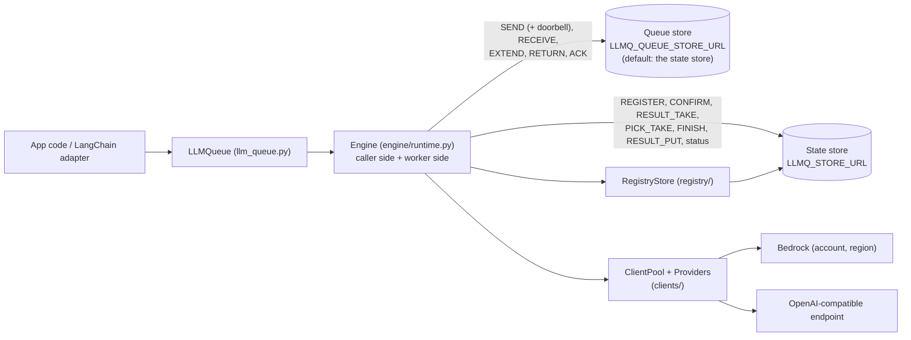

# Architecture of taskiq-llm-queue 0.3

This page describes how the library works, written from the code under `src/taskiq_llm_queue` as of
0.3.0 (unreleased, 2026-11-13). The design and its decisions are in
[ACCOUNT_ROUTING_PLAN.md](https://github.com/techiewonk/taskiq-llm-queue/blob/main/docs/ACCOUNT_ROUTING_PLAN.md); a worked example with sample data is in
[ACCOUNT_ROUTING_WALKTHROUGH.md](https://github.com/techiewonk/taskiq-llm-queue/blob/main/docs/ACCOUNT_ROUTING_WALKTHROUGH.md). Anything marked **unverified** was
not confirmed in the code or by a measurement.

## 1. Purpose and boundaries

The library puts LLM calls (Amazon Bedrock, or OpenAI-compatible servers such as vLLM) through a
queue on a Redis-protocol store (Valkey or Redis), and runs them under RPM / TPM budgets per
**deployment**: one model in one account and one region. It chooses the deployment, keeps waiting
calls in order, spills to fallback regions and fallback models by rule, retries by outcome, tracks
deployment health, and reports status.

| In scope | Out of scope |
|---|---|
| Admission (budgets, concurrency slots, order), balancing, fallback, retries, health | Prompt building, tool execution, agent logic (the app and LangChain do that) |
| Queues, results, request status, streaming to the caller, jobs (`register_job`) | A general task queue (jobs are a small add-on: at least once, no LLM budget) |
| Registry of accounts, models and settings, live edits with audit | Provisioning quotas at AWS; IAM; the store itself |
| Metrics (EMF or Prometheus), alerts as gauges and log lines, an HTTP router, a CLI | Dashboards, alert routing |

Every process runs the same code. The worker side runs inside the app's own pods (`LLMQ_MODE=both`,
the default), so there is no separate worker fleet. No process keeps a count of its own: budgets,
slots, waiter order and health live in the store, so 1 pod and 50 pods behave the same.

## 2. Components

| Module | Role |
|---|---|
| `llm_queue.py` | Front door `LLMQueue`: `from_env`, `start`, `pause_receiving`, `stop`, `converse` / `chat` / `call`, `converse_stream` (= `chat_stream`), `embed`, `*_sync` (direct path on a private loop and engine), `register_job` / `send_job`, `cancel`, `status`, `request_status`, `health`, `registry`, `http_router` |
| `engine/runtime.py` | `Engine`: caller (register, send, wait), worker loops, held calls, attempts, retries, fallback, direct path, `store_down`, cancel, every background task |
| `engine/_admission_lua.py`, `engine/admission.py` | Lua `PICK_TAKE`, `FINISH`, `UNDO`, `RENEW`, `SWEEP`, `REREGISTER` and their Python wrapper |
| `engine/queue.py` | `StreamQueues`: a queue on a stream with visibility, generation, failures and dead letters (`SEND`, `RECEIVE`, `RETURN`, `EXTEND`, `FAIL`, `ACK`, `DEPTH`, `REDRIVE`), doorbells |
| `engine/requests.py` | `RequestStore`: claim record, callers set, result, status (`REGISTER`, `CONFIRM`, `ABANDON`, `RESULT_PUT`, `RESULT_TAKE`, `STATUS_SET`, `CALLERS_ALIVE`) |
| `engine/streaming.py` | `ChunkWriter` (worker) and `ChunkReader` (one per caller process) over `P:{r:ID}:chunks` |
| `engine/status.py` | `StatusReader` (one `_MODEL_STATUS` script per model) and `AlertEvaluator` |
| `engine/health.py` | Target-error counting, auto-disable, probe outcomes (`RECORD`, `PROBED`) |
| `engine/tokens.py`, `engine/inference.py` | Token estimate and refund rule; inference defaults / limits in the provider's request shape |
| `engine/envelope.py` | Message format v2 (`Envelope`), `Reply`, `Meta` |
| `engine/settings.py` | `InfraSettings.from_env`: the `LLMQ_*` process settings |
| `engine/store_client.py` | One store client factory with the failover options |
| `engine/http.py`, `engine/cli.py` | FastAPI router (extra `http`); the `llm-queue` command |
| `engine/jobs.py`, `engine/embed.py`, `engine/offload.py`, `engine/metrics.py`, `engine/hooks.py` | Jobs; embedding batching; large results in S3; EMF / Prometheus sinks; named hooks |
| `registry/` | `settings.py` (one table of every setting: levels, check, default), `schema.py` (build with every problem listed), `validate.py` (cross-field checks), `resolve.py` (`ResolvedRegistry`: deployments, effective values with their level), `store.py` + `_lua.py` (publish, live edit, audit, rollback, reload) |
| `clients/` | `ClientPool` (one aiobotocore client per account and region, SDK retries and parameter validation off; assume-role sessions `llmq-<env>-<pod>`, 1 h, refreshed by aiobotocore), `Providers` (Bedrock `converse` over ConverseStream, `invoke_model`; OpenAI chat over SSE, embeddings), attempt timers |
| `langchain/`, `http_transport.py` | `QueuedChatBedrockConverse`, `QueuedBedrockEmbeddings`, `QueuedChatOpenAI`, `QueuedOpenAIEmbeddings` (the OpenAI ones through an httpx transport that answers the SDK in process) |
| `ids.py`, `context.py` | UUIDv7 ids (32 hex); `request_context(priority, session_id, user_id, tenant_id)` |

## 3. The life of a call

### 3.1 Caller (`Engine.call`, `_call_once`, `_send`)

1. **Resolve** (memory only): alias or provider model id to alias. A model disabled at model level
   sends the call to its first `model_fallback` model (if `allow_fallback="all"`) or fails
   `model_disabled`. `timeout_secs` (default 120) is capped by `timeout_max_secs` (900). The id is the
   app's `request_id` or a new UUIDv7. The `admission` hook may `Reject`.
2. **Route**: direct (in this process) when `force_direct` (sync calls), `routing.kill_switch`, or the
   id's hash falls outside `queue_pct`; users in `routing.allow_users` (HMAC hashes) always queue.
3. **Register** (`REGISTER`, one script): creates `P:{r:ID}:job` (`state=queued`, user and params
   hashes, `confirmed=0`), adds this process to `P:{r:ID}:callers`, writes the status `waiting`. A
   repeated id returns `attached` (wait for the first run), `done`, `expired` (`result_expired`),
   `conflict` (other params or user: `request_id_conflict`) or `takeover` (an unconfirmed record older
   than 5 s: its sender died).
4. **Send** (`SEND`, queue store): `XADD` to `<queue_prefix>llm-<alias>` or `...-priority` (the
   stream id is the store's clock: it is the call's queue position and the start of its deadline),
   refused with `queue_full` above `max_waiting` (50,000), and one token pushed on the queue's
   doorbell list `P:bell:<queue>`. With `LLMQ_QUEUE_WAIT_REPLICAS` the send and a `WAIT` go down one
   pipeline; too few acknowledgements make the call run direct under the same record.
5. **Confirm** (`CONFIRM`): the record lives until the deadline plus the status TTL.
6. **Wait**: no read right after sending. The caller waits for the pub/sub wake-up on
   `P:done:<worker id>`, then reads with `RESULT_TAKE`. A per-process sweep (`_RESULTS_EXIST`, every
   5 s, 500 ids per script) and a re-subscribe that wakes every waiter cover missed messages.

### 3.2 Worker: receive and admit (`_model_loop`, `_receive_once`, `_admit_new`, `_try`, `_decide`)

One loop per model. It reads the priority queue first, up to `min(free worker_slots, 10)`
messages (`RECEIVE`: due returned messages and new ones, oldest first; each taken message is hidden
for `queue.visibility_secs`, its generation goes up; a hold that lapsed counts one failure and the
tenth goes to the dead-letter stream). Idle, the loop blocks on both doorbells (`BLPOP`) for 50 ms,
then for 1 s after 20 empty polls; a send wakes exactly one blocked worker.

For each message: parse (a newer envelope version is returned in 5 s, never dropped); check that a
caller is alive (`CALLERS_ALIVE`; dead callers mean `cancelled` / `caller_gone`); then admission.

**`PICK_TAKE`** (one script, all or nothing) does, in order:

| Step | What happens |
|---|---|
| Config | Reads the model's resolved numbers from `P:{m:A}:cfg` (written with every publish / edit). A change counter different from the worker's means `stale_config` (the worker reloads and asks again); missing numbers mean `no_config` (republish, then `queue_unavailable` or return in 5 s) |
| Settled? | A stored result or a final job state: `done`; a cancel flag: `cancelled`; running under another worker with a fresh heartbeat: `duplicate` (message returned after half a lease). A dead owner's entry and slot are dropped |
| Waiters | Expired waiter entries are cleaned. A foreign (model-fallback) ask is refused `busy` while the model has waiters of its own |
| Reservation | Older waiters of the same class set aside their cost (1 request, their tokens, 1 slot) on every deployment they may use. A normal call also sets aside what waiting priority calls need, on a deployment whose normal use this minute reached `normal_min_share` x rpm |
| Candidates | Each passed candidate is usable unless disabled, its account disabled, blocked, outside residency, auto-disabled (`health`), or its breaker open (after the cooldown one trial call at a time) |
| Budgets | Per candidate: the deployment's `rpm` / `tpm`, the class share (normal at most `1 - priority_reserve`, priority at most `1 - normal_min_share`), and the account's `shared_rpm` / `shared_tpm` (with the account's own `priority_reserve` for normal calls). `smooth` (default): a GCRA clock per budget, cost `60 / limit` s per unit, burst `max(1, floor(limit x rate_burst))`. `fixed`: counters per calendar minute. A call larger than the whole bucket is admitted when the clock is idle |
| Slots | Concurrency per class: `limit` from `P:{m:A}:ac:DEP` (starts at `max_concurrency`, 200 when unset; x0.7 on a throttle at most once a second, +1/limit per success up to the cap); normal slots at most `(1 - priority_reserve)` of it, priority at most `(1 - normal_min_share)` |
| Slow | With 3+ candidates that have `slow_min_samples` (20) latency samples, one above `slow_ratio` (3) x the median and above `slow_min_secs` (5) becomes a last choice |
| Choose | `ordered` (default) stops at the first fitting confirmed candidate; `round_robin`, `weighted` (smooth weighted round robin), `headroom` (`pick`: `percent` = largest free share of the bucket / minute and slots, before the call; `max`; `spread`), `custom:<name>` (the hook orders, then `ordered`). Order of preference: confirmed, then fallback, then last choices (previously failed or slow). A sticky session keeps its deployment while it fits or would wait at most `sticky_move_after_secs` (1 s) |
| Headroom rule | A foreign ask with `require_headroom` needs the chosen deployment's free share at or above `require_headroom_pct` (20 %) |
| Take or wait | Granted: write the budget states and per-minute counters, the slot lease, `P:{m:A}:inprog` and `inprog:ID` (owner, deployment, class, minute, cost), the claim (`job state=running, owner, hb`), the sticky key, the rotation; remove the waiter. Refused: register or refresh the waiter (`wait:p` / `wait:n` scored by queue position, `waitinfo` with cost and usable deployments, expiry 2 s) and return `wait` with the shortest wait and its reason (`rpm`, `tpm`, `account`, `reserve`, `not_head`, `slot`). No usable candidate at all: `none` |

Python then handles the terminal outcomes: an input estimate above every candidate's `tpm` fails
`request_too_large`; `none` turns on fallback regions for the cause `broken` (after
`fallback.after_secs`) or tries fallback models, else `model_unavailable` with `retry_after_secs`
until the next probe; no candidate after the call's filters is `no_deployment`, or
`credentials_unavailable` when only accounts with failed credentials were left.

**Hold.** A refused first attempt is held: the class stops being read (the calls behind it stay
in the queue, untouched), and a task retries `PICK_TAKE` every `min(wait, 1 s)`, extending the
message's visibility each time. Fallback regions join the candidates once the call has waited
`fallback.after_secs` (2) and the cause (`exhausted`, `broken`, `error`) is listed; fallback models
are tried after `model_fallback.after_secs` (5), with the other model's own budgets and estimate,
only while it has no waiters. The `fallback_policy` hook can override both. Past `max_wait_secs`
(counted from the queue position) or the deadline the call ends `expired`, and the caller gets
`rate_limited` with `retry_after_secs`. A call that already waited out `max_wait_secs` unreceived is
refused on arrival rather than started with no time left. When the hold ends the loop is woken.

### 3.3 Attempts (`_run`, `_attempts`, `_attempt`)

A granted call takes a worker slot of its model and runs attempts. Each attempt: request = app
params + `inference` defaults and `inference_limits` at the deployment level + the deployment's
`params`; first-response timer `min(attempt_timeout_secs (60), half the time left on attempt 1,
else all of it)`; idle timer between chunks `stream_idle_secs` (30); an outer timer at the deadline.
Bedrock chat always uses ConverseStream underneath, so long answers are not cut by the first timer.

| Outcome | Budgets (`FINISH`) | Learning | Next |
|---|---|---|---|
| Success | TPM corrected to real usage (input + cache writes + output x `tpm_output_weight`; cache reads only with `tpm_count_cached`); no usage reported: estimate kept | limiter +1/limit, breaker closed, target errors cleared, latency EWMA (0.8 / 0.2) | `RESULT_PUT`, status `done`, `ACK` |
| Throttle | request and every token back | limiter x0.7, throttle counter; never the breaker | retry at once, that deployment a last choice; more than `throttle_retry_attempts` (6) ends `rate_limited`; does not count toward `max_attempts` |
| 5xx, timeout, connection | output part back, input kept | breaker failures +1 (opens at `breaker_threshold` 5 for `breaker_cooldown_secs` 15) | retry after backoff `retry_base_secs x retry_multiplier^(n-1) x U[1, retry_spread]` (1-2.5 s, 4-10 s, 16-30 s), capped at `retry_max_secs` (30) **and the deadline**; at `max_attempts` (4) `provider_error`; above the per-minute retry budget (`retry_budget_pct` 20 % of first attempts, at least `retry_budget_min` 10) `retry_budget_exhausted` |
| Idle mid-answer | nothing back | as a failure | as a failure |
| Cut by the call's own deadline | nothing back | none (not counted toward breaker or health) | `deadline_exceeded` |
| Target error (access denied, model not in region) | everything back | counted once the outcome is known; a request failing this way on two deployments is the cause and is not counted | next deployment; on the second one `provider_error` |
| Auth / credentials | everything back | account skipped in this process for 5 s, doubling to 60 s; client dropped | next deployment |
| Other (validation) | everything back | none | `provider_error` |

Retries, fallback and refunds settle against the estimate that admission charged (model-level
params, cached per registry view). The estimate is characters / 4 of every string in the request
(tool definitions included) plus `max_tokens` (or `default_output_tokens`, 1000) for chat.

### 3.4 Finish and reply

`FINISH` (refund, slot and entry removed, learning) runs first; then `RESULT_PUT` writes
`P:{r:ID}:res` once (TTL `LLMQ_RESULT_TTL_SECS`, 300), marks the job final and `PUBLISH`es the id to
every caller's `P:done:<caller>`; then `STATUS_SET` (`done` with deployment, served model, attempts,
tokens) and `ACK` (deletes the message, only with the current generation). A failure writes an error
`Reply` the same way. `RESULT_TAKE` returns the result and, for a library-made id, deletes it at once
(`LLMQ_RESULT_DEDUPE_SECS`, default 0, keeps it that long instead); an app-supplied id keeps its TTL
so a duplicate id gets the same answer. Results above `offload_bytes` go to S3 (`ResultOffload`) and
the store keeps a marker. One `llmq_call_finished` log record per call (ids hashed, no text).

### 3.5 Direct path

Used for sync calls (`converse_sync`, `embed_sync`, on a private event loop and caller-only engine),
the kill switch, `queue_pct`, a separate queue store that failed for `LLMQ_QUEUE_FAILOVER_SECS` (5),
and an unreplicated send. It registers and confirms the same record, then admits with the same
`PICK_TAKE` and waiter order (position = the store's time at registration; one registered waiter per
process, model and class, the rest wait on a local lock) and runs the same attempts. Only the queue
send and receive are skipped. Measured: 2,000 direct calls waiting cost 16 store scripts per process
per second (B96).

### 3.6 State store down (`store_down`, per model)

Applies when the state store fails before the call was sent (registering). `pause` (default): ping
every second until the call's timeout, then run it normally, else `queue_unavailable`. `static_cap`:
run without the store, at most `LLMQ_LOCAL_LIMIT_CAP` (10) calls per process and model, confirmed
deployments in order, no budgets (quotas may be exceeded). `fail_fast`: `queue_unavailable` at once.
A call already sent never takes this path: its caller waits for the store until its deadline (before,
it could run twice). A streaming call fails `queue_unavailable` (chunks travel through the store).

### 3.7 Streaming

`converse_stream` / `chat_stream` start a normal call with `stream=True`. The worker's `ChunkWriter`
appends entries `{seq, att, t: chunk|end|error, d}` to `P:{r:ID}:chunks`: the first event at once,
later ones batched by `stream_flush_ms` (30), capped at `stream_max_bytes` (8 MiB, then an error,
never trimmed); `end` carries the usage and TPM is corrected after it. Each caller process runs one
`ChunkReader` (`XREAD` over every open stream, block 100 ms). The caller checks sequence gaps
(`worker_lost`) and idleness (`stream_idle_secs`). After chunks were sent, a failure ends the stream
with an error entry carrying the partial text (`CallFailed.partial_text`) and no switch to another
deployment; a stream already begun by another worker ends `worker_lost`.

## 4. Key layout

`P` is `LLMQ_KEY_PREFIX` (default `llmq`). Queue names are `LLMQ_QUEUE_PREFIX` + `llm-<alias>` (or the
model's `queue.name`) and `...-priority`; jobs use `jobs-<name>`. Hash tags group a model
(`{m:A}`), a request (`{r:ID}`), a queue (`{q:NAME}`), an account (`{a:ACCT}`) and the registry
(`{reg}`), but scripts cross tags (see §5).

| Keys | Type | Holds | Lifetime |
|---|---|---|---|
| `P:{reg}:doc`, `:meta`, `:audit`, `:history` | string, hash, stream, hash | Registry JSON; `version`, `config_hash`, `changes`, `published`; one audit entry per publish / edit (`actor, op, version, diff, ts`); the last 20 published versions | audit trimmed to `LLMQ_AUDIT_RETENTION_DAYS` (90) |
| `P:{m:A}:cfg` | hash | `numbers` (resolved admission settings per deployment), `changes` | until `registry gc` |
| `P:{m:A}:rate:DEP` | hash | `rpm_tat`, `tpm_tat`, class clocks `p_/n_rpm_tat`, `p_/n_tpm_tat` (or `*_win` / `*_n` when fixed); `seen_win`, `seen_calls`, `seen_tokens`, `seen_n` | 180 s, refreshed on write |
| `P:{a:ACCT}:rate` | hash | Account budget clocks / counters | 180 s |
| `P:{m:A}:wait:p`, `:wait:n`, `:waitinfo` | zset, zset, hash | Waiters by queue position; their cost, usable deployments, expiry | entries expire after 2 s unless refreshed |
| `P:{m:A}:ac:DEP`, `:lease:DEP:p`, `:lease:DEP:n`, `:cb:DEP` | hash, zsets, hash | Learned concurrency (`limit`, `cut_at`); slots in use (owner to lease expiry); breaker (`state`, `failures`, `until`, `probe`, `probe_at`) | no TTL (leases expire by score) |
| `P:{m:A}:inprog`, `:inprog:ID` | zset, hash | Calls in progress (owner to lease expiry); the grant (owner, worker, dep, cls, minute, cost, account, started) | entry 2 x lease, renewed |
| `P:{m:A}:health`, `:terr:DEP`, `:thr:DEP:MIN` | hash, zset, counter | fields `DEP\|until`, `DEP\|wait`, `DEP\|since`, `DEP\|lat` (latency EWMA, ms), `DEP\|n`; target errors by request id; throttles this minute | window; 180 s |
| `P:{m:A}:rot`, `:sticky:HASH`, `:retries:MIN` | hash, string, hash | Rotation; a session's deployment; retries and first attempts this minute | none; `sticky.idle_ttl_secs` (1800); 120 s |
| `P:{r:ID}:job`, `:callers`, `:status`, `:res`, `:cancel`, `:chunks`, `:debug` | hash, set, hash, string, string, stream, string | Claim; calling processes; status (`state`, `model`, `priority`, `<state>_at`, ...); result; cancel flag; stream; `debug_capture` text | job and callers: deadline + status TTL; status: `LLMQ_STATUS_TTL_SECS` (1800); res: `LLMQ_RESULT_TTL_SECS` (300), deleted on first read for a library id; cancel: status TTL; chunks: result TTL + timeout; debug: 1 h |
| `P:{q:NAME}:s`, `:vis`, `:gen`, `:fails`, `:st`, `:dlq`, `:meta` | stream, zset, hashes, stream, hash | Messages; hidden until; generation; failures; held / returned; dead letters (`body, src, fails`); the receive cursor | stream `MINID` 4 days (`retention_secs`); DLQ 1 day |
| `P:bell:NAME` | list | Doorbell tokens (at most 64) | 60 s |
| `P:caller:WORKER`, `P:done:WORKER`, `P:cancel` | string, channel, channel | Process liveness; result wake-ups; cancels | `LLMQ_CALLER_TTL_SECS` (30) |
| `P:epoch`, `P:reset_minute`, `P:lock:{sweep,alerts,probe:A}`, `P:alert:*`, `P:health:WORKER` | strings | Store-reset detector; locks for one-process tasks; alert state; readiness probe | locks 5-25 s; alerts 1 day; probe 5 s |

## 5. Store usage

- **Single primary only** (with replicas). Cluster mode is not supported: the scripts build key
  names inside Lua from the prefix rather than taking them in `KEYS`, and one script touches several
  tags (`PICK_TAKE` writes `{m:}`, `{r:}` and `{a:}` keys; `SEND` pushes the doorbell, which is not in
  `KEYS` and has no tag). Two stores are possible: the queue store holds only queues and doorbells.
- **Time** is the store's (`TIME` inside every script); a process keeps an offset (`StoreClock`,
  resynced every heartbeat), so pod clock skew does not matter.
- **Client** (`store_client.py`): bytes replies, `BlockingConnectionPool` with
  `LLMQ_STORE_MAX_CONNECTIONS` (200) and a 10 s wait for a free connection, connect timeout 5 s,
  keepalive, idle health check 30 s, and 3 retries with jitter (about 1.5 s) on dropped connections,
  timeouts and `READONLY`. `READONLY` closes the connection, so the retry resolves the DNS name again
  and reaches the new primary after a failover (before, every write failed until a restart).
  `valkey://` / `valkeys://` are accepted. Store passwords can come from `from_env(secrets=)`, read on
  every new connection.
- **Readiness** (`health_check`): ready means registry loaded and not draining; each store is probed
  with a bounded (1 s) write and reported `ok`, `read_only` or `down`, but never makes the process
  unready.
- **`NOSCRIPT`**: a pipelined `SEND` + `WAIT` that meets a node without the script cached is run once
  more (pipelines load scripts only when they start); plain script calls rely on redis-py's reload.
- **Queue store failover**: `LLMQ_QUEUE_FAILOVER_SECS` (5) of send errors before a call runs direct;
  `LLMQ_QUEUE_WAIT_REPLICAS` / `LLMQ_QUEUE_WAIT_MS` (0 / 100) make a send wait for replicas.
- **Store reset**: a missing `P:epoch` (restart without data, failover to an empty node) is detected
  by the heartbeat: running grants are put back (`REREGISTER`), a fixed window holds until the next
  minute, and the reload loop republishes the registry (live edits are lost and logged).
- **TLS**: outside `LLMQ_ENVIRONMENT` `dev` / `local` / `test` / `ci`, store URLs must be `rediss://`
  with certificate and host-name checks on (a localhost URL is allowed), and `LLMQ_ID_HASH_SALT` is
  required.

## 6. Background tasks per process

| Task | Side | Cadence | Does |
|---|---|---|---|
| `_model_loop` (one per model) | worker | busy: no wait; idle: doorbell `BLPOP` 50 ms, 1 s after 20 empty polls; held class: local wake event | receive and admit |
| `_hold` (one per held call) | worker | `min(wait, 1 s)` | `EXTEND` + `PICK_TAKE`, fallback checks |
| `_heartbeat` | both | `lease_secs / 3` (20 s), shorter for short `visibility_secs`; 1 s after a store error | caller key, `RENEW` all grants, `EXTEND` each held message, clock sync, epoch check |
| `_sweeper` | worker | 10 s, one process (lock) | `SWEEP`: drop in-progress entries and slots of owners whose lease lapsed (no refund) |
| `_prober` | worker | 5 s, one process per model (lock) | probe auto-disabled deployments that are due (one short real call; a throttle counts as success) |
| `_alert_loop` | worker | 30 s, one process (lock) | status report, alert gauges, a log line per flip |
| `_cancel_reader` | worker | pub/sub | cancel running attempts named on `P:cancel` |
| `_warm_clients` | worker | once at start | build every Bedrock client (first call 1,032 ms before, ~140 ms after) |
| `_result_reader` | caller | pub/sub | wake waiters; on re-subscribe wake all |
| `_result_sweep` | caller | 5 s | one script finds results of all waiting callers |
| `RegistryStore.run` | both | `LLMQ_CFG_RELOAD_SECS` (30) | reload; republish when the stored registry was lost or older |
| `ChunkReader` | caller | while streams are open, `XREAD` block 100 ms | deliver chunks |
| `JobRunner._loop` (one per job name) | worker | receive polls 20 ms to 500 ms | run jobs, keep them visible, fail with 5 s delay |

## 7. Failure model

| Event | What happens |
|---|---|
| Worker killed mid-call | Its message reappears after `visibility_secs` (60) with one failure counted; its grant's lease lapses and `SWEEP` frees the slot and entry (the charged budget stays); `PICK_TAKE` drops a dead owner's entry when the message is admitted again. A result already stored is reused. After `max_receives` (10) failures the message is dead-lettered and the caller gets `dead_lettered` (B13 / B30 / B71 tested) |
| Error inside the worker (store refusal, bug) | `_release`: every grant settled as a cut, message returned at once (or in 5 s for missing numbers); a direct call's caller gets the error. A store blip after the provider answered skips `FINISH` (the lease expires) but keeps the answer |
| State store outage | Callers already waiting keep waiting for the store; new calls follow `store_down`, all within the call's one deadline (timeout + `caller_margin_secs`). A worker treats callers as alive for a caller TTL + a heartbeat + 5 s after it saw the store fail (any store error, a late heartbeat, or a heartbeat back from a gap), so waiting calls are not dropped as `caller_gone` (B95: 45 s block, 500 waiting, 0 dropped; scenarios S4, S5). The registry stays on its last good copy. Admin operations raise `StoreUnavailable` |
| Half-open store (replies never come) | Every store command fails after `Tuning.store.read_timeout_secs` (15 s); a timeout is not retried (redis-py retries it by default: 4 x 15 s, and a Lua write could run twice). Scenario S5 |
| Store out of memory | Calls fail as `queue_unavailable` ("out of memory"), admin operations as `StoreUnavailable` (scenario S9) |
| A call still held past its deadline | Should not happen; the heartbeat logs `held_call_stuck`, cancels its task, gives its grants back and returns its message (one-hour soak: two calls were renewed for 50 minutes) |
| Store failover | Reconnect on `READONLY`; `scripts/failover.py`: `failover` and `restart` lose no call; `slowdns` (DNS lags 6 s) may fail calls in flight, at most 5 % |
| Queue store outage (separate store) | Per call: send retries for 5 s, then the call runs direct under the same budgets |
| Provider throttle | Refund all, limiter cut, retry elsewhere (§3.3); alert `quota_above_observed` when throttles come with budget left |
| Provider errors | Breaker per deployment; retries capped by attempts, a per-model retry budget and the deadline. A move to a deployment the call has not tried is free of the retry budget (failover, bounded by the deployments); retries after every deployment failed spend it (scenarios P3, P4, P7) |
| Credentials refused | The account is skipped in that region only, with backoff (5 s doubling to 60 s): an opt-in region such as ap-south-2 can refuse a token the others accept (scenario P5) |
| Deployment broken (target errors) | `disable_errors` (3) distinct requests in `disable_window_secs` (300) with no success between disable it, unless it is the model's last healthy one (then only a log); probes after `probe_after_secs` (900), then doubling (at least 60 s) up to `probe_max_secs` (7200); health is apart from the registry, so a deploy never re-enables one |
| No usable deployment | `model_unavailable` with `retry_after_secs` until the next probe |
| Caller gone | The awaiting task cancelled: the call is cancelled unless another caller waits on the id. The calling process dead (no `P:caller:` key): the worker cancels it on receive (`caller_gone`) |
| Cancel | Waiting: never starts (`cancelled`); running: the attempt task is cancelled, the grant settled with nothing refunded |
| Deploy / restart | `pause_receiving()` (preStop) fails readiness and stops receiving; `stop(drain_secs)` returns held messages, lets running calls and this pod's waiting callers finish within `LLMQ_DRAIN_SECS` (45), then cancels (B33: 4 rolling restarts, 0 lost) |
| Registry invalid in the store | Read leniently (unknown names are warnings); an invalid stored document is ignored and the last good one kept |

## 8. Performance (measured)

Numbers from CHANGELOG 0.3.0 "Performance" and plan §13 (2026-11-13, Python 3.12, fakellm, worker
processes as pods on one machine).

| What | Measured |
|---|---|
| Store scripts per queued call | 11.6 (B19, 2,000 calls in 10 s). By the code: caller `REGISTER`, `SEND`, `CONFIRM`, `RESULT_TAKE`; worker `RECEIVE` (batched), `CALLERS_ALIVE`, `PICK_TAKE`, first-attempt counter, `FINISH`, `RESULT_PUT`, `STATUS_SET`, `ACK`; plus doorbell and heartbeat. About 4 ms of store time per call on an in-VPC store (plan estimate) |
| Store work vs process count | 248 commands per call on 2 processes, 252 on 8 (B22) |
| Admission | `PICK_TAKE` p99 0.94 ms with 20 models x 30 deployments (B91; plan asks 2 ms) |
| Status | 20 x 30 report (210 KB) in 47 ms, 375 ms cold; 6.5 s before one script per model (B91) |
| Queue overhead | +0 ms at p95 over a direct call, 141 ms both (B34); CHANGELOG: 0-15 ms p95; 290 calls/s on 4 workers |
| Waiting callers | 2,000 waiting: 1,976 store calls/s before, 499/s after (pub/sub + sweep, B56) |
| Budgets | 1,800 of 1,800 a minute on 9 deployments, none above its RPM, priority wait p95 0.27 s (B17); normal class at 100 % of its 80 % (B56 / B93) |
| Recovery | Waiter pod killed: next waiter within 1.3 s smooth, 0.02 s after the minute fixed (B94); first call after idle 125 ms (B92) |
| Memory | Bulk Cohere embedding (300 x 96 texts): store +23 MB at peak, +582 MB before deleting results on first read (B97; CHANGELOG states 31 MB vs 587 MB). Process memory: **unverified** |
| CPU per call | botocore parameter validation off: 8.5 to 3.5 ms per attempt at 218 KB; no deep copy (1.86 ms saved); envelope encode 342 to 57 us; UUIDv7 0.49 us; `hiredis` parsing 39-75x faster |

## 9. Extension points

| Hook | Registered with | Chosen by | Contract |
|---|---|---|---|
| Balancer | `register_balancer(name, fn)` | `balance: "custom:<name>"` | `fn(views, ctx) -> ordered keys`; the script then takes the first that fits |
| Fallback policy | `register_fallback_policy(name, fn)` | `fallback_policy` | `fn(cause, waited, rule, ctx) -> bool` replaces the `on` / `after_secs` test |
| Admission | `register_admission(name, fn)` | `admission` | `fn(ctx)` returns a `Reject` or None, on the caller before sending |
| Sticky key | `register_sticky_key(name, fn)` | `sticky.key: "custom:<name>"` | `fn(ctx)` returns a key or None (hashed) |
| Probe | `register_probe(name, fn)` | `probe` | `fn(alias, op) -> params` for health probes |
| Token estimator | `register_token_estimator(name, fn)` | `token_estimator` | `fn(op, params) -> input tokens` |
| Provider, account kind | `register_provider(name, factory)`, `register_account_kind(kind, provider)` | model `provider`, account `kind` | a `Provider` with `call(op, params, route, timing, sink=)` and `classify(exc)` |
| Others | `register_job`; `from_env(credentials=, secrets=, metrics=, offload=, offload_bytes=, worker_id=)` | | credentials per account, secret source, metrics sink, S3 offload |

Hooks run through `call_safely`: one that raises or is not registered is logged once and the built-in
behaviour is used, so a hook never fails a call. `CallContext` carries ids, never prompt text.

## 10. What is tested where

`python scripts/check.py <step>` runs lint, format, types and the step's tests; stack steps use
Valkey 8.1 and Redis 7.4 with fakellm (`scripts/stack.py up`). No test calls a real LLM.

| Step | Covers | Tests |
|---|---|---|
| `a0` | fakellm (accounts, TPM, pacing, hang, streaming) | `tests/unit/fakellm` |
| `a1`, `a2` | registry schema / validation / resolve; store (version rule, edits, audit, rollback) | `tests/unit/registry`, `tests/integration/registry` |
| `a3` | clients, providers, timers | `tests/unit/clients` |
| `a4`, `a5`, `a6` | request records; stream queue; admission scripts | `tests/integration/engine/test_requests.py`, `test_queue.py`, `test_admission.py` |
| `a7` | tokens and inference | `tests/unit/engine` |
| `a8`-`a11`, `a15`, `a16` | runtime end to end, hooks, direct path, `store_down`, cancel, store reset, health, assume role, slow exclusion | `tests/integration/engine` (`test_runtime.py` and others), `tests/unit/clients/test_assume_role.py` |
| `a12`, `a13`, `a14`, `a17` | status / CLI / HTTP; embeddings; front door, jobs, sync, LangChain; streaming | `test_ops.py`, `test_embed.py`, `test_front.py`, `test_stream.py` |
| `store` | failover options, readiness, preStop, HTTP writes + `scripts/failover.py` drill | `test_store_and_http.py` |
| `load` | `scripts/load.py`: 2,000 calls over 3 workers (all succeed, none left held); 300 calls on a 600 RPM model (at most burst + rate served, the rest `rate_limited`, none past its deadline) | |
| `gates` | `scripts/gates.py`: B17, B19, B22, B23, B33, B34, B56 / B93, B91, B92, B94-B97 (~20 min) | |
| `samples` | `scripts/samples.py`: the nine samples on fakellm (`--live` real Bedrock, `--store env` a TLS store) | |
| `scenarios` | `scripts/scenarios.py`: 29 fault scenarios (worker, store, provider, registry, caller, pairs) x 3 loads, plus the Docker failover drills; judged by calls, not time (fast profile: 10-40 s each) | |
| `soak3` / `soak10` / `soak20` | `scripts/soak.py --minutes N`: 8 worker processes, chaos every 30-120 s, leak and drift checks (`--live`: real Bedrock at 10 RPM) | |

## 11. Removed before release

The settings `retry_attempts`, `throttle_retry_max_secs`, `hold_max_secs`, `output_reserve` and
`request_status`, and the envelope fields `params_ref` and `est_tokens`, were validated but
never read; they were removed before 0.3.0 shipped, so a document that sets them is refused
with the problem named. Attempts are bounded by `max_attempts`; a call reserves its effective
`max_tokens`; the status record is always written in full; params travel inside the message.
