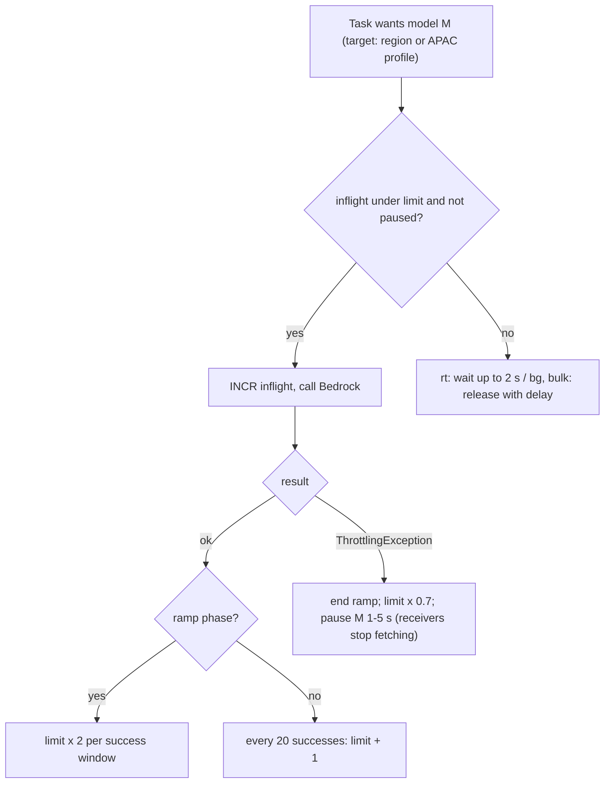

# Design notes

Reference for the IDs used in code comments and tests: delivery-safety rules (**DS1–DS19**), broker parity features (**P1–P17**) and broker additions (**A1–A9**).

## Delivery-safety rules

| # | Rule | Why |
|---|---|---|
| DS1 | Claim states `queued → running → done \| cancelled \| expired \| released`, plus a `failures` counter, all in `<prefix>:job:<id>` (Lua, Valkey `TIME`) | One place decides whether a message may run |
| DS2 | `running` + fresh heartbeat seen by another pod → `ChangeMessageVisibility(heartbeat window)`, **never delete**. Delete only on `done` / `cancelled` / `expired` | Deleting would lose the task if the owning pod then crashes |
| DS3 | Missing claim key → create `running` if `now < deadline_at`, else ack as `expired`. Claim TTL = `max(LLMQ_STATE_TTL_S, deadline_at − now + exec_max)`, refreshed by every heartbeat | Base queues keep messages 4 days; jobs can run > 30 min |
| DS4 | Receive budget = `min(free worker slots, limiter headroom for the queue's lanes)`, so tasks aren't received and then released for lack of capacity | Releases add to `ApproximateReceiveCount` and push healthy work toward the DLQ |
| DS5 | `maxReceiveCount` **10** on LLM queues; real failures are counted in `failures` and a task goes to the DLQ only after `LLMQ_MAX_FAILURES` (3) or as poison | Deploys and throttling must not fill DLQs |
| DS6 | Heartbeat interval ≤ visibility / 3; heartbeat batch flushed ≤ 1 s; `max_extensions` derived from `deadline_at`; if an extend fails with `ReceiptHandleIsInvalid` / `MessageNotInflight`, the local task is cancelled and writes no result | Prevents silent redelivery while running |
| DS7 | Ack batch flushed at ≤ 1 s or 10 entries and always before `visibility − 5 s`; `Failed[]` entries retried individually; an invalid receipt handle is fine because the claim is `done` | Partial batch failures |
| DS8 | Order: **write result → CAS `done` → ack**. If the result write fails, retry until the deadline, then release (visibility 0) with the claim left `running` and a cached response, so the next pod only saves | No second provider call |
| DS9 | Unknown task name or envelope `v` newer than supported → `ChangeMessageVisibility(30)`, **not ack**. Task names are stable and namespaced (`taskiq_llm_queue.call`) | taskiq's Receiver acks unknown tasks (`receiver.py:176-183`), losing them during rolling deploys |
| DS10 | A limiter slot covers **one attempt**: acquired just before the call, released in `finally` before any sleep. Worker slots are counted separately, with a cap on total sleep per task | No stall with full concurrency and idle Bedrock |
| DS11 | Limiter slots are **leases** in a ZSET scored by expiry (≈ 2 × call timeout), renewed by the heartbeat; acquire removes expired leases first | A crashed pod frees its capacity within minutes, not 30 |
| DS12 | AIMD increases only when `inflight ≥ 0.9 × limit`; ramp doubling capped at 2 × the measured peak | No drift to `LLMQ_AC_MAX` when idle |
| DS13 | Pause per (model, target). `-rt` keeps receiving while any target in its fallback chain has headroom; after the 2 s rt wait the task moves to the next fallback step | Throttling in one region shouldn't block chat |
| DS14 | Cancel flag checked before every attempt and every sleep; when cancelled: release slot, write `{ok: false, cancelled: true}`, ack | Cancelled work stops holding capacity |
| DS15 | `SendMessageBatch` is byte-aware (flush before 900 KB total); the 200 KB inline limit is measured on the serialized taskiq message | 10 × 200 KB would fail the 1 MiB batch limit |
| DS16 | SQS API errors (`RequestThrottled`, 5xx) on receive/heartbeat/ack: adaptive botocore retries for SQS calls only, jittered backoff per poller, counted in metrics | Scale to 10K in flight |
| DS17 | Ambiguous send (timeout) before failing over to `direct`: CAS the claim to `running(direct)` first, so a queued copy that did arrive is skipped | No double execution on SQS failover |
| DS18 | Valkey down: close every `ReceiveGate` (workers stop taking tasks); senders run `direct` with a local cap = `last_known_limit / live_pods` (fallback `LLMQ_LOCAL_LIMIT_CAP`); params > 200 KB need S3 offload (P9) or fail fast. ElastiCache needs Multi-AZ + persistence for claim/limiter keys | without exceeding provider limits |
| DS19 | FIFO / fair queues: priority, capacity-aware receive and release keep group order; `delay` labels are rejected on FIFO queues | Parity features stay correct |

## Broker: parity and additions

**A. Parity — every feature of both libraries is in our broker (the base):**

| # | Feature | From | Our API |
|---|---|---|---|
| P1 | Async SQS broker, standard + FIFO queues | both | `HybridSQSBroker(queues=[SQSQueue(...)])` |
| P2 | Multiple queues, route per task / message (`queue_name` label) | both | `@broker.task(queue_name=…)`, `.with_labels(queue_name=…)` |
| P3 | Queue config: max messages, wait time, visibility timeout, FIFO flag, attributes | both | `SQSQueue` (dataclass, validated) |
| P4 | **Declare queues on startup** (create if missing, with attributes) or require existing | taskiq-sqs | `SQSQueue(is_declare=True, options={…})`; we run `is_declare=False` |
| P5 | **Delayed tasks** 0–900 s (`delay` label; broker default) | both | `.with_labels(delay=30)`; `default_delay_seconds` |
| P6 | **FIFO**: `group_id`, `deduplication_id` labels; task id as dedup id option | both | same labels; `use_task_id_for_deduplication=True` |
| P7 | **Fair queues** (MessageGroupId on standard queues for even distribution) | aio-sqs | `SQSQueue(is_fair=True)`, group from `group_id` label or task name |
| P8 | **Batched send** (`SendMessageBatch`), size/timeout, skip per task or label, FIFO groups kept in order, **flush on shutdown** | both | `SQSQueue(batching=Batching(size, timeout))`, `skip_batching` label, `skip_batch_tasks=[…]` |
| P9 | **Large messages to S3** (extended messages / offload middleware: payload over a threshold stored in S3, reference in SQS, deleted after execute) | both | `S3Offload(bucket, threshold, delete_after_execute)`; optional, alongside our Valkey-reference option |
| P10 | **S3 result backend** | both | `S3ResultBackend` |
| P11 | **Message expiry** (`expiry` label; expired messages deleted without running) | taskiq-sqs | `expiry` label; our client sets it from `deadline_at` |
| P12 | **Message metadata to task code** (receipt handle, message id, approximate receive count) | aio-sqs | `expose_message_metadata=True` → labels / `Context` |
| P13 | **Heartbeat** (extend visibility while running; interval; max extensions) | aio-sqs | `Heartbeat(interval, max_extensions)`, **batched** (addition A6) |
| P14 | Ack after the task (`WHEN_SAVED` / `WHEN_EXECUTED`) | both (taskiq) | default `WHEN_SAVED` |
| P15 | Explicit endpoint/credentials (ElasticMQ/moto endpoint, keys) + default AWS chain (IRSA) | both | `endpoint_url`, `region_name`, keys optional |
| P16 | Typed exceptions and config validation (limits: 10 msgs, 20 s, 900 s delay, 128-char FIFO ids) | both | `taskiq_llm_queue.exceptions` |
| P17 | Docs + runnable examples (multi-queue, delayed, FIFO, batching, S3, expiry, metadata, heartbeat) | both | `docs/` + `examples/`, each example run in CI against ElasticMQ (Docker) |

**B. Additions — what neither library has:**

| # | Addition | Why |
|---|---|---|
| A1 | **Priority across queues**: strict priority + `reserve_for_priority0` + `min_slots_for_lower` | Chat before background (R21) |
| A2 | **Capacity-aware receive**: fetch only up to free slots; bounded buffer | No hoarding across pods (aio-sqs buffers 100, taskiq-sqs is unbounded) |
| A3 | **Real 20 s long poll** by default | aio-sqs polls in 1 s slices (idle cost) |
| A4 | **`ReceiveGate`** (pause receiving per broker/queue) | The limiter pauses a throttled model |
| A5 | **Release on shutdown** (`ChangeMessageVisibility(0)` for not-started messages) | Faster recovery after deploys |
| A6 | **Batched ack and heartbeat** (`DeleteMessageBatch`, `ChangeMessageVisibilityBatch`) | Fewer SQS calls at 10K in flight |
| A7 | **Metrics hooks** (receive, ack, heartbeat, queue wait, expiry) | Dashboards and alarms |
| A8 | **Adaptive concurrency limiter** + gate | Stay under provider limits without quota config |
| A9 | **LLM layer**: providers, client, LangChain adapters, fallback, claim/dedup, canary router | The point of the package |

## Adaptive concurrency limiter

- State `<prefix>:ac:<model>:<target>` (`limit`, `inflight`, `ok_count`, `ramp`, `paused_until`), one Lua script.
- Start: stored value if present, otherwise `LLMQ_AC_INITIAL[model]` from your measured baseline, with ramp on.
- `bg`/`bulk` may use 80 % of the limit; min/max are configurable (`LimiterSettings`); at most one decrease per second.
- Leak guard: in-flight slots are leases in `<prefix>:lease:<model>:<target>` (sorted set scored by expiry), renewed while a call runs; acquire drops expired leases first (DS11).
- Bedrock client inside tasks: `aiobotocore` with `total_max_attempts=1` (`max_attempts=1` would still retry once), so every throttle reaches the limiter.
- Real quotas (reference only): Service Quotas → Amazon Bedrock.

