# Rate limits (RPM / TPM) and the waiting / working streams — analysis and plan

Status: **plan agreed** (decisions in section 6), not implemented yet. Written 2026-10-29 against `main` (`1af5ebb`).

## 1. The question

> I have a quota of 500 requests per minute (RPM). 1,000 requests arrive. Keep all of them in a
> waiting queue, send only 500 in this minute, and as soon as the next minute starts send the rest.
> I must be able to see what is waiting and what is in progress.

## 2. What the library does today

| Need | Today | Gap |
|---|---|---|
| Keep every request until it can run ("waiting stream") | ✅ SQS holds every request (one queue per model and lane); nothing is dropped while waiting | Only visible through `llm-queue queues` (SQS counts); no metric from the library |
| Limit how many run at once ("working stream") | ✅ Concurrency bucket per model + target (`max_concurrency`, adaptive limiter, provider `shared_max_concurrency`) | `llmq_inflight` is defined but never emitted |
| Limit how many **start per minute** (RPM) | ❌ None. Starts per minute = bucket size ÷ call latency, so it changes with latency | Needs a rate limiter |
| Limit **tokens per minute** (TPM) — Bedrock's other quota | ❌ None | Needs a token budget |
| React when the provider throttles anyway | ✅ Adaptive limiter cuts the bucket on clustered 429s, retries with backoff | Reactive only: the quota is hit first, then the library backs off |
| One view of waiting / working / done | ❌ Spread over `llm-queue queues`, `limiter show`, CloudWatch SQS metrics | Needs `llm-queue status` and metrics |

**Why concurrency alone does not give "500 per minute":** with a bucket of 20 and 2 s calls, 600 calls
start per minute; if the provider gets slower (4 s), only 300 start. The quota is per minute, the
bucket is not. Today the only thing that keeps us under the quota is Bedrock's 429s plus the
adaptive cut, i.e. we hit the limit first and then slow down.

## 3. Target design

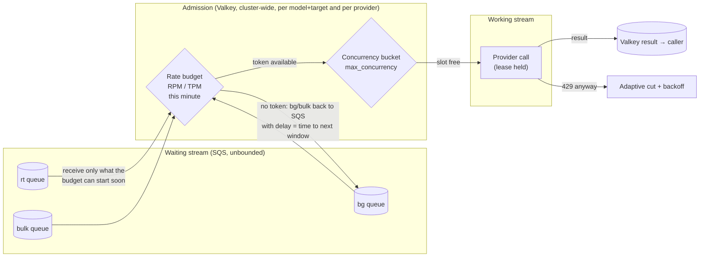

A call starts only when it holds **both** a rate token (RPM, optionally TPM) **and** a concurrency
slot. Admission is one Lua call per attempt in Valkey, so every pod shares the same minute budget.

Proposed settings (per provider and per model, env and live like the other settings):

| Setting | Meaning | Default |
|---|---|---|
| `rpm` | Calls that may **start** per minute per model + target | unset (no rate limit, today's behaviour) |
| `tpm` | Tokens per minute per model + target (input estimate + `max_tokens`, corrected with actual usage) | unset |
| `shared_rpm`, `shared_tpm` (provider) | Same, across all models of a provider (account quota) | unset |
| `rate_window` | `fixed` (calendar minute: 500 at 10:00:00, the rest at 10:01:00) or `smooth` (token bucket: 500/min = one every 0.12 s, with a burst allowance) | decision D1 below |
| `rate_burst` | For `smooth`: how many may start back to back | 10 % of `rpm` |
| `rt_rate_share` | Part of the budget only `rt` may use, so a bg backlog never starves live chat | 20 % |

## 4. Scenarios

Each scenario becomes a harness scenario (`R01`–`R12`) with a pass/fail gate. Numbers use fakellm
with 1 s latency unless stated.

### R01 — RPM basic: 1,000 queued, RPM 500

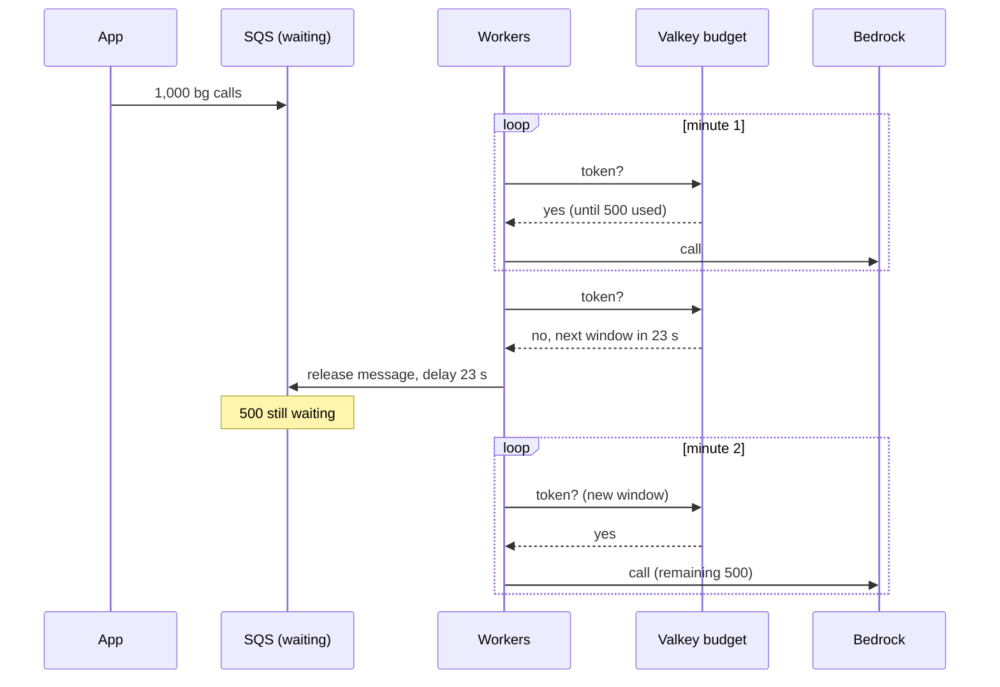

Gate: provider starts per minute ≤ 500 in every window; 1,000/1,000 done in about 2 minutes; 0 lost, 0 duplicates; no 429.

### R02 — RPM and concurrency together

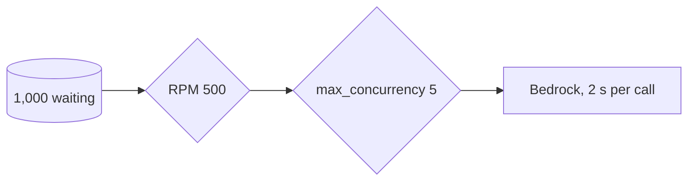

With 5 slots and 2 s calls only 150 can start per minute, so the bucket is the tighter limit.
Gate: starts/min = min(RPM, concurrency × 60 / latency) = 150; neither limit exceeded.

### R03 — Live chat keeps priority inside the budget

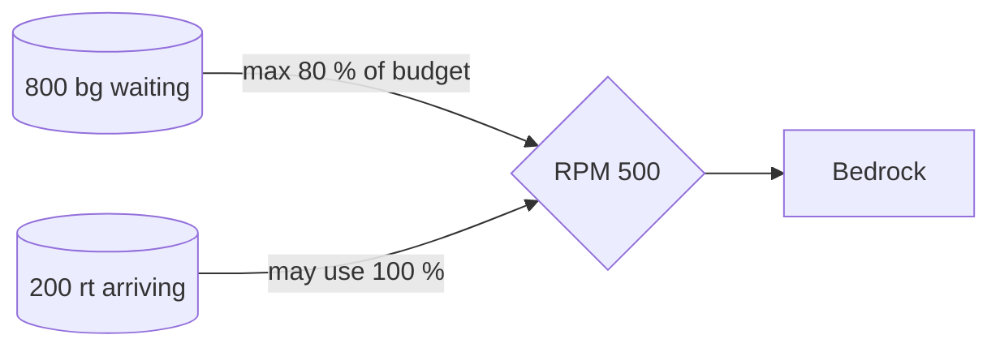

Gate: rt calls start within 2 s p95 even while bg has a backlog; bg never uses the 20 % rt reserve.

### R04 — Three pods share one minute budget

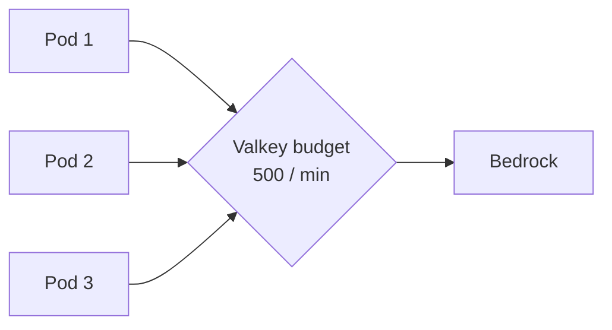

Gate: sum of starts across pods ≤ 500 per window (not 3 × 500).

### R05 — Token budget (TPM)

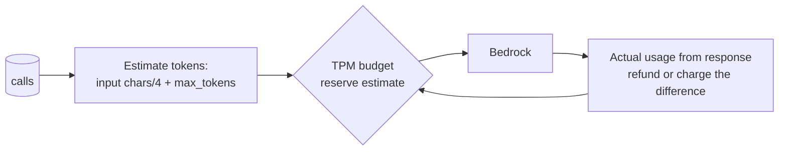

Gate: tokens per minute ≤ TPM; the reservation is corrected with the real `usage`, so a
generous `max_tokens` does not waste the budget for long.

### R06 — Provider quota shared by several models

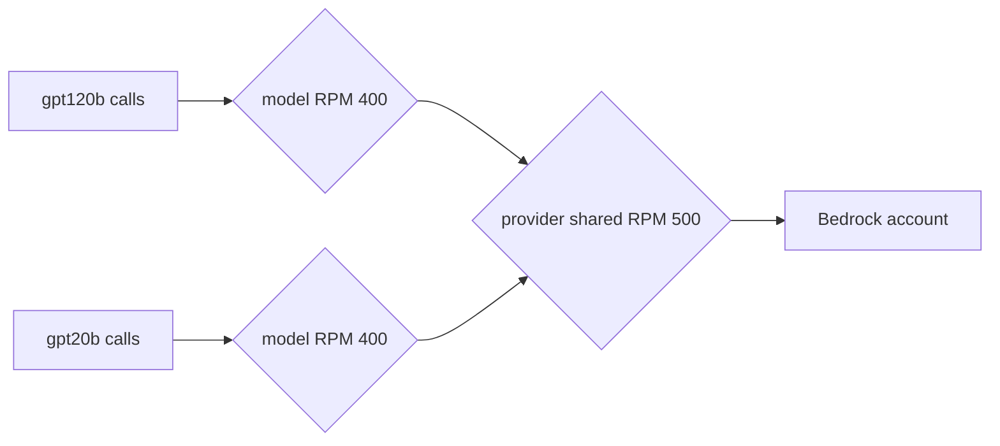

Gate: each model ≤ 400/min and both together ≤ 500/min.

### R07 — Deadline shorter than the wait for budget

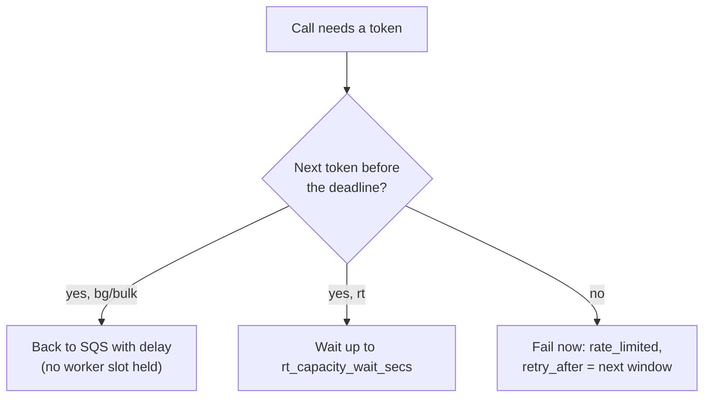

Gate: no call waits past its deadline; callers get `rate_limited` with `retry_after_secs`, not a timeout.

### R08 — Change RPM live, mid-run

```mermaid
flowchart LR
  O["llm-queue settings set<br/>--model gpt20b rpm=200"] --> V[(Valkey P:{cfg}:models)]
  V -->|"reload ≤ 30 s"| W[Every worker]
  W --> R{"next window uses 200"}
```

Gate: starts in the first full window after the reload ≤ 200.

### R09 — Valkey down

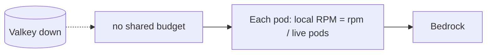

Gate: total starts per minute ≤ RPM (best effort with a known pod count), calls keep flowing on the direct path.

### R10 — Provider throttles below the configured RPM

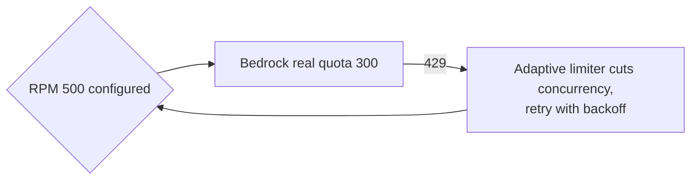

Gate: throttle rate falls to < 5 % within 60 s; no call lost. (The configured RPM was wrong; the existing adaptive limiter still protects.)

### R11 — Budget used up on the primary target

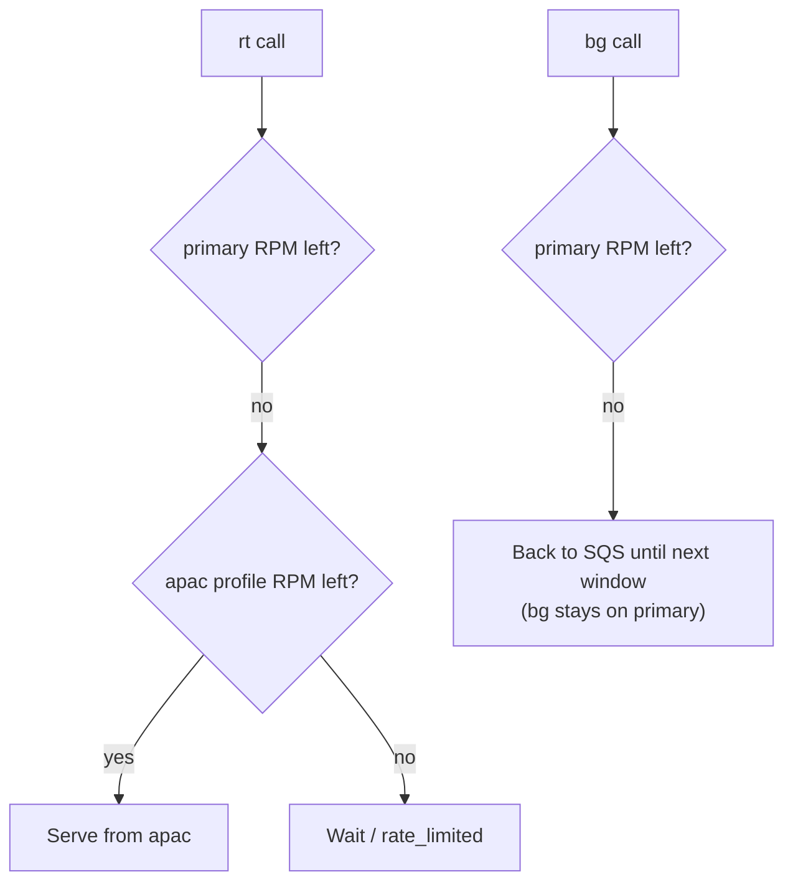

Gate: rt moves to the next target when the primary budget is used; bg waits rather than spending the fallback's budget (decision D3).

### R12 — One view of waiting / working / done

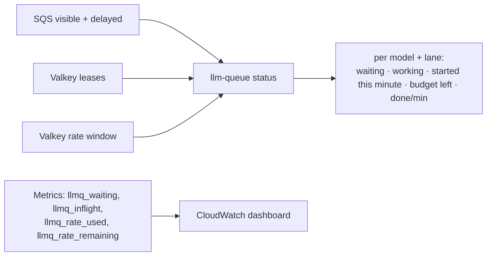

Gate: the numbers match the call log within one sample interval.

## 5. What has to change

| # | Change | Where | Size |
|---|---|---|---|
| C1 | Rate budget in Valkey: Lua `RATE_ACQUIRE` per model+target and per provider (fixed window or GCRA token bucket), returns token or `wait_secs` | `reliability/rate.py`, `_lua.py` | M |
| C2 | Settings `rpm`, `tpm`, `shared_rpm`, `shared_tpm`, `rate_window`, `rate_burst`, `rt_rate_share` in `Overrides` / `ProviderOverrides` (env + live) | `config.py`, `model_settings.py` | S |
| C3 | Admission in `core._take_slot`: rate token before the concurrency slot; refund the token if no slot | `core.py` | M |
| C4 | bg/bulk with no token: release the message to SQS with delay = time to next token (no worker slot held, receive count bounded) | `core.py`, `tasks.py` | M |
| C5 | Receive budget also limited by tokens available in the next few seconds, so workers do not pull messages they cannot start | `lifecycle.receive_budget` | S |
| C6 | TPM: token estimate before the call, correction from `usage` after it | `core.py`, providers | M |
| C7 | `rate_limited` error with `retry_after_secs` for rt/direct calls that cannot get a token before their deadline | `core.py`, `client._unwrap` | S |
| C8 | Valkey-down local rate (`rpm / live pods`) | `failover.py`, `local_limiter.py` | S |
| C9 | `llm-queue status` (waiting / working / started this minute / budget left per model + lane) and metrics `llmq_waiting`, `llmq_inflight` (finally emitted), `llmq_rate_used`, `llmq_rate_remaining` | `cli.py`, `client.py`, metrics | M |
| C10 | Harness: scenarios R01–R12, fakellm per-minute call counter | `tools/scenarios` | M |
| C11 | Docs: README, ARCHITECTURE §5/§7a, integration guide (Bedrock quotas per model to put in `LLMQ_SETTINGS`) | docs | S |

## 6. Decisions (agreed 2026-10-29)

| # | Question | Decision |
|---|---|---|
| D1 | Window shape | **Both**, `rate_window = smooth` (default, token bucket: RPM spread evenly with a `rate_burst` allowance) or `fixed` (calendar minute: 500 from :00, the rest from the next minute) |
| D2 | Scope of the first cut | **RPM and TPM together** (TPM reserves input estimate + `max_tokens`, corrected with the real `usage`) |
| D3 | Primary budget used up | **rt falls back** to the next target's budget; **bg/bulk wait** in SQS for the next window on the same target |
| D4 | rt cannot get a token in time | **Wait** up to `rt_capacity_wait_secs` (never past the deadline), then `rate_limited` with `retry_after_secs` |

Build order: C2 settings → C1 Lua budget → C3/C4/C7 admission → C5 receive budget → C6 TPM → C8 Valkey-down → C9 status/metrics → C10 scenarios R01–R12 → C11 docs.
